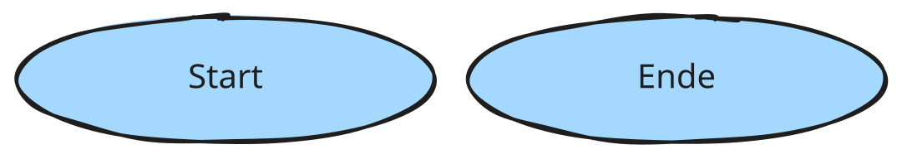
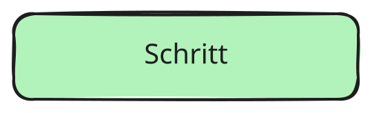
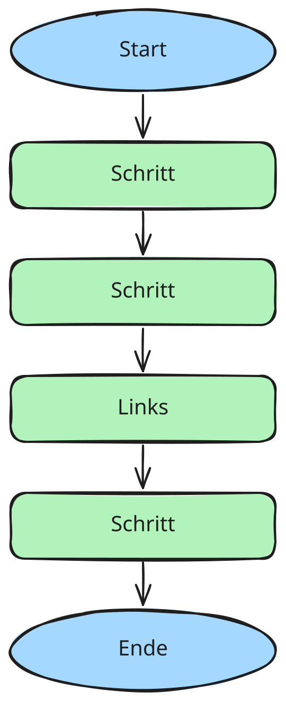
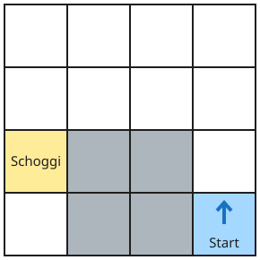
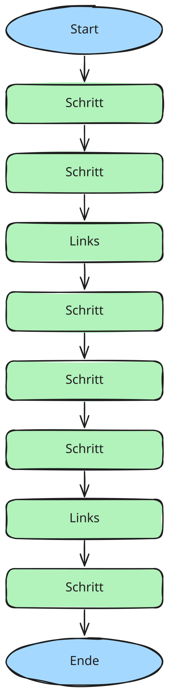
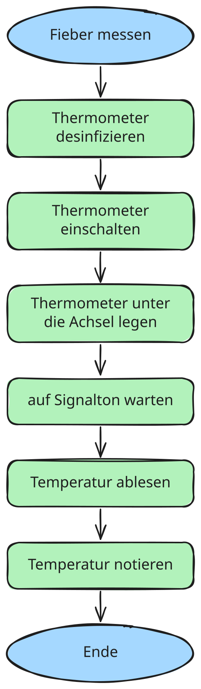

import Excalidoc from '@tdev/excalidoc/Component';
import useBaseUrl from '@docusaurus/useBaseUrl';
import Video from '@tdev-components/Video'

# Flussdiagramm
Einen Algorithmus können wir als Text aufschreiben – so wie die Such-Anleitung bei der Schoggi-Schatzsuche. Wir können ihn aber auch zeichnen. Ein **Flussdiagramm** (engl. _flow chart_) ist eine grafische Darstellung eines Algorithmus.

## Kontrollstrukturen
Eine **Kontrollstruktur** legt fest, in welcher Reihenfolge und wie oft die Befehle eines Algorithmus ausgeführt werden. Bei der Schoggi-Schatzsuche stand Ihnen nur eine einzige Kontrollstruktur zur Verfügung:

| Kontrollstruktur | Beschreibung |
| -- | -- |
| **Sequenz 👣** | Abfolge von Befehlen, die nach und nach ausgeführt werden |

## Symbole
Für eine Sequenz benötigen wir drei Elemente:

| Element | Symbol | Bedeutung |
| -- | -- | -- |
| **Start / Ende** |  | Hier beginnt, respektive endet der Algorithmus. Beim Start kann auch der Name des Algorithmus stehen. |
| **Schritt** |  | Ein einzelner Schritt (Befehl). |
| **Pfeil** |  | Zeigt, was als Nächstes kommt. |

Verwenden Sie die Symbole immer genau so, wie sie hier gezeigt werden. So stellen Sie sicher, dass auch andere Personen Ihr Flussdiagramm verstehen.

## Beispiel: Schoggi-Schatzsuche
Hier sehen Sie eine (stark verkürzte) Such-Anleitung als Text und als Flussdiagramm:

:::flex
**Als Text:**
```text showLineNumbers
Schritt
Schritt
Links
Schritt
```
::br
**Als Flussdiagramm:**


:::

## Excalidraw
Wir zeichnen Flussdiagramme mit **Excalidraw**, das Ihnen direkt hier auf Classrooms zur Verfügung steht. Das folgende Video zeigt, wie ein Flussdiagramm entsteht. Es enthält bereits ein Symbol, das Sie erst später kennenlernen (gelb). Achten Sie vor allem darauf, wie Formen, Texte und Pfeile gezeichnet werden.

<Video src={useBaseUrl('/img/tutorials/excalidoc_spaghetti.mov')} />

## Übungen
:::aufgabe[Excalidraw kennenlernen]
<TaskState id="16f66ced-b81c-4a56-a483-29c873c29a0b" />

Zeichnen Sie das Flussdiagramm aus dem obigen Schatzsuche-Beispiel in Excalidraw nach.

<Excalidoc id="a2ce88f7-d0a2-4f28-8701-f5eb8ce6ed87" />
:::

:::aufgabe[Der Weg zur Schoggi]
<TaskState id="de62aeb7-f606-4cd4-a22b-c08894b81bb4" />

Sie stehen auf dem Startfeld und schauen in Pfeilrichtung. Mit jedem `Schritt` gehen Sie ein Feld weiter. Graue Felder sind Wände.

Zeichnen Sie ein Flussdiagramm für den Weg zur Schoggi. Es sind nur die Befehle `Schritt` und `Links` (90°-Drehung nach links) erlaubt.



<Excalidoc id="a3152441-277a-41b8-81dd-89853f54f0f2" />

<Solution id="c3f4d706-de90-4ff4-b8d0-868375159f41">

</Solution>
:::

:::aufgabe[Fieber messen]
<TaskState id="07c50781-1a47-4306-871c-300f56ef25ad" />

Beim Fiebermessen sind die Schritte durcheinandergeraten. Bringen Sie diese in eine sinnvolle Reihenfolge und zeichnen Sie ein Flussdiagramm:

- Temperatur ablesen
- Thermometer einschalten
- auf Signalton warten
- Thermometer desinfizieren
- Temperatur notieren
- Thermometer unter die Achsel legen

<Excalidoc id="b9316da2-691c-4923-96b2-d19617e9b26d" />

<Solution id="f8f144ec-60ad-4722-abc5-75ba8f5597e5">

</Solution>
:::
