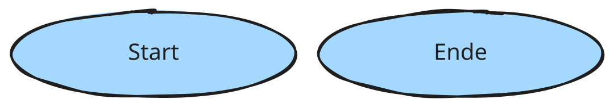
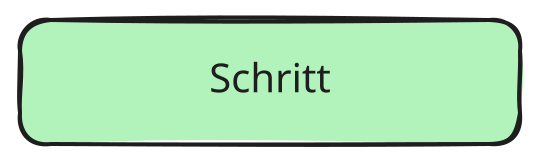
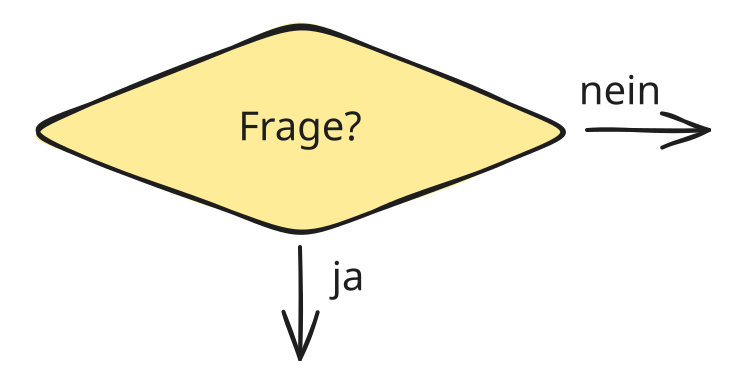
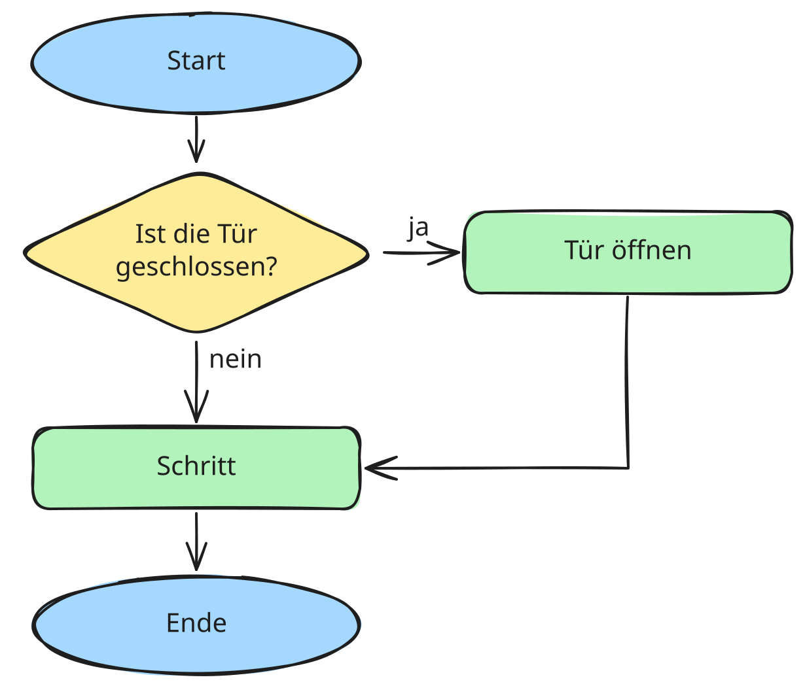
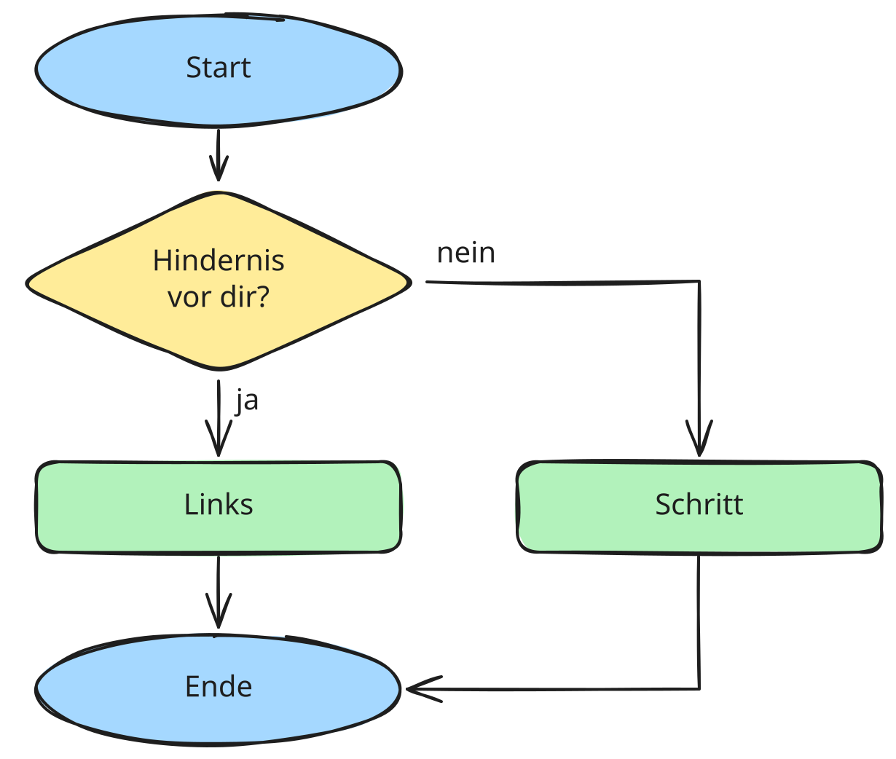
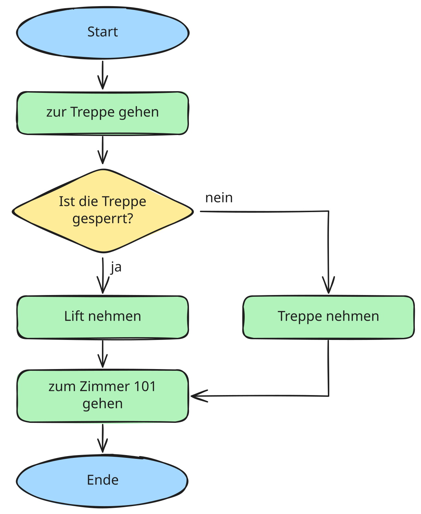
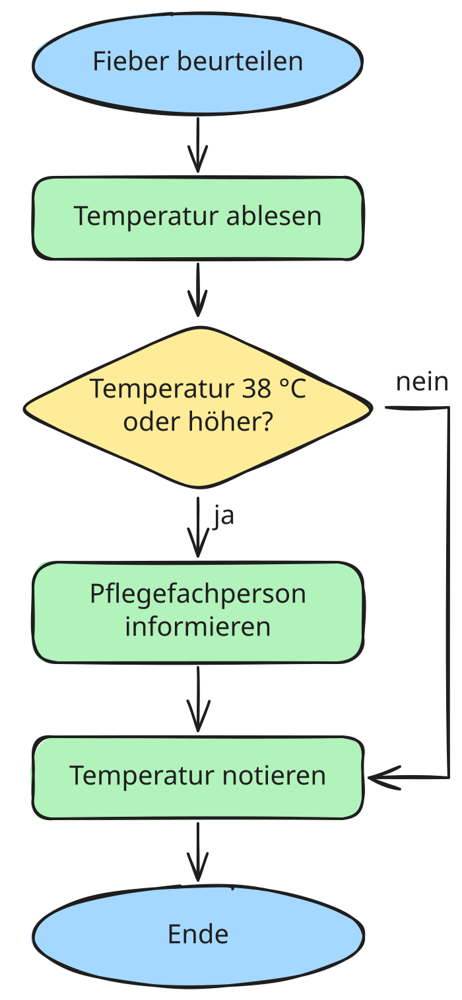
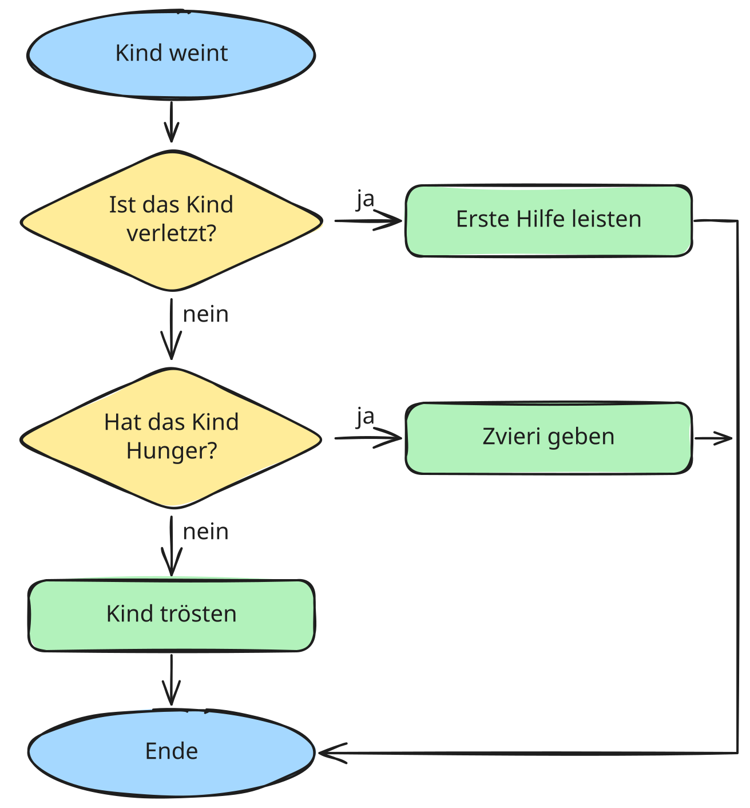

import Excalidoc from '@tdev/excalidoc/Component';

# Verzweigung ⑂
Mit der **Verzweigung** (auch **bedingte Ausführung** genannt) kann ein Algorithmus auf unterschiedliche Situationen reagieren: **Wenn** eine Bedingung erfüllt ist, **dann** tun wir das eine, **sonst** das andere.

Sie kennen damit folgende Kontrollstrukturen:

| Kontrollstruktur | Beschreibung |
| -- | -- |
| Sequenz 👣 | Abfolge von Befehlen, die nach und nach ausgeführt werden |
| **Verzweigung ⑂** | Je nach Bedingung werden unterschiedliche Befehle (oder gar keine) ausgeführt |

## Symbole
Für die Verzweigung brauchen wir ein neues Symbol: die **Frage**.

| Element | Symbol | Bedeutung |
| -- | -- | -- |
| Start / Ende |  | Hier beginnt, respektive endet der Algorithmus. Beim Start kann auch der Name des Algorithmus stehen. |
| Schritt |  | Ein einzelner Schritt (Befehl). |
| Pfeil |  | Zeigt, was als Nächstes kommt. |
| **Frage** |  | Eine Ja/Nein-Frage. Von hier gehen immer **zwei** Pfeile weg: einer für «ja» und einer für «nein». |

## Beispiel: Schoggi-Schatzsuche
Bei der Schoggi-Schatzsuche stand Ihnen nur die _Sequenz_ zur Verfügung. Solche Such-Anleitungen scheitern leicht, wenn sich unterwegs etwas verändert: Eine Tür ist plötzlich geschlossen oder jemand steht im Weg. Mit einer _Verzweigung_ können wir solche Fälle einplanen.

### Wenn …, dann …
Der Befehl wird nur ausgeführt, wenn die Bedingung erfüllt ist. Sonst passiert nichts und es geht direkt weiter. Was zur Verzweigung gehört, rücken wir ein.

:::flex
**Ohne Verzweigung:**
```text showLineNumbers
Schritt
```
**Mit Verzweigung (neu):**
```text showLineNumbers
Wenn die Tür geschlossen ist:
    Tür öffnen
Schritt
```
::br

:::

### Wenn …, dann …, sonst …
Es wird immer genau **einer** der beiden Wege ausgeführt.

:::flex
```text showLineNumbers
Wenn Hindernis vor dir:
    Links
Sonst:
    Schritt
```
::br

:::

## Übungen
:::aufgabe[Treppe oder Lift]
<TaskState id="13812e0f-0b93-417c-948a-92ba6c2fa6a4" />

Die Schoggi ist in einem Zimmer im ersten Stock versteckt. Zeichnen Sie ein Flussdiagramm für diese Such-Anleitung:

> Geh zur Treppe. Wenn die Treppe gesperrt ist, nimm den Lift in den ersten Stock, sonst die Treppe. Geh dann zum Zimmer 101.

<Excalidoc id="15cfbc0e-be1f-45ed-9717-acbc48b8fe2c" />

<Solution id="329f33a6-f895-4e95-b98f-43fb8bd1464a">

</Solution>
:::

:::aufgabe[Fieber beurteilen]
<TaskState id="d121b486-1f27-4426-a6e6-5209a9e3720a" />

Zeichnen Sie ein Flussdiagramm für diesen Algorithmus:

> Temperatur ablesen. Wenn die Temperatur 38 °C oder höher ist, die Pflegefachperson informieren. Auf jeden Fall die Temperatur notieren.

<Excalidoc id="e9544479-feca-4cff-b467-107242ca830b" />

<Solution id="89f5cb23-7440-4504-b809-4dc35dbfdfe6">

</Solution>
:::

:::aufgabe[Ein Kind weint]
<TaskState id="5b36214c-0d87-4fad-a4e4-f89ee75c35c9" />

In der Kita weint ein Kind. Zeichnen Sie ein Flussdiagramm für diesen Algorithmus:

> Wenn das Kind verletzt ist, Erste Hilfe leisten. Sonst: Wenn das Kind Hunger hat, ihm ein Zvieri geben. Sonst das Kind trösten.

<Excalidoc id="c96ab1fb-1a12-4abb-bc99-455f76af8b0a" />

<Solution id="06a00707-d956-4d44-8a47-6567d4375e0c">

</Solution>
:::
