import Excalidoc from '@tdev/excalidoc/Component';

# Schleife 🔁
Mit der **Schleife** (auch **Wiederholung** genannt) schreiben wir eine _Sequenz_ von Befehlen nur einmal auf und lassen sie beliebig oft wiederholen.

Sie kennen damit folgende Kontrollstrukturen:

| Kontrollstruktur | Beschreibung |
| -- | -- |
| Sequenz 👣 | Abfolge von Befehlen, die nach und nach ausgeführt werden |
| Verzweigung ⑂ | Je nach Bedingung werden unterschiedliche Befehle (oder gar keine) ausgeführt |
| **Wiederholung (Schleife) 🔁** | Eine bestimmte Sequenz wird wiederholt (bestimmte Anzahl Mal, oder bis eine Abbruchbedingung eintritt) |

## Beispiel: Schoggi-Schatzsuche
Bei der Schoggi-Schatzsuche mussten Sie den gleichen Befehl oft viele Male hintereinander aufschreiben. Mit einer _Schleife_ geht das kürzer:

:::flex
**Ohne Schleife (wie im Original-Spiel):**
```text showLineNumbers
Schritt
Schritt
Schritt
Schritt
Schritt
Schritt
Schritt
Links
```
::br
**Mit Schleife (neu):**
```text showLineNumbers
Wiederhole 7x:
    Schritt
Links
```
:::

Wir können auch eine ganze _Sequenz_ wiederholen. Was zur Schleife gehört, rücken wir ein – hier für ein Zickzack-Muster mit 3 «Stufen»:

:::flex
**Ohne Schleife:**
```text showLineNumbers {1-6}
Schritt
Links
Schritt
Links
Links
Links
Schritt
Links
Schritt
Links
Links
Links
Schritt
Links
Schritt
Links
Links
Links
```
::br
**Mit Schleife:**
```text showLineNumbers {2-7}
Wiederhole 3x:
    Schritt
    Links
    Schritt
    Links
    Links
    Links
```
:::

## Symbole
Für die Schleife brauchen wir kein neues Symbol. Wir verwenden wieder die **Frage**:

| Element | Symbol | Bedeutung |
| -- | -- | -- |
| Start / Ende | 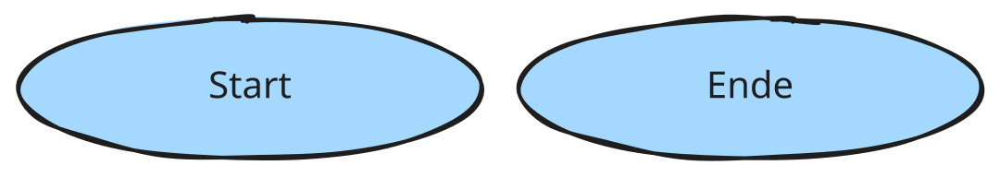 | Hier beginnt, respektive endet der Algorithmus. Beim Start kann auch der Name des Algorithmus stehen. |
| Schritt | 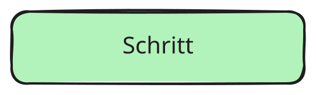 | Ein einzelner Schritt (Befehl). |
| Pfeil |  | Zeigt, was als Nächstes kommt. |
| Frage | 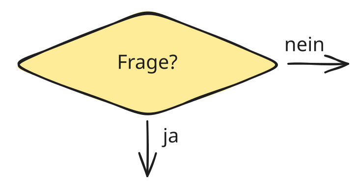 | Eine Ja/Nein-Frage. Von hier gehen immer **zwei** Pfeile weg: einer für «ja» und einer für «nein». |

Neu ist der **Pfeil zurück**: Nach den Befehlen, die wiederholt werden, führt er wieder zur Frage.

## Zwei Arten von Schleifen
### Wiederholen, bis eine Bedingung erfüllt ist
Wir müssen die Anzahl nicht kennen. So funktioniert die Anleitung auch für Personen mit kürzeren oder längeren Schritten.

:::flex
```text showLineNumbers
Wiederhole bis zur Treppe:
    Schritt
Links
```
::br
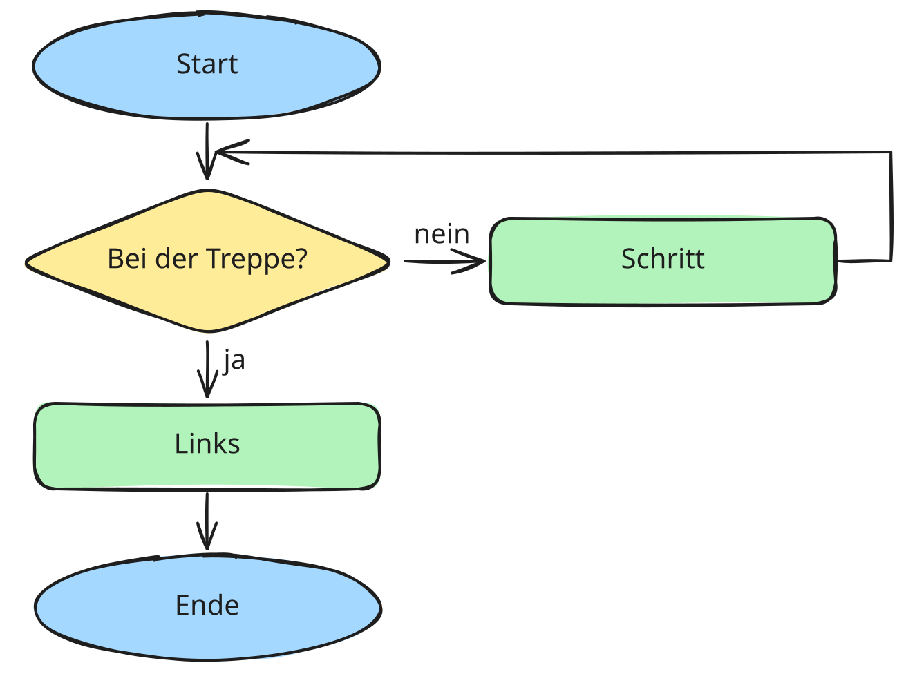
:::

### Feste Anzahl Wiederholungen
Wir wissen im Voraus, wie oft wiederholt werden soll. Beim Ausführen zählen wir mit und fragen jedes Mal, ob wir schon fertig sind.

:::flex
```text showLineNumbers
Wiederhole 7x:
    Schritt
Links
```
::br
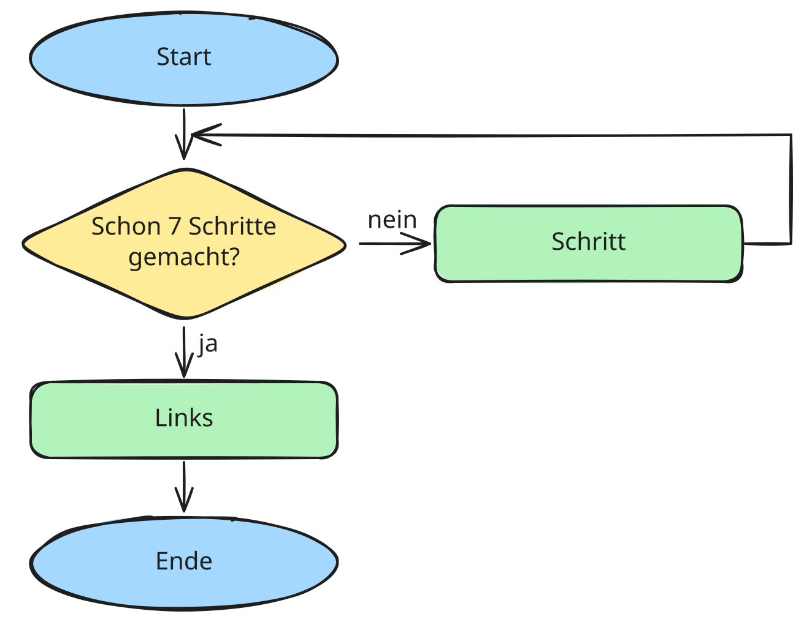
:::

:::insight[Wo steht die Frage?]
Steht die Frage **vor** den Befehlen, werden diese eventuell gar nie ausgeführt (z.B. wenn Sie schon bei der Treppe stehen). Steht die Frage **nach** den Befehlen, werden diese mindestens einmal ausgeführt.
:::

:::warning[Endlosschleife]
Wird die Bedingung nie erfüllt (z.B. weil es gar keine Treppe gibt), endet die Schleife nie. Der Algorithmus ist dann **nicht endlich**.
:::

:::insight[Schleife oder Verzweigung?]
Beide verwenden das gleiche Symbol. Den Unterschied erkennen Sie an den Pfeilen:
- **Schleife:** Ein Pfeil führt **zurück** zur Frage. Die Befehle können mehrfach ausgeführt werden.
- **Verzweigung:** Beide Wege führen **vorwärts** und kommen später wieder zusammen. Jeder Befehl wird höchstens einmal ausgeführt.
:::

## Verzweigung in einer Schleife
Kontrollstrukturen lassen sich kombinieren. Hier wird die Verzweigung so lange wiederholt, bis die Schoggi gefunden ist:

:::flex
```text showLineNumbers
Wiederhole bis zur Schoggi:
    Wenn Hindernis vor dir:
        Links
    Sonst:
        Schritt
```
::br
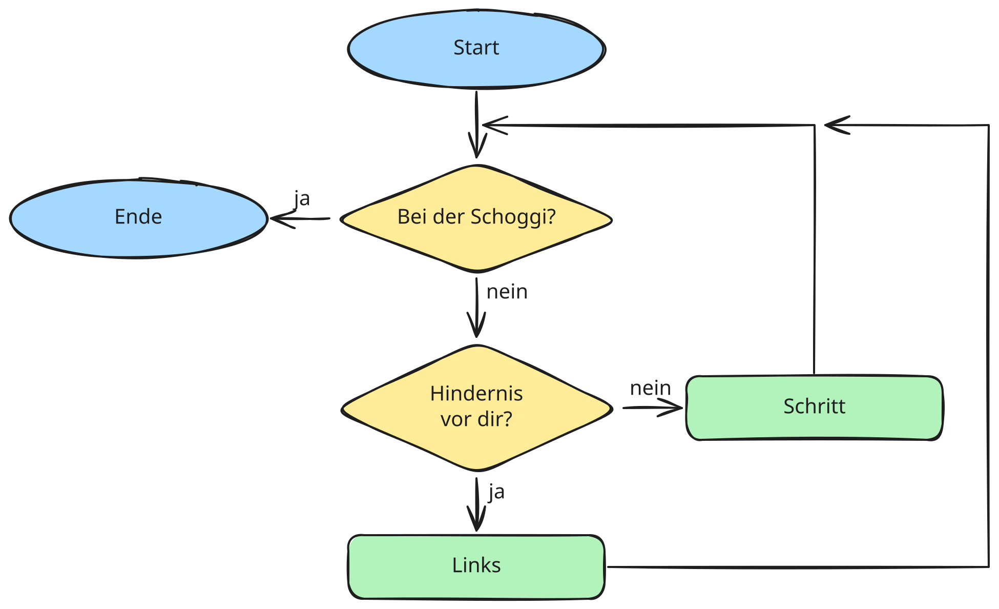
:::

## Übungen
:::aufgabe[Zickzack]
<TaskState id="156ae850-f36b-4094-9b7a-603918a4bdfb" />

Zeichnen Sie ein Flussdiagramm für das obige Zickzack-Muster mit 3 «Stufen». Verwenden Sie dabei eine **Schleife**.

<Excalidoc id="98410530-16f2-4e95-a16b-374f1c4e5805" />

<Solution id="c6b43697-8e8e-4e63-8a4d-a8e4a1ff69f1">
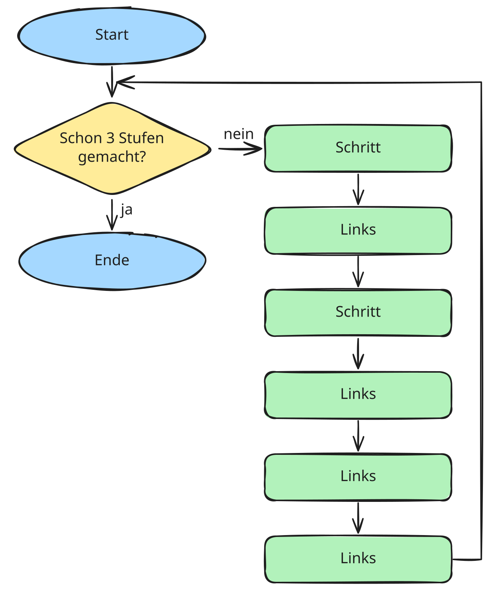
</Solution>
:::

:::aufgabe[Von der Wand zur Tür]
<TaskState id="7a5497bc-bc63-4ad0-b897-a245d7dec792" />

Zeichnen Sie ein Flussdiagramm für diese Such-Anleitung:

> Geh geradeaus, bis du bei der Wand bist. Dreh dich nach links. Geh geradeaus, bis du bei der Tür bist.

<Excalidoc id="7d39fecf-4901-46d9-b340-e3f0b2c32b36" />

<Solution id="9c8b5034-812c-4749-b393-768c93eeaa75">
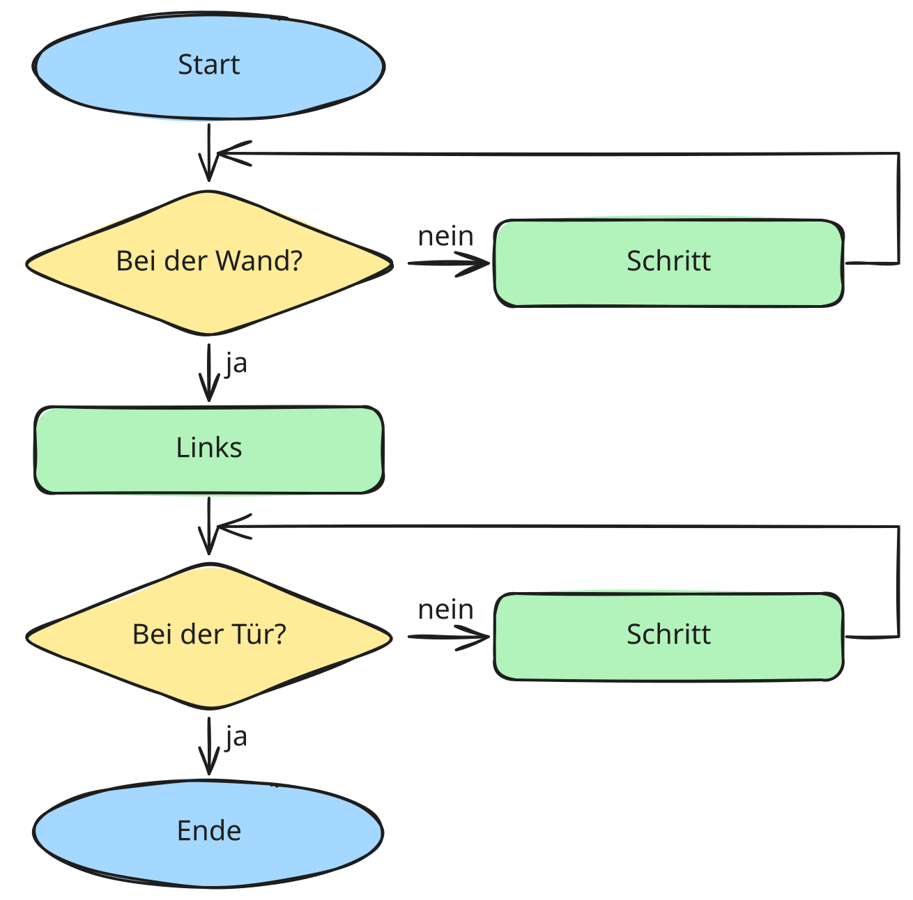
</Solution>
:::

:::aufgabe[Schoggigüezi]
<TaskState id="e37e868c-65bb-4593-9690-8df96b5a43dc" />

Zeichnen Sie ein Flussdiagramm für diesen Algorithmus:

> 200 Gramm Mehl, 100 Gramm Zucker, 50 Gramm Kakaopulver, 100 Gramm weiche Butter und 1 Ei in eine Schüssel geben. Rühren, bis ein glatter Teig entsteht. Ein Stück Teig nehmen, zu einer Kugel formen und auf das Backblech legen. Wiederholen, solange noch Teig übrig ist. Dann das Backblech in den Ofen schieben und 12 Minuten backen.

<Excalidoc id="8099f8d2-e88d-497c-a302-9bf54ae1c4f7" />

<Solution id="3d979e2a-9a9e-45c7-85a0-6809830ed286">
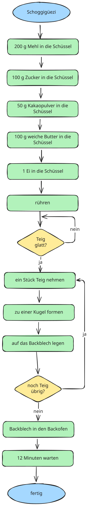
</Solution>
:::

:::aufgabe[Spaghetti kochen]
<TaskState id="6d16dba4-c09c-46c3-8403-d0a7f6179199" />

Dieser Algorithmus enthält eine **Schleife** und eine **Verzweigung**. Finden Sie heraus, wo, und zeichnen Sie ein Flussdiagramm:

> Wasser aufkochen, salzen und Spaghetti beigeben. 7 Minuten kochen. Wenn sie noch nicht al dente sind, jeweils 1 Minute weiterkochen, bis sie es sind. Wasser abgiessen. Werden die Spaghetti ohne Sauce serviert, Olivenöl beigeben.

<Excalidoc id="3e067e5e-21d8-4325-b2c4-e072202d7a48" />

<Solution id="037c46c0-b0c5-4d27-96aa-655d19f92b09">
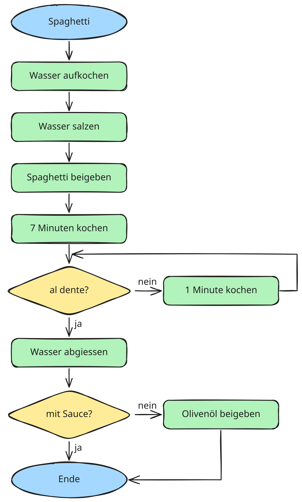
</Solution>
:::

::::aufgabe[⭐️ Ampelsteuerung]
<TaskState id="804d4d4e-67a9-4784-8d5c-02bee75b5b06" />

An einer Strasse gibt es einen Fussgängerstreifen mit einer Ampel. Wenn ein:e Fussgänger:in den Knopf drückt, wird die Ampel für die Autos nach 30 Sekunden rot. 3 Sekunden später wird die Ampel für die Fussgänger:innen grün. Nach weiteren 20 Sekunden wird die Ampel für die Fussgänger:innen wieder rot und 3 Sekunden später wird die Ampel für die Autos wieder grün. Danach wartet die Ampel, bis wieder jemand den Knopf drückt.

Zeichnen Sie ein Flussdiagramm für diese Ampelsteuerung. Es stehen Ihnen folgende Befehle und Fragen zur Verfügung:
- Fussgänger rot setzen
- Fussgänger grün setzen
- Autos rot setzen
- Autos grün setzen
- Knopf gedrückt?
- … Sekunden warten (Anzahl frei wählbar)
- nichts tun

:::tip[Kein Ende]
Dieser Algorithmus ist absichtlich **nicht endlich**: Die Ampel soll immer weiterlaufen. Ihr Flussdiagramm hat deshalb kein Ende-Symbol.
:::

<Excalidoc id="c4be4933-9446-4c62-bad9-398d1b2c6b85" />

<Solution id="7b86d5aa-0411-4b30-ac7e-21000c9f53fd">
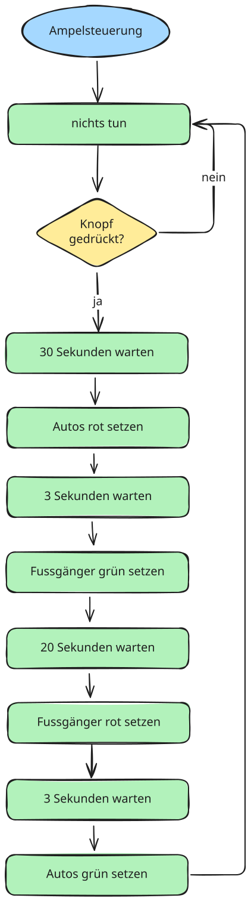
</Solution>
::::
