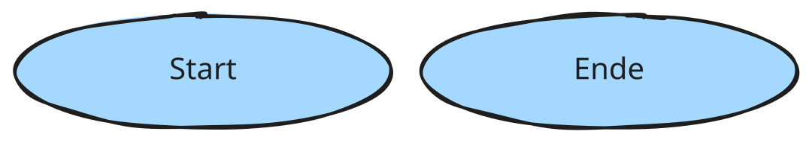
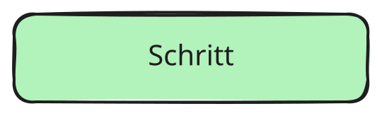
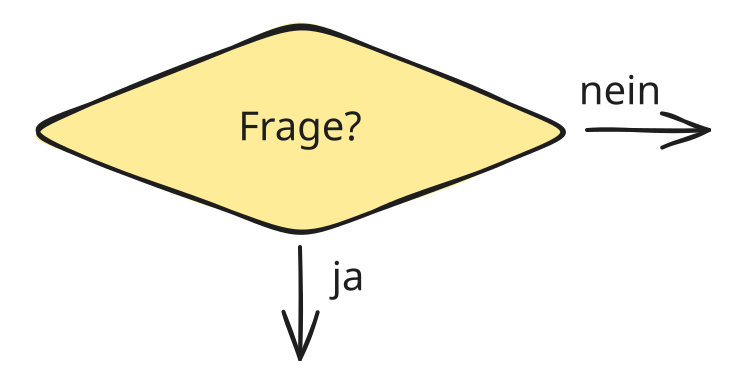
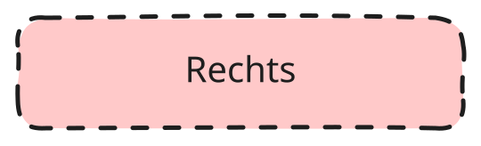
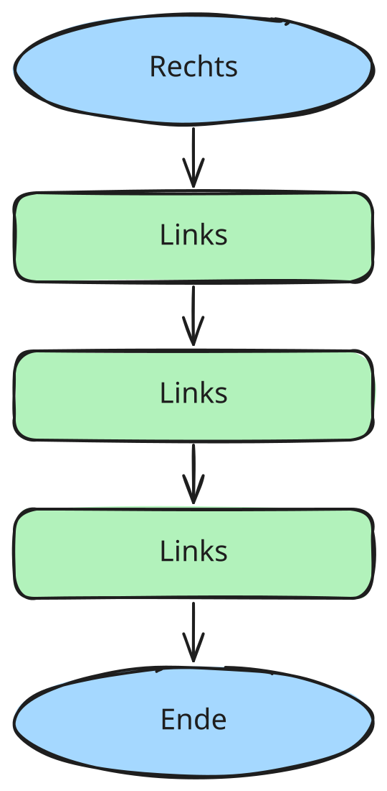
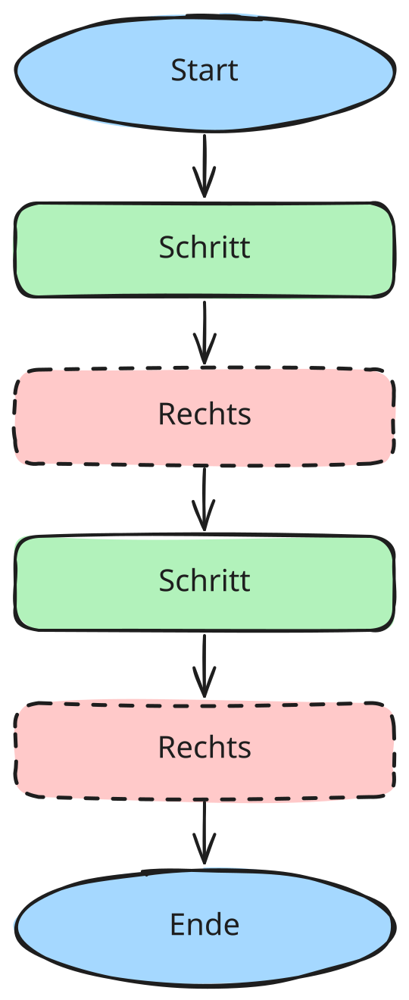
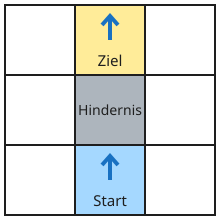
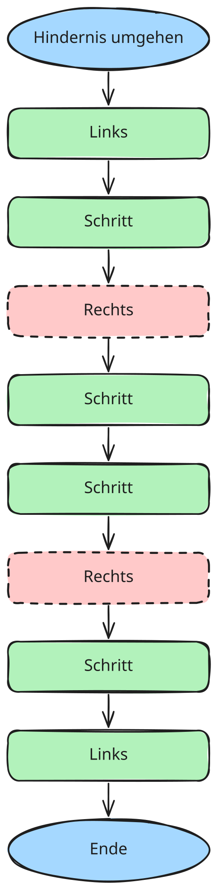
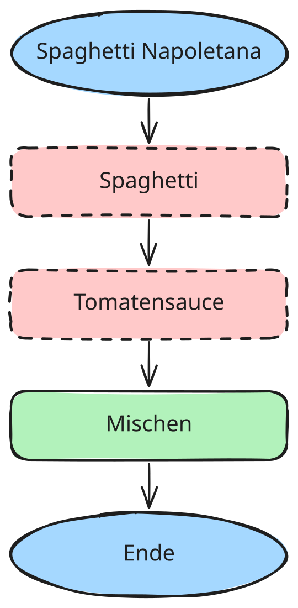
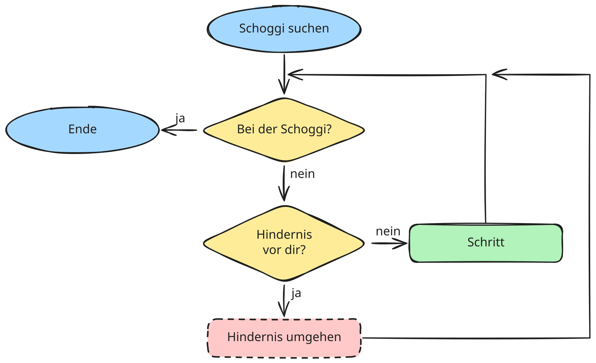

import Excalidoc from '@tdev/excalidoc/Component';

# Unterprogramm 🏷
Ein **Unterprogramm** fasst eine Sequenz von Befehlen zusammen und gibt ihr einen Namen. Damit erschaffen wir einen **neuen Befehl**, den wir beliebig oft verwenden können.

Sie kennen damit folgende Kontrollstrukturen:

| Kontrollstruktur | Beschreibung |
| -- | -- |
| Sequenz 👣 | Abfolge von Befehlen, die nach und nach ausgeführt werden |
| Verzweigung ⑂ | Je nach Bedingung werden unterschiedliche Befehle (oder gar keine) ausgeführt |
| Wiederholung (Schleife) 🔁 | Eine bestimmte Sequenz wird wiederholt (bestimmte Anzahl Mal, oder bis eine Abbruchbedingung eintritt) |
| **Unterprogramm 🏷** | Eine Sequenz erhält einen Namen und kann danach wie ein einzelner Befehl verwendet werden |

## Symbole
Für das Ausführen eines Unterprogramms gibt es ein eigenes Symbol:

| Element | Symbol | Bedeutung |
| -- | -- | -- |
| Start / Ende |  | Hier beginnt, respektive endet der Algorithmus. Beim Start kann auch der Name des Algorithmus stehen. |
| Schritt |  | Ein einzelner Schritt (Befehl). |
| Pfeil |  | Zeigt, was als Nächstes kommt. |
| Frage |  | Eine Ja/Nein-Frage. Von hier gehen immer **zwei** Pfeile weg: einer für «ja» und einer für «nein». |
| **Unterprogramm** |  | Führt ein Unterprogramm aus, das an einem anderen Ort beschrieben ist. |

## Beispiel: Schoggi-Schatzsuche
Bei der Schoggi-Schatzsuche war der Befehl `Rechts` nicht erlaubt. Für eine Rechtsdrehung mussten Sie deshalb jedes Mal dreimal `Links` schreiben. Mit einem Unterprogramm können wir den Befehl `Rechts` selbst definieren:

:::flex
**Ohne Unterprogramm (wie im Original-Spiel):**
```text showLineNumbers
Schritt
Links
Links
Links
Schritt
Links
Links
Links
```
::br
**Mit Unterprogramm (neu):**
```text showLineNumbers
Unterprogramm Rechts:
    Links
    Links
    Links

Schritt
Rechts
Schritt
Rechts
```
:::

Im Flussdiagramm zeichnen wir das Unterprogramm **separat**. Sein Name steht im Start-Symbol. Überall, wo wir es ausführen möchten, verwenden wir das Unterprogramm-Symbol mit dem gleichen Namen.

:::flex
**Das Unterprogramm `Rechts`:**


::br
**Die Such-Anleitung:**


:::

:::insight[Was passiert beim Ausführen?]
Beim Unterprogramm-Symbol wechseln Sie zum Flussdiagramm mit diesem Namen und führen es bis zum Ende aus. Danach machen Sie **dort weiter, wo Sie vorher waren**.
:::

Ein Unterprogramm hat mehrere Vorteile:

Kürzer
: Die Sequenz wird nur einmal aufgeschrieben.
Verständlicher
: Der Name sagt, worum es geht.
Einfacher anzupassen
: Eine Änderung nehmen wir nur an einer Stelle vor.

Ein Unterprogramm kann auch Verzweigungen, Schleifen und andere Unterprogramme enthalten.

## Übungen
:::aufgabe[Hindernis umgehen]
<TaskState id="3ed184e7-2266-47f4-84ac-6838b9e9eb85" />

Direkt vor Ihnen steht ein Hindernis, das genau ein Feld gross ist. Zeichnen Sie ein Flussdiagramm für das Unterprogramm `Hindernis umgehen`. Am Ende stehen Sie auf dem Feld **hinter dem Hindernis** und schauen wieder in die **ursprüngliche Richtung**.

Verwenden Sie die Befehle `Schritt` und `Links` sowie das Unterprogramm `Rechts`.



<Excalidoc id="ab1b26b2-d80c-4798-90c7-0d115701c65d" />

<Solution id="393ebb05-41cb-4a46-8461-f407cdcc8311">

</Solution>
:::

:::aufgabe[Spaghetti Napoletana]
<TaskState id="3fa27c7e-f072-4ba0-8f5f-945d85fe8fa8" />

Sie kennen bereits den Algorithmus für das [Kochen von Spaghetti](../04-Schleife/index.mdx). Gehen Sie davon aus, dass es auch ein Unterprogramm `Tomatensauce` gibt.

Zeichnen Sie ein Flussdiagramm für `Spaghetti Napoletana`. Verwenden Sie die Unterprogramme `Spaghetti` und `Tomatensauce`. Zum Schluss wird alles gemischt.

<Excalidoc id="df4b77e5-68d7-4c3f-9694-04cd90433897" />

<Solution id="ef7cd8e0-a280-4d31-adde-9f981c74544c">

</Solution>
:::

:::aufgabe[Die perfekte Schatzsuche]
<TaskState id="3afd3d91-b32f-4664-8ebf-385a22edf5fa" />

Die Schoggi liegt irgendwo geradeaus vor Ihnen. Unterwegs können einzelne Hindernisse im Weg stehen, die je ein Feld gross sind. Sie wissen aber nicht, wo und wie viele. Weder direkt vor noch direkt nach einem Hindernis steht ein weiteres Hindernis und die Felder neben dem Weg sind frei.

Zeichnen Sie ein Flussdiagramm, mit dem Sie die Schoggi **immer** finden. Verwenden Sie eine **Schleife**, eine **Verzweigung** und das Unterprogramm `Hindernis umgehen`.

<Excalidoc id="0629222d-0dac-4c05-9cf9-533a8a7c42f3" />

<Solution id="6b0a443c-c3df-459f-8116-32aed27bab9c">

</Solution>
:::
