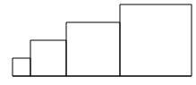

# Arithmetik
In Python können Sie arithmetische Ausdrücke verwenden. Die wichtigsten Operatoren sind:

| Operation | Symbol | Beispiel | Ergebnis des Beispiels |
| --------- | ------ | -------- | ---------------------- |
| Addition | `+` | `14 + 5` | `19` |
| Subtraktion | `-` | `14 - 5` | `9` |
| Multiplikation | `*` | `14 * 5` | `70` |
| Division | `/` | `14 / 5` | `2.8` |
| Ganzzahldivision (Division mit Rest) | `//` | `14 // 5` | `2` |
| Modulo (Rest der Division) | `%` | `14 % 5` | `4` |
| Potenzieren ($a^b$) | `**` | `14 ** 5` | `537824` |

:::info[Punkt vor Strich]
Aus der Mathematik wissen Sie:

$$3 + 5 \cdot 2 = 13$$

denn es gilt die Regel «Punkt vor Strich»: Zuerst wird die Multiplikation $5 \cdot 2 = 10$ berechnet und erst danach mit $3$ addiert.

Herkömmliche Taschenrechner (und viele Programmiersprachen) setzen diese Regel normalerweise nicht selbst um. Wir müssen sie mit Klammern erzwingen. Python hält sich allerdings an diese Regel. **Der Lesbarkeit halber kann es aber dennoch sinnvoll sein, explizit Klammern zu verwenden.**
:::

## Theorieaufgaben
:::aufgabe[Warum nicht vorher ausrechnen?]
<TaskState id="eb7aa9e5-3f47-4e8c-b1c3-d2955f8d158b" />
Warum kann es nützlich sein, im Code arithmetische Ausdrücke zu verwenden, statt `14 + 5` einfach «von Hand» auszurechnen und im Code direkt das Ergebnis `19` zu verwenden? Halten Sie Ihre Überlegungen im Textfeld fest.

<QuillV2 id="07983856-a8fe-4355-8772-6d6c7b9efb09" />

<Solution id="5e52169f-0837-411a-a299-6d5995a8ae13">
Arithmetische Ausdrücke sind besonders dann nützlich, wenn einer oder mehrere der Operanden durch Variablen bestimmt sind. 

Ein Beispiel:
```py live_py readonly slim
from turtle import *

seite = 50

# Erstes Quadrat
for i in range(4):
    forward(seite)
    left(90)
    
# Verschieben
penup()
forward(70)
pendown()

# Zweites Quadrat, doppelt so gross
for i in range(4):
    forward(seite * 2)  # <-- Hier macht ein arithmetischer Ausdruck Sinn.
    left(90)
```

In diesem Fall ist der Parameter des `forward()`-Befehls auf Zeile `17` abhängig von einer Variable. Wir können seinen Wert also nicht direkt ausrechnen, ohne dass wir den Nutzen der Variable verlieren.

Abgesehen davon kann das Verwenden arithmetischer Ausdrücke auch dann sinnvoll sein, wenn unser Code dadurch besser verständlich wird. Beispielsweise kann man in diesem Programm leicht nachvollziehen, wie der Drehwinkel berechnet wird, was nicht so klar wäre, wenn wir stattdessen einfach `left(72)` verwenden würden:

```py live_py readonly slim
from turtle import *

for i in range(5):
    forward(50)
    left(360 / 5)  # Die Turtle macht einen Kreis (360°) und "biegt" dabei 5x ab.
```
</Solution>
:::

:::aufgabe[Rechnen]
<TaskState id="29534478-22af-4505-8ce8-e6d9f273cbbb" />
Berechnen Sie diese Aufgaben von Hand. Geben Sie das Ergebnis als Zahl ins Textfeld ein und prüfen Sie Ihre Antwort.

| Aufgabe | Resultat |
| ------- | -------- |
| `4 + 3 * 9` | <String solution="31" id="405ba742-b5da-417f-852d-1efb30306bf1" /> |
| `(4 + 3) * 9` | <String solution="63" id="4f97c2a1-dba9-4987-8b86-eb413422c28d" /> |
| `21 / 7` | <String solution="3" id="75e52d58-2824-4487-8ab9-c7690966f2bc" /> |
| `5 / 2` | <String solution="2.5" id="612a5f3e-71fa-462a-b7fd-b2dfcc5ce0f9" /> |
| `5 // 2` | <String solution="2" id="b54b29ac-8637-4773-9b79-9edd27677fce" /> |
| `5 % 2` | <String solution="1" id="e7f16c71-b130-41ac-81cd-15ea95bec68f" /> |
| `2 ** 5` | <String solution="32" id="b1593afc-e923-4bae-8301-eab95708f96a" /> |
| `(3 * ((((5 ** 2) - 1) / 6) - 1)) ** ((14 - 6) / 4)` | <String solution="81" id="d603ef12-d406-4314-b4c9-071db93590c7" /> |
:::

## Programmieraufgaben
::::aufgabe[Anpassbarer Kreis]
<TaskState id='8a50ffe7-fe04-423e-a044-d0eec1058811' />

Vervollständigen Sie dieses angefangene Turtle-Programm so, dass die Turtle einen Kreis mit dem festgelegten `umfang` zeichnet. Als Annäherung für die Zahl $\pi$ können Sie den Wert `3.14` verwenden.

:::tip[Umfang, Durchmesser, Radius]
- Für einen Kreis mit Umfang $U$ und einen Durchmesser $d$ gilt $U = d \cdot \pi$.
- Der Befehl `circle(r)` zeichnet einen Kreis mit **Radius** `r`.
:::

```py live_py id=6c385730-5ef6-42a1-b73e-07cac25e52b8
from turtle import *

shape('turtle')

umfang = 290
```

<Solution id='ec8dec54-c2ce-49ab-a620-adfb435079f8'>
  ```py live_py readonly slim
  from turtle import *

  shape('turtle')

  umfang = 290

  durchmesser = umfang / 3.14
  radius = durchmesser / 2

  circle(radius)
  ```
</Solution>
::::

::::aufgabe[Wachsende Quadrate]
<TaskState id="bc1a0482-d85c-47e1-a785-87cb099c1e35" />

Schreiben Sie ein Programm, das diese vier wachsenden Quadrate zeichnet:



Die Seitenlänge des zweiten Quadrats ist doppelt so lang wie die des ersten Quadrats, die des dritten Quadrats dreimal so lang und die des vierten Quadrats viermal so lang. 

Unten ist ein angefangenes Programm mit einer verschachtelten `for`-Schleife, das Sie vervollständigen können. Die Schleifenstruktur (verschachtelte `for`-Schleife) dürfen Sie nicht verändern – Sie dürfen aber natürlich den Inhalt der Schleifen anpassen.

Wenn Sie den Wert der Variablen `seite` z.B. auf `10` setzen, dann sollten sich die Seitenlängen der Quadrate verändern, die **Verhältnisse der Seitenlängen** zueinander aber **gleich bleiben**.

```py live_py id=bd72fbd1-a3c9-4ce9-ac10-b6e9e8eeb2d7
from turtle import *

seite = 20

hideturtle()
for i in range(4):
    for j in range(4):
        # Ihr Code ab hier...
```

:::tip[Tipp 1]
Für diese Aufgabe benötigen Sie einen der beiden Schleifenzähler (`i`, `j`).
:::

:::tip[Tipp 2]
Es ist auch möglich, dass Sie etwas **ausserhalb** der **inneren Schleife** machen müssen.
:::

<Solution id="1fcbf175-1cb3-4d92-bbde-6c6348ebc801">
```py live_py readonly slim
from turtle import *

seite = 20

hideturtle()
for i in range(4):
    for j in range(4):
        forward(seite * (i + 1))
        left(90)
    forward(seite * (i + 1))
```
</Solution>
::::