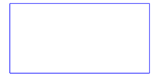

# Repetition
Bevor wir mit erweiterten Konzepten und komplexeren Programmieraufgaben fortfahren, frischen wir hier auf, was Sie im ersten Programmierblock gelernt haben.

Im Unterkapitel [Arithmetik](01-Arithmetik/index.mdx) wiederholen wir zudem die Rechenoperationen in Python. Dort lernen Sie auch zwei neue Operatoren kennen, die später noch sehr nützlich werden.

## Turtle
:::insight[Zur Erinnerung: Turtle-Befehle]
Jedes Turtle-Programm beginnt mit `from turtle import *`. Die wichtigsten Befehle:

| Befehl | Bedeutung |
|--------|-----------|
| `forward(n)`, `back(n)` | `n` Pixel vorwärts bzw. rückwärts gehen |
| `left(w)`, `right(w)` | um `w` Grad nach links bzw. rechts drehen |
| `penup()`, `pendown()` | Stift anheben (nicht mehr zeichnen) bzw. wieder absetzen |
| `pencolor(farbe)` | Stiftfarbe setzen, z.B. `pencolor('red')` |
| `fillcolor(farbe)` | Füllfarbe setzen, z.B. `fillcolor('yellow')` |
| `begin_fill()`, `end_fill()` | Alles, was dazwischen gezeichnet wird, wird am Schluss ausgefüllt |
| `dot(d)` | einen Punkt mit Durchmesser `d` in der Stiftfarbe zeichnen |
| `shape('turtle')`, `hideturtle()` | Turtle als Schildkröte anzeigen bzw. verstecken |
:::

:::tip[Turtle schneller machen]
Wenn Sie am Anfang Ihres Programms (aber nach dem Turtle-Import) den Befehl `speed(100)` einfügen, zeichnet die Turtle praktisch ohne Verzögerung.
:::

::::aufgabe[Rechteck]
<TaskState id="e0fb6f57-ab83-4999-b542-c35951d5a5c8" />
Wir starten ganz einfach: Zeichnen Sie mit der Turtle ein **blaues** Rechteck, das `200` Pixel breit und `100` Pixel hoch ist.



:::info[Kommentare]
Im Code unten sehen Sie auf Zeile 5 einen **Kommentar**. Kommentare beginnen in Python mit einem `#`. Alles, was auf einer Zeile nach dem `#` steht, wird vom Python-Interpreter **ignoriert**. Kommentare sind also nur für Menschen gedacht: Damit können wir z.B. erklären, was ein Programm macht, oder (wie hier) markieren, wo Sie Ihren Code einfügen sollen.
:::

```py live_py id=c4440bcc-099b-4dab-9886-1a7c45bd1bf7
from turtle import *

shape('turtle')

# Ihr Code ab hier...
```

<Solution id="834ae926-b963-4072-9429-9571c4324b7e">
  ```py live_py readonly slim
  from turtle import *

  shape('turtle')

  pencolor('blue')
  forward(200)
  left(90)
  forward(100)
  left(90)
  forward(200)
  left(90)
  forward(100)
  left(90)

  done()
  ```

  Wenn Sie genau hinschauen, sehen Sie, dass sich die ersten vier Befehle wiederholen. Mit einer `for`-Schleife (siehe unten) geht es deshalb auch kürzer.
</Solution>
::::

::::aufgabe[Ampel]
<TaskState id="aef2a74e-ff24-44e0-b858-0934bffbe356" />
Zeichnen Sie eine Ampel aus drei Punkten mit je `60` Pixel Durchmesser, die untereinander angeordnet sind: oben rot (`red`), in der Mitte orange (`orange`) und unten grün (`green`). Die Mittelpunkte der Punkte sind je `70` Pixel voneinander entfernt.

Die Turtle soll dabei keine Linien zeichnen und am Schluss nicht mehr zu sehen sein.


```py live_py id=4328e00c-5659-47ef-aef1-c350dce33108
```

<Solution id="da8801fd-e06c-495e-a105-ca0fdc4d90d0">
  ```py live_py readonly slim
  from turtle import *

  penup()
  right(90)

  pencolor('red')
  dot(60)
  forward(70)

  pencolor('orange')
  dot(60)
  forward(70)

  pencolor('green')
  dot(60)

  hideturtle()
  done()
  ```

  Mit `right(90)` schaut die Turtle nach unten. So bewegt sie sich mit `forward(70)` jeweils zum nächsten Punkt.
</Solution>
::::

## `for`-Schleife
:::insight[Zur Erinnerung: `for`-Schleife]
Mit einer `for`-Schleife wiederholen wir die eingerückten Anweisungen eine bestimmte Anzahl Mal:

```py
for i in range(4):
    forward(100)
    right(90)
```

Das `i` ist der **Schleifenzähler**: Beim ersten Durchlauf hat er den Wert `0`, beim zweiten den Wert `1`, …, beim letzten (hier: vierten) Durchlauf den Wert `3`.
:::

<ChoiceAnswer correct={[3]} title="Schleife #1" id="65da3173-4eaa-43cc-aff4-ce6cbe4da726">
    Führen Sie das folgende Programm **von Hand** (z.B. auf einem Blatt Papier) aus und wählen Sie die korrekte Ausgabe. Was gibt dieses Programm aus?

    ```py showLineNumbers
    for i in range(3):
        print(i * 2)
    ```

    1. ```
       2
       4
       6
       ```
    2. ```
       0
       1
       2
       ```
    3. ```
       0
       2
       4
       ```
    4. ```
       0
       2
       4
       6
       ```
    5. ```
       6
       ```

    <Hint when={['correct']}>
        Genau! Der Schleifenzähler `i` nimmt nacheinander die Werte `0`, `1` und `2` an. Ausgegeben wird jeweils das Doppelte, jedes Mal auf einer neuen Zeile.
    </Hint>

    <Hint when={['incorrect']}>
        Notieren Sie für jeden Schleifendurchlauf den Wert von `i` und von `i * 2`. Achtung: Bei `range(3)` beginnt der Schleifenzähler bei `0` und es gibt genau drei Durchläufe.
    </Hint>
</ChoiceAnswer>

<ChoiceAnswer title="Schleife #2" correct={[2]} id="ff5a7960-fbc9-4c31-ad1d-64de617526e4">
    Führen Sie das folgende Programm **von Hand** (z.B. auf einem Blatt Papier) aus und wählen Sie die korrekte Ausgabe. Was gibt dieses Programm aus?

    ```py showLineNumbers
    summe = 0
    for i in range(4):
        summe = summe + i
    print(summe)
    ```

    1. ```
       4
       ```
    2. ```
       6
       ```
    3. ```
       10
       ```
    4. ```
       0
       1
       3
       6
       ```
    5. ```
       3
       ```

    <Hint when={['correct']}>
        Genau! `summe` wird nacheinander zu `0`, `1`, `3` und `6`. Weil `print(summe)` nicht eingerückt ist, wird es erst **nach** der Schleife und nur einmal ausgeführt.
    </Hint>

    <Hint when={['incorrect']}>
        Notieren Sie in einer Tabelle für jeden Durchlauf den Wert von `i` sowie den Wert von `summe` vor und nach dem Durchlauf. Achten Sie zudem auf die Einrückung von `print(summe)`: Gehört es zur Schleife?
    </Hint>
</ChoiceAnswer>

:::insight[Arithmetik]
In den folgenden Aufgaben brauchen Sie oft arithmetische Grundoperationen. Sie können jetzt auch gleich das Unterkapitel [Arithmetik](01-Arithmetik/index.mdx) durcharbeiten, um die Rechenoperationen in Python zu wiederholen und zu vertiefen.
:::

::::aufgabe[Treppe]
<TaskState id="7dde6cca-bc9a-4913-8820-36af31e95c02" />
**Teil a)** Zeichnen Sie mit einer `for`-Schleife eine Treppe mit `6` Stufen. Jede Stufe ist `20` Pixel breit und `20` Pixel hoch:


```py live_py id=3608b6dc-6f6f-4216-ac13-ce37e2c8fca8
```

**Teil b)** Kopieren Sie Ihren Code aus Teil a) in den Editor unten und passen Sie ihn so an, dass eine **wachsende** Treppe entsteht: Die Stufen sind weiterhin `20` Pixel breit, aber die erste Stufe ist nur `5` Pixel hoch, die zweite `10`, die dritte `15` und so weiter:


```py live_py id=d691867b-25ec-43ed-ab98-cb2add0c86b7
```

:::tip[Schleifenzähler]
Die Höhe der Stufe hängt davon ab, im wievielten Durchlauf der Schleife wir uns befinden. Verwenden Sie dafür den Schleifenzähler `i`. Achtung: Er beginnt bei `0`.
:::

<Solution id="87a17eb9-8bbb-4d70-9d69-bbd90b9d27b8" title="Lösung Teil a)">
  ```py live_py readonly slim
  from turtle import *

  shape('turtle')

  for i in range(6):
      left(90)
      forward(20)
      right(90)
      forward(20)

  done()
  ```
</Solution>

<Solution id="5595388c-4a76-4cb3-83fd-fad92845cd7a" title="Lösung Teil b)">
  ```py live_py readonly slim
  from turtle import *

  shape('turtle')

  for i in range(6):
      left(90)
      forward(5 * (i + 1))
      right(90)
      forward(20)

  done()
  ```
</Solution>
::::

## Variablen und Datentypen
:::insight[Zur Erinnerung: Variablen und Datentypen]
In **Variablen** speichern wir Werte, um sie später wieder zu verwenden, z.B. `seite = 100`. Eine Variable kann auch überschrieben werden, z.B. `zaehler = zaehler + 1`: Hier wird zuerst rechts vom `=` der neue Wert berechnet und dieser dann in `zaehler` gespeichert.

Jeder Wert hat einen **Datentyp**:

| Datentyp | Bedeutung     | Beispiel          |
|----------|---------------|-------------------|
| `int`    | Ganzzahl      | `anzahl = 20`     |
| `float`  | Dezimalzahl   | `groesse = 1.68`  |
| `str`    | Text          | `name = 'Snoopy'` |
| `bool`   | Wahrheitswert | `fertig = True`   |
:::

::::aufgabe[Zahlen aufsummieren]
<TaskState id="3c18f83c-4bca-48f0-9ec5-2902d394ed8b" />
Schreiben Sie ein Programm, das die Summe aller Zahlen von `1` bis `n` berechnet und ausgibt. Die Variable `n` ist im Code-Editor bereits vorgegeben.

Testen Sie Ihr Programm zuerst mit einem kleinen `n`, bei dem Sie das Ergebnis selbst ausrechnen können. Für `n = 4` muss z.B. `10` herauskommen, denn `1 + 2 + 3 + 4 = 10`.

```py live_py id=b2dbffec-a015-4b55-a1a6-ba877b7d20be
n = 4

# Ihr Code ab hier...
```

:::tip[Ausgeben]
Zur Wiederholung: Erstellen Sie **vor** der Schleife eine Variable `summe` mit dem Wert `0`. In jedem Schleifendurchlauf zählen Sie dann die aktuelle Zahl dazu. Ein ähnliches Programm haben Sie in der Aufgabe «Schleifenzähler von Hand» (Programm B) bereits von Hand ausgeführt.
:::

:::tip[Summe mitführen]
Zur Wiederholung: Um etwas in der Konsole auszugeben, verwenden Sie `print()`. Wenn Sie z.B. `print(summe)` schreiben, wird der aktuelle Wert der Variable `summe` ausgegeben. Mehr dazu weiter unten.
:::

:::tip[Kein Turtle-Programm]
Die Turtle brauchen Sie hier nicht. Dementsprechend brauchen Sie auch kein `from turtle import *` am Anfang.
:::

Wenn Ihr Programm funktioniert: Welche Summe erhalten Sie für `n = 100`?

<String id="adf387b4-4339-4f5c-bbc0-479c5b7973c6" solution="5050" />

<Solution id="c5951138-8529-4f6c-8165-7e9685659c2d">
  ```py live_py readonly slim
  n = 100

  summe = 0
  for i in range(n):
      summe = summe + (i + 1)

  print(summe)
  ```

  Weil `i` bei `0` beginnt und bei `n - 1` aufhört (für `n=4` ist `i` gleich `0`, `1`, `2` und `3`), addieren wir jeweils `i + 1`.

</Solution>
::::

## Zufall
:::insight[Zur Erinnerung: Zufall]
Mit `from random import *` laden wir die Zufallsbefehle. Danach liefert `randint(a, b)` eine zufällige Ganzzahl zwischen `a` und `b` (beide Grenzen eingeschlossen). `randint(1, 6)` simuliert also einen Würfel.
:::

::::aufgabe[Konfetti]
<TaskState id="adc21b74-8e18-4d7c-a219-d6f28dc2eba7" />
Schreiben Sie ein Turtle-Programm, das `30` Konfetti-Punkte an zufälligen Positionen zeichnet:
- Die `x`- und die `y`-Koordinate jedes Punkts liegen zufällig zwischen `-200` und `200`. Mit `goto(x, y)` können Sie die Turtle direkt an eine Position schicken.
- Auch der Durchmesser jedes Punkts ist zufällig, nämlich zwischen `10` und `40` Pixel.
- Wählen Sie eine Farbe nach Wahl. Die Turtle soll keine Linien zeichnen und am Schluss nicht zu sehen sein.

```py live_py id=e2accc1c-1fbc-490b-955c-52edb16ed466
```

<Solution id="89738002-6076-4732-98d5-e13a198a38ff">
  ```py live_py readonly slim
  from turtle import *
  from random import *

  penup()
  pencolor('purple')

  for i in range(30):
      x = randint(-200, 200)
      y = randint(-200, 200)
      goto(x, y)
      dot(randint(10, 40))

  hideturtle()
  done()
  ```

  Weil `randint()` bei jedem Schleifendurchlauf neu aufgerufen wird, erhält jeder Punkt eine andere Position und Grösse. Und bei jeder Ausführung des Programms sieht das Bild wieder anders aus.
</Solution>
::::

## `while`-Schleife
:::insight[Zur Erinnerung: `while`-Schleife]
Eine **`while`-Schleife** wiederholt die eingerückten Anweisungen, **solange** die Bedingung zutrifft.

```py
x = 1
while x < 1000:
    x = x * 2
print(x)
```

Die Bedingung wird jeweils **zu Beginn** jedes Durchlaufs geprüft. Trifft sie nicht (mehr) zu, geht es nach der Schleife weiter.

**Hinweis:** Im obigen Beispiel wird die `while`-Schleife im Prinzip genau wie eine (etwas kompliziertere) `for`-Schleife verwendet. Die `while`-Schleife ist aber vor allem dann  nützlich, wenn wir **im Voraus nicht wissen**, wie oft etwas wiederholt werden muss.
:::

:::aufgabe[`while`-Schleife von Hand]
<TaskState id="1d58d6be-7ac1-47c9-9048-5d40a6133da4" />
Führen Sie das folgende Programm **von Hand** aus und notieren Sie, was es ausgibt.

```py showLineNumbers
x = 1
while x < 50:
    x = x * 3
print(x)
```

Ausgabe:

<String id="c18a454e-0486-42b5-b89e-7002de759c41" solution="81" />

<Solution id="fb90caab-318b-482d-ad24-7c938d636875">
| Durchlauf | `x` vorher | `x < 50`? | `x` nachher |
|-----------|------------|-----------|-------------|
| 1         | `1`        | `True`    | `3`         |
| 2         | `3`        | `True`    | `9`         |
| 3         | `9`        | `True`    | `27`        |
| 4         | `27`       | `True`    | `81`        |
| –         | `81`       | `False`   | Schleife wird beendet |

Ausgegeben wird also `81`. Beachten Sie: Die Bedingung wird nur **zu Beginn** jedes Durchlaufs geprüft. Deshalb kann `x` am Schluss grösser als `50` sein.
</Solution>
:::

::::aufgabe[Würfeln bis 100]
<TaskState id="a69f401a-34af-488a-a54a-9b0b149beb8a" />
Schreiben Sie ein Programm, das so lange «würfelt» (Zufallszahlen von 1 bis 6 generiert), bis die **Summe** aller Würfe mindestens `100` beträgt. Am Schluss soll ausgegeben werden, wie viele Würfe dafür nötig waren.

```py live_py id=fa4d1f88-705f-48d5-9636-80a2d4e6b4e4
```

:::tip[Zwei Variablen]
Sie brauchen zwei Variablen, die beide vor der Schleife bei `0` starten: eine für die Summe der Würfe und eine, die die Anzahl Würfe zählt. Wie oft gewürfelt werden muss, wissen Sie im Voraus nicht. Deshalb passt hier eine `while`-Schleife.
:::

<Solution id="7ebb6d8d-867c-47cd-a278-97480c1874a0">
  ```py live_py readonly slim
  from random import *

  summe = 0
  anzahl_wuerfe = 0

  while summe < 100:
      wurf = randint(1, 6)
      summe = summe + wurf
      anzahl_wuerfe = anzahl_wuerfe + 1

  print(anzahl_wuerfe)
  ```

  Da ein Würfel im Durchschnitt $3.5$ Augen zeigt, braucht es meistens etwa $100 / 3.5 \approx 29$ Würfe. Das Ergebnis schwankt aber von Ausführung zu Ausführung.
</Solution>
::::

## Bugs
:::insight[Zur Erinnerung: Bugs]
- Bei einem **Syntaxfehler** hält sich der Code nicht an die Regeln von Python (z.B. fehlende Klammer, fehlender Doppelpunkt, falsche Einrückung). Das Programm lässt sich gar nicht erst ausführen.
- Bei einem **Logikfehler** (Semantikfehler) läuft das Programm zwar, macht aber nicht das, was es soll.
- Die **Fehlermeldung** verrät Ihnen, auf welcher Zeile Python über den Fehler gestolpert ist. Manchmal liegt die Ursache auch eine Zeile weiter oben.
:::

::::aufgabe[Fehler beheben]
<TaskState id="ec0c1493-4836-4438-91cb-8a9c0e43a25b" />
Das folgende Programm sollte ein rotes Quadrat zeichnen und am Schluss `Fertig!` ausgeben. Leider haben sich **fünf Syntaxfehler** eingeschlichen.

Führen Sie das Programm aus, lesen Sie die Fehlermeldung (auf welcher Zeile ist der Fehler?) und beheben Sie den Fehler. Wiederholen Sie das, bis das Programm korrekt funktioniert.

```py live_py id=c685505f-00a4-4431-9657-096737379aff
from turtle import *

seite = 100
pencolor('red'

for i in range(4)
    forward(seite))
   left(90)

print('Fertig!)
done()
```

<Solution id="3ec0ddfb-1508-43c4-8459-9cc8420881dc">
  ```py live_py readonly slim
  from turtle import *

  seite = 100
  pencolor('red')

  for i in range(4):
      forward(seite)
      left(90)

  print('Fertig!')
  done()
  ```

  | Zeile | Fehler |
  |-------|--------|
  | 4     | Es fehlt eine schliessende Klammer `)`: Für jede geöffnete Klammer braucht es eine schliessende. |
  | 6     | Nach `for i in range(4)` fehlt der Doppelpunkt `:`. |
  | 7     | Hier hat es eine schliessende Klammer `)` zu viel. |
  | 8     | `left(90)` ist falsch eingerückt (3 statt 4 Leerzeichen). |
  | 10    | Beim String `'Fertig!'` fehlt das schliessende Anführungszeichen. |
</Solution>
::::

## Ein- und Ausgabe
:::insight[Zur Erinnerung: Ein- und Ausgabe]
| Befehl | Bedeutung |
|--------|-----------|
| `input(s)` | Verlangt eine Eingabe von der Benutzerin und zeigt dabei die Eingabeaufforderung `s` an. Das Ergebnis ist **immer** ein `str`. |
| `int(s)`, `float(s)`, `str(x)` | Wandelt einen Wert in den entsprechenden Datentyp um, z.B. `int(input('Zahl: '))`. |
| `print(s)` | Gibt `s` aus. |
| `f'...'` | **f-String**: Werte in geschweiften Klammern werden eingesetzt, z.B. `print(f'Hallo, {name}!')`. |
:::

:::aufgabe[Datentypen bestimmen]
<TaskState id="be530c1d-02c2-4338-945f-31758ce99ac1" />
Schauen Sie sich das folgende Programm an. Nehmen Sie an, dass die Benutzerin bei den Eingaben `Snoopy` und `17` eingibt.

```py showLineNumbers
name = input('Name: ')
alter = int(input('Alter: '))
groesse = 1.68
jahrgang = 2026 - alter
postleitzahl = '2502'
halbes_alter = alter / 2
print(f'{name} ist {alter} Jahre alt.')
```

Welchen Datentyp (`int`, `float`, `str` oder `bool`) hat die Variable, die auf der jeweiligen Zeile definiert wird?

| Zeile | Variable       | Datentyp                                        |
|-------|----------------|-------------------------------------------------|
| 1     | `name`         | <String id="bf206659-2fbc-407f-9cfc-62e3a0c7a2c1" solution="str" />   |
| 2     | `alter`        | <String id="1b98f9ed-09bf-44da-a541-86742c5c8a1d" solution="int" />   |
| 3     | `groesse`      | <String id="d1bc6c3c-b67b-422e-b6e7-ed8b25a746de" solution="float" /> |
| 4     | `jahrgang`     | <String id="4b849c2d-029e-4d20-9bc6-20f9aee490f2" solution="int" />   |
| 5     | `postleitzahl` | <String id="d565eacb-e8aa-4a0f-8334-fab5fc8e0273" solution="str" />   |
| 6     | `halbes_alter` | <String id="fa8f1548-75e5-437a-bb01-b0cee2166150" solution="float" /> |

<Solution id="f083d23f-8c0d-4e08-a57e-a3d7c82ccf12">
- **Zeile 1:** `input()` liefert immer einen `str`, auch wenn die Benutzerin eine Zahl eingibt.
- **Zeile 2:** Die Eingabe wird mit `int()` in eine Ganzzahl umgewandelt.
- **Zeile 3:** `1.68` ist eine Dezimalzahl, also ein `float`.
- **Zeile 4:** Die Differenz zweier `int` ist wieder ein `int` (hier: `2009`).
- **Zeile 5:** `'2502'` steht in Anführungszeichen und ist deshalb ein `str`, obwohl es wie eine Zahl aussieht. Mit Postleitzahlen rechnet man ja auch nicht.
- **Zeile 6:** Die Division `/` ergibt in Python **immer** einen `float`, auch wenn die Rechnung aufgeht. Hier gibt es `8.5`, aber auch `18 / 2` würde `9.0` (und nicht `9`) ergeben.
</Solution>
:::

::::aufgabe[Einmaleins]
<TaskState id="5460c1cf-6f9f-480c-a66d-2c2944858b82" />
Schreiben Sie ein Programm, das die Benutzerin nach einer Zahl fragt und dann die ersten zehn Rechnungen der entsprechenden Einmaleins-Reihe ausgibt. Verwenden Sie dazu einen f-String. Für die Eingabe `7` soll die Ausgabe also so aussehen:

```
1 x 7 = 7
2 x 7 = 14
3 x 7 = 21
...
10 x 7 = 70
```

```py live_py id=56d53cd5-ff68-4412-8764-ec2b3cb3c0c2
```

<Solution id="10acc4e8-8281-4f92-8126-bc4f2d2cd5ca">
  ```py live_py readonly slim
  zahl = int(input('Zahl: '))

  for i in range(10):
      faktor = i + 1
      print(f'{faktor} x {zahl} = {faktor * zahl}')
  ```

  Innerhalb der geschweiften Klammern eines f-Strings dürfen auch Rechnungen stehen, z.B. `{faktor * zahl}`.
</Solution>
::::

::::aufgabe[⭐️ Balkendiagramm]
<TaskState id="07bd5020-e609-4482-a18a-9df360cd55b3" />
Ein Verein verkauft an drei Tagen Kuchen. Das angefangene Turtle-Programm fragt nacheinander die **Anzahl verkaufter Kuchen** für jeden der drei Tage als Eingabe ab. 

Erweitern Sie das Programm so, dass es anschliessend ein Balkendiagramm mit drei ausgefüllten Balken zeichnet:
- Jeder Balken ist `40` Pixel breit und zwischen den Balken hat es `20` Pixel Abstand.
- Ein Kuchen entspricht `10` Pixel Höhe. Wurden also `12` Kuchen verkauft, dann ist der Balken `120` Pixel hoch.
- Der erste Balken ist rot (`red`), der zweite grün (`green`), der dritte blau (`blue`).
- Am Schluss soll die Turtle nicht mehr zu sehen sein.

```py live_py id=ae8acc6f-6d07-45e8-a151-cd7599bc5a0e
from turtle import *

tag_1 = int(input('Kuchen am Tag 1: '))
tag_2 = int(input('Kuchen am Tag 2: '))
tag_3 = int(input('Kuchen am Tag 3: '))

penup()
back(100)
pendown()

# Ihr Code ab hier...
```

:::tip[Ein Balken]
Überlegen Sie sich zuerst, wie Sie **einen** Balken zeichnen, sodass die Turtle am Schluss unten rechts am Balken steht und wieder nach rechts schaut. Wenn das funktioniert, ist der Rest (fast) nur noch Kopieren.
:::

<Solution id="f371fabe-954b-4b70-ba88-db286230f631">
  ```py live_py readonly slim
  from turtle import *

  tag_1 = int(input('Kuchen am Tag 1: '))
  tag_2 = int(input('Kuchen am Tag 2: '))
  tag_3 = int(input('Kuchen am Tag 3: '))

  penup()
  back(100)
  pendown()

  # Balken 1
  fillcolor('red')
  begin_fill()
  for i in range(2):
      forward(40)
      left(90)
      forward(tag_1 * 10)
      left(90)
  end_fill()
  penup()
  forward(60)
  pendown()

  # Balken 2
  fillcolor('green')
  begin_fill()
  for i in range(2):
      forward(40)
      left(90)
      forward(tag_2 * 10)
      left(90)
  end_fill()
  penup()
  forward(60)
  pendown()

  # Balken 3
  fillcolor('blue')
  begin_fill()
  for i in range(2):
      forward(40)
      left(90)
      forward(tag_3 * 10)
      left(90)
  end_fill()

  hideturtle()
  done()
  ```

  Ist Ihnen aufgefallen, dass sich der Code für die drei Balken fast vollständig wiederholt? Nur die Farbe und die Höhe sind jeweils anders. Und was wäre, wenn der Verein nicht drei, sondern 30 Tage lang Kuchen verkauft? In den nächsten Kapiteln lernen Sie mit **Listen** und **Funktionen** zwei Werkzeuge kennen, mit denen sich solche Programme viel kürzer und flexibler schreiben lassen.
</Solution>
::::

## Verzweigungen und Booleans
:::insight[Zur Erinnerung: Verzweigungen und Booleans]
Mit `if`, `elif` und `else` führen wir Code nur unter bestimmten Bedingungen aus. Es wird jeweils nur der **erste** Block ausgeführt, dessen Bedingung zutrifft:

```py
if punkte > 90:
    print('Super!')
elif punkte > 50:
    print('Bestanden.')
else:
    print('Leider nicht bestanden.')
```

Bedingungen sind Ausdrücke vom Datentyp `bool`: Sie sind entweder `True` oder `False`.

| Vergleichsoperatoren | Logische Operatoren |
|----------------------|---------------------|
| `<`, `<=`, `>`, `>=`, `==` (gleich), `!=` (ungleich) | `and`, `or`, `not` (Reihenfolge: `not` vor `and` vor `or`) |
:::

:::aufgabe[Logische Ausdrücke auswerten]
<TaskState id="56e27cf0-302d-4527-a1e1-6dd34517d0ff" />
Gegeben sind folgende Variablen:

```py
x = 7
y = 12
regen = True
```

Bestimmen Sie von Hand den Wahrheitswert (`True` oder `False`) der folgenden booleschen Ausdrücke. Überprüfen Sie Ihre Antworten, indem Sie jeweils auf den :mdi[help-circle-outline]-Button klicken.

| Ausdruck                                     | Wahrheitswert                                  |
|----------------------------------------------|------------------------------------------------|
| `True and False`                             | <String id="adde8c16-a739-4160-9f05-16884574e48b" solution="False" /> |
| `True or False`                              | <String id="b662afa3-2682-43a5-aac4-15e0e86749c8" solution="True" />  |
| `True and (False or True)`                   | <String id="175c3037-fb14-490b-847b-369215a35692" solution="True" />  |
| `not False`                                  | <String id="8f9d5d3c-88bc-4f3f-aaf9-918450b23950" solution="True" />  |
| `x < y`                                      | <String id="b3cc8dbe-735f-41c9-acf2-7f5a493189a3" solution="True" />  |
| `not regen`                                  | <String id="1c17f7a9-75af-43ab-bda4-c8309e90172d" solution="False" /> |
| `x > 5 and y > 20`                           | <String id="a8e7e18c-4964-4f86-96e7-838b9dd11d43" solution="False" /> |
| `x > 5 or y > 20`                            | <String id="9c090bee-dbbc-4dd7-a324-b828b5af95c3" solution="True" />  |
| `x != y and not regen`                       | <String id="e9a713fe-df20-4b95-8deb-8227dee1db71" solution="False" /> |
:::

Führen Sie das folgende Programm **von Hand** aus und wählen Sie die korrekte Ausgabe.

<ChoiceAnswer correct={[1]} id="e187a378-40a9-4e52-87e5-4aaa8d5025ee">
    Was gibt dieses Programm aus?

    ```py showLineNumbers
    for i in range(5):
        if i < 2:
            print('A')
        elif i == 3:
            print('B')
        else:
            print('C')
    ```

    1. ```
       A
       A
       C
       B
       C
       ```
    2. ```
       A
       A
       B
       C
       C
       ```
    3. ```
       A
       A
       A
       B
       C
       ```
    4. ```
       A
       A
       C
       B
       ```
    5. ```
       A
       B
       C
       ```
    6. ```
       A
       A
       C
       C
       C
       ```

    <Hint when={['correct']}>
        Genau! Für `i = 0` und `i = 1` trifft `i < 2` zu (`A`). Für `i = 3` trifft `i == 3` zu (`B`). Für `i = 2` und `i = 4` trifft keine der Bedingungen zu, deshalb wird der `else`-Block ausgeführt (`C`).
    </Hint>

    <Hint when={['incorrect']}>
        Gehen Sie die Werte `i = 0` bis `i = 4` einzeln durch und prüfen Sie jeweils die Bedingungen von oben nach unten. Denken Sie daran: Es wird nur der **erste** Block ausgeführt, dessen Bedingung zutrifft. Und gilt `2 < 2`?
    </Hint>
</ChoiceAnswer>


::::aufgabe[Würfelstatistik]
<TaskState id="25bb8ce0-3651-48dc-8d68-d0c26963db6c" />
Schreiben Sie ein Programm, das mit einer `for`-Schleife **100-mal** einen Würfel (Zahlen von 1 bis 6) wirft und dabei zählt, wie oft eine 6 gewürfelt wurde. Am Schluss soll das Ergebnis ausgegeben werden.

```py live_py id=ace41171-82f1-4d41-a50a-3d079030b7cf
```

:::tip[Zählen]
Zählen funktioniert ähnlich wie das Aufsummieren in der Aufgabe «Zahlen aufsummieren»: Sie brauchen eine Variable, die vor der Schleife bei `0` startet. Der Unterschied: Sie erhöhen sie nur dann um `1`, wenn eine bestimmte Bedingung zutrifft.
:::

Führen Sie Ihr Programm mehrmals aus. Welches Ergebnis erwarten Sie ungefähr im Durchschnitt? Überlegen Sie zuerst und vergleichen Sie dann mit der Lösung.

<Solution id="89059feb-db1a-43bc-b8e7-c45831f609bb">
  ```py live_py readonly slim
  from random import *

  anzahl_sechser = 0
  for i in range(100):
      wurf = randint(1, 6)
      if wurf == 6:
          anzahl_sechser = anzahl_sechser + 1

  print(anzahl_sechser)
  ```

  Bei einem fairen Würfel ist jede Zahl gleich wahrscheinlich. Im Durchschnitt erwarten wir also bei $\frac{1}{6}$ der Würfe eine 6, das sind $100 / 6 \approx 16.7$, also etwa 17 Sechser. Das Ergebnis schwankt aber von Ausführung zu Ausführung.
</Solution>
::::

::::aufgabe[Kinoticket]
<TaskState id="674219ea-6180-4e30-a46a-7b247898eff9" />
Ein Kino hat folgende Preise:

| Alter          | Preis   |
|----------------|---------|
| unter 16       | 12 CHF  |
| 16 bis und mit 25      | 15 CHF  |
| ab 65          | 13 CHF  |
| alle anderen   | 18 CHF  |

Vervollständigen Sie das angefangene Programm so, dass es den passenden Preis berechnet und als vollständigen Satz ausgibt. Verwenden Sie dazu einen f-String. Für die Eingabe `17` soll also z.B. `Ihr Ticket kostet 15 CHF.` ausgegeben werden.

```py live_py id=c4c835c8-3fbb-45f3-a975-45e3ad1e2440
alter = int(input('Alter: '))

# Ihr Code ab hier...
```

:::tip[Reihenfolge]
Überlegen Sie sich gut, in welcher Reihenfolge Sie die Bedingungen prüfen.
:::

<Solution id="91da5152-662e-4225-9758-c0c6281081de">
  ```py live_py readonly slim
  alter = int(input('Alter: '))

  if alter < 16:
      preis = 12
  elif alter <= 25:
      preis = 15
  elif alter >= 65:
      preis = 13
  else:
      preis = 18

  print(f'Ihr Ticket kostet {preis} CHF.')
  ```

  Die Bedingung `alter <= 25` auf Zeile 5 reicht aus: Wenn das Programm hier ankommt, wissen wir bereits, dass `alter < 16` nicht zutrifft, die Person also mindestens 16 ist.
</Solution>
::::

## ⭐️ Zusatzaufgaben
::::aufgabe[⭐️ Zahlenraten]
<TaskState id="495243a3-c217-40a2-9ffc-122a43c56c34" />
Zum Abschluss kombinieren wir fast alles, was Sie bisher repetiert haben. Programmieren Sie ein Zahlenraten-Spiel:
1. Der Computer «denkt» sich eine zufällige Zahl zwischen 1 und 100 aus.
2. Die Benutzerin gibt einen Tipp ein (versucht, die Zahl zu erraten).
3. Das Programm gibt aus, ob der Tipp `Zu klein!` oder `Zu gross!` war.
4. Das wiederholt sich ab Schritt 2, so lange, bis die Zahl erraten wurde.
5. Am Schluss gibt das Programm aus, wie viele Versuche gebraucht wurden, z.B. `Richtig! Sie haben 6 Versuche gebraucht.`

```py live_pyo id=d72daea8-fac9-4684-a11f-8640de3a965a
```

:::tip[Welche Schleife?]
Sie wissen im Voraus nicht, wie viele Versuche die Benutzerin braucht. Eine `for`-Schleife mit einer festen Anzahl Wiederholungen passt hier deshalb nicht. Verwenden Sie eine `while`-Schleife, die so lange läuft, wie der Tipp **nicht** der gesuchten Zahl entspricht.
:::

<Solution id="56a77ac1-cf81-4574-b087-9af6f21c36f5">
  ```py live_pyo readonly slim
  from random import *

  geheimzahl = randint(1, 100)
  tipp = 0
  versuche = 0

  while tipp != geheimzahl:
      tipp = int(input('Ihr Tipp: '))
      versuche = versuche + 1
      if tipp < geheimzahl:
          print('Zu klein!')
      elif tipp > geheimzahl:
          print('Zu gross!')

  print(f'Richtig! Sie haben {versuche} Versuche gebraucht.')
  ```

  Die Variable `tipp` wird auf Zeile 4 mit `0` initialisiert, damit die Bedingung der `while`-Schleife beim ersten Mal überhaupt geprüft werden kann. Weil `0` nie die Geheimzahl ist, wird die Schleife sicher mindestens einmal ausgeführt.
</Solution>
::::

::::aufgabe[⭐️ Schaltjahr]
<TaskState id="97601356-3d89-4423-aca5-03073b5e0ef6" />
:::warning[Arithmetik]
Für diese Aufgabe brauchen Sie den Modulo-Operator `%`. Diesen lernen Sie im Unterkapitel [Arithmetik](01-Arithmetik/index.mdx) kennen. Bearbeiten Sie dieses deshalb zuerst.
:::

Schreiben Sie ein Programm, das nach einer Jahreszahl fragt und ausgibt, ob es sich um ein Schaltjahr handelt (z.B. `2024 ist ein Schaltjahr.` oder `2026 ist kein Schaltjahr.`).

Im gregorianischen Kalender gelten folgende Regeln:
- Ein Jahr ist ein Schaltjahr, wenn es durch `4` teilbar ist,
- **ausser** wenn es auch durch `100` teilbar ist,
- es sei denn, es ist sogar durch `400` teilbar: Dann ist es doch ein Schaltjahr.

Testen Sie Ihr Programm z.B. mit `2024` (Schaltjahr), `2026` (kein Schaltjahr), `1900` (kein Schaltjahr) und `2000` (Schaltjahr).

```py live_py id=6a75c9a3-4eac-4109-a149-fd53df74c0ac
```

:::tip[Teilbarkeit]
Eine Zahl `a` ist genau dann durch `b` teilbar, wenn bei der Division kein Rest bleibt, also wenn `a % b == 0` ist.
:::

<Solution id="253faef2-a4e1-4c4d-a31d-5880b8df15ec">
  ```py live_py readonly slim
  jahr = int(input('Jahr: '))

  schaltjahr = (jahr % 4 == 0 and jahr % 100 != 0) or jahr % 400 == 0

  if schaltjahr:
      print(f'{jahr} ist ein Schaltjahr.')
  else:
      print(f'{jahr} ist kein Schaltjahr.')
  ```

  Statt mit einem einzigen booleschen Ausdruck können Sie das Problem auch mit verschachtelten `if`/`else`-Blöcken lösen. Beides ist korrekt.
</Solution>
::::
