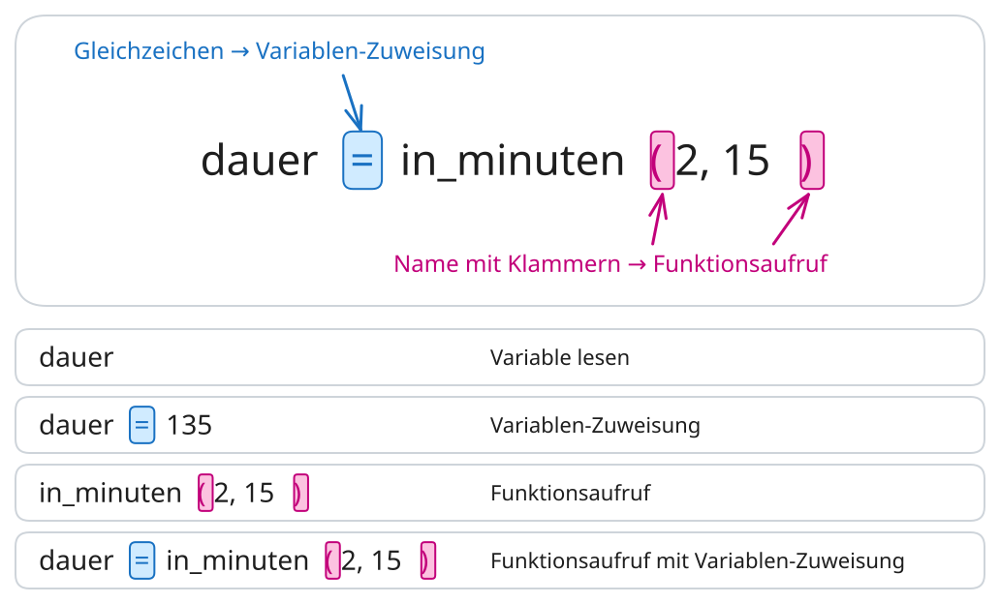
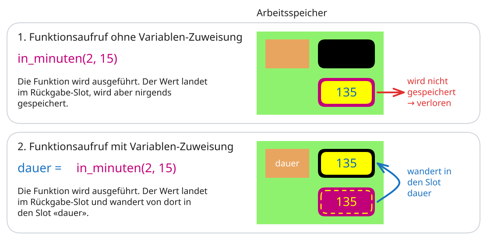
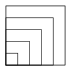

import { points } from '@tdev-components/documents/Assessable/helpers/scoring';

# Rückgabewerte
Eine Funktion kann etwas **tun**, etwas **produzieren** (nämlich einen Wert) oder **beides**:
- `forward(50)` **tut** etwas: Die Turtle bewegt sich 50 Pixel vorwärts.
- `randint(1, 6)` **produziert** etwas: eine Zufallszahl zwischen 1 und 6.
- `input('Name: ')` macht **beides**: Die Eingabeaufforderung wird angezeigt, und der eingegebene Text wird produziert.

Wenn eine Funktion einen Wert produziert, können wir diesen in einer Variable speichern:

```py
wurf = randint(1, 6)
```

Die Funktion `randint()` **gibt** den produzierten Wert **zurück**, und wir speichern ihn in der Variable `wurf`. Mit `return` können auch unsere eigenen Funktionen einen Wert zurückgeben:

```py live_py slim
def in_minuten(stunden, minuten):
    resultat = stunden * 60 + minuten
    return resultat

dauer = in_minuten(2, 15)  # 2h 15min
print(f'Dauer: {dauer} Minuten')
```

- **`return`:** Auf Zeile 3 gibt die Funktion den Wert von `resultat` zurück. Diesen Wert nennen wir **Rückgabewert**.
- **Zuweisung:** Auf Zeile 5 rufen wir die Funktion auf und speichern ihren Rückgabewert in der Variable `dauer`.

Nach `return` kann auch direkt eine Berechnung stehen, z.B. `return stunden * 60 + minuten`. Python berechnet dann **zuerst den Wert** und gibt diesen zurück.

:::warning[`return` ist eine Anweisung]
`return` ist ein Verb im Imperativ: «Gib zurück!». `return resultat` heisst also: «Gib `resultat` zurück!»

- ✅ `return resultat`
- ❌ `return = resultat`: `return` ist **keine Variable**, der wir etwas zuweisen. Das führt zu einem Syntaxfehler (`SyntaxError`).
- ❌ `return(resultat)`: `return` ist **keine Funktion**, die wir aufrufen. Es gibt zwar keinen Fehler, aber die Klammern gehören nicht dazu.
:::

## Rückgabewerte im Arbeitsspeicher
Das folgende Video zeigt, was bei `return` im Arbeitsspeicher passiert.

::video[./img/Return.mp4]

Achten Sie besonders auf diese Punkte:
- `return` legt den Wert im **Rückgabe-Slot** ab (pink). Dieser Slot hat **keinen Namen**.
- Wenn die Funktion fertig ist, werden die Slots von `stunden`, `minuten` und `resultat` abgeräumt. Der Wert im Rückgabe-Slot steht noch für die Zuweisung bereit.
- Bei der Zuweisung **wandert** der Wert in den Slot von `dauer`. Danach ist der Rückgabe-Slot wieder leer.

:::key[So liest Python Code]
- Steht da ein **Variablenname** (z.B. `dauer`), schaut Python im Arbeitsspeicher beim **Slot mit diesem Namen** nach.
- Steht da ein **Funktionsaufruf** (z.B. `in_minuten(2, 15)`), **führt** Python die Funktion **aus** und schaut danach im **Rückgabe-Slot** nach.

Achten Sie auf das **Gleichzeichen** und die **Klammern**:


:::

### `return` beendet die Funktion
`return` legt nicht nur den Wert in den Rückgabe-Slot, sondern **beendet** auch die Funktion. Python springt sofort zurück zum Aufruf. Was in der Funktion nach dem `return` steht, wird deshalb **nie ausgeführt**:

```py live_py slim
def in_minuten(stunden, minuten):
    resultat = stunden * 60 + minuten
    return resultat
    print('Fertig berechnet!')

dauer = in_minuten(2, 15)
print(f'Dauer: {dauer} Minuten')
```

Zeile 4 ist sogenannter **Dead Code** («toter Code»): Er steht zwar im Programm, kann aber nie erreicht werden. Eine Fehlermeldung gibt es dabei nicht.

### `return` in Verzweigungen
Eine Funktion darf mehrere `return` enthalten. Bei einem Aufruf wird aber nur das **erste** ausgeführt, das Python erreicht:

```py live_py slim
def groessere(a, b):
    if a > b:
        return a
    else:
        return b

ergebnis = groessere(12, 7)
print(ergebnis)
```

Weil `return` die Funktion beendet, können wir das `else` hier auch weglassen. Zeile 4 wird nur erreicht, wenn die Bedingung **nicht** erfüllt ist:

```py live_py slim
def groessere(a, b):
    if a > b:
        return a
    return b

ergebnis = groessere(12, 7)
print(ergebnis)
```

<ChoiceAnswer randomizeOptions correct={[1]} title="Kein Rabatt?" id="2a5e280e-6754-40af-8799-d211efaab320">
    ```py showLineNumbers
    def rabatt(alter):
        if alter < 16:
            return 50
        print('Kein Rabatt')
        return 0

    prozent = rabatt(12)
    print(prozent)
    ```

    Was gibt dieses Programm aus?

    1. ```
       50
       ```
    2. ```
       Kein Rabatt
       50
       ```
    3. ```
       Kein Rabatt
       0
       ```
    4. ```
       50
       Kein Rabatt
       ```

    <Hint when={['correct']}>
        Genau! Die Bedingung ist erfüllt, also beendet das `return` auf Zeile 3 die Funktion. Die Zeilen 4 und 5 werden bei diesem Aufruf nicht ausgeführt.
    </Hint>
    <Hint when={['incorrect']}>
        Welches `return` erreicht Python zuerst? Und was passiert danach mit dem Rest der Funktion?
    </Hint>
</ChoiceAnswer>

## Die vergessene Zuweisung
Das folgende Video zeigt, was passiert, wenn wir den Rückgabewert keiner Variable zuweisen.

::video[./img/Return-verloren.mp4]

Achten Sie besonders auf diese Punkte:
- Die Funktion wird trotzdem ausgeführt, und der Wert `135` landet im Rückgabe-Slot.
- Am Ende von Zeile 5 wird der Rückgabe-Slot geleert. Der Wert ist **verloren**.
- Den Fehler gibt es erst auf Zeile 6: Einen Slot mit dem Namen `dauer` gibt es nicht.

Vergleichen Sie diese zwei Fälle:



Fall 1 ist nicht immer ein Fehler, es kommt auf die Funktion an:
- `in_minuten()` **produziert nur** etwas. Ohne Zuweisung ist der Aufruf nutzlos.
- Wenn eine Funktion etwas **tut und produziert** (z.B. ein Quadrat zeichnet **und** dessen Umfang zurückgibt), kommt es darauf an: Wenn uns nur die Zeichnung interessiert, dürfen wir den Rückgabewert «vergessen». Brauchen wir auch den Umfang, müssen wir ihn einer Variable zuweisen.

<ChoiceAnswer randomizeOptions correct={[3]} title="Wo ist der Wert?" id="d3546321-899b-44c3-a28e-352e30bee5ae">
    ```py showLineNumbers
    def verdoppeln(zahl):
        resultat = zahl * 2
        return resultat

    verdoppeln(21)
    print('Fertig!')
    ```

    Wo befindet sich der Wert `42`, wenn Python bei Zeile 6 ankommt?

    1. im Slot `resultat`
    2. im Slot `verdoppeln`
    3. nirgends
    4. im Rückgabe-Slot

    <Hint when={['correct']}>
        Genau! Der Rückgabewert wurde auf Zeile 5 keiner Variable zugewiesen. Am Ende der Zeile wird der Rückgabe-Slot geleert, und der Wert ist verloren.
    </Hint>
    <Hint when={['incorrect']}>
        Welche Slots werden abgeräumt, wenn die Funktion fertig ist? Und was passiert am Ende von Zeile 5 mit dem Rückgabe-Slot?
    </Hint>
</ChoiceAnswer>

:::warning[Nicht einfach nochmal aufrufen]
Einen verlorenen Wert können wir nicht «zurückholen», indem wir die Funktion nochmal aufrufen. Sie wird dann nämlich auch **nochmal ausgeführt**:

```py live_py slim
def in_minuten(stunden, minuten):
    print('Rechne in Minuten um')
    resultat = stunden * 60 + minuten
    return resultat

in_minuten(2, 15)
dauer = in_minuten(2, 15)
print(f'Dauer: {dauer} Minuten')
```

`Rechne in Minuten um` wird **zweimal** ausgegeben. Der Wert in `dauer` stammt vom zweiten Aufruf (Zeile 7), der Wert vom ersten Aufruf (Zeile 6) ist verloren. Bei `in_minuten(2, 15)` ist das nur unnötige Arbeit. Bei `randint(1, 6)` würden wir aber **neu würfeln**.
:::

:::warning[Der Wert steckt nicht im Funktionsnamen]
Auch über den **Namen der Funktion** kommen wir nicht an den Wert:

```py live_py slim
def in_minuten(stunden, minuten):
    resultat = stunden * 60 + minuten
    return resultat

in_minuten(2, 15)
print(f'Dauer: {in_minuten} Minuten')
```

Der Name `in_minuten` ohne Klammern bezeichnet die **Funktion selbst**, nicht ihren Rückgabewert. Deshalb gibt Python hier nicht `135` aus, sondern `<function in_minuten>`.
:::

## Funktionen ohne Rückgabewert
Eine Funktion gibt nur dann einen Wert zurück, wenn sie `return` verwendet. Turtle-Befehle wie `forward()` sind Anweisungen an die Schildkröte, sie geben nichts zurück. Eine Zuweisung bringt hier nichts:

```py live_py slim
from turtle import *

x = forward(50)
print(x)
```

Es gibt zwar keinen Fehler, aber die Variable `x` enthält danach `None` («Nichts»). Das Gleiche passiert, wenn Sie in einer eigenen Funktion das `return` vergessen. Oder wenn es eine Verzweigung gibt, aber in einem der Fälle kein `return` erreicht wird.

## Quiz
Lösen Sie das Quiz vollständig **von Hand**, ohne die Programme auszuführen.

<Quiz randomizeQuestions randomizeOptions scoring={points(1)} keepExpanded={'correct'} resetMode='incorrect' id='760df50e-2f21-4b3d-9a0c-146c4f2a84d2'>
    <ChoiceAnswer correct={[1]}>
        ```py
        def verdoppeln(zahl):
            return zahl * 2

        punkte = 5
        verdoppeln(punkte)
        print(punkte)
        ```

        Was gibt dieses Programm aus?

        1. `5`
        2. `10`
        3. `None`
        4. Es gibt einen Fehler.

        <Hint when={['correct']}>
            Genau! `verdoppeln(punkte)` gibt zwar `10` zurück, aber dieser Wert wird keiner Variable zugewiesen. Der Slot `punkte` enthält weiterhin `5`.
        </Hint>
        <Hint when={['incorrect']}>
            An die Funktion wird nur der **Wert** von `punkte` übergeben. Wird der Variable `punkte` nach der ersten Zuweisung nochmals etwas zugewiesen?
        </Hint>
    </ChoiceAnswer>
    <ChoiceAnswer correct={[2]}>
        ```py
        def addieren(a, b):
            return a + b

        x = addieren(2, 3)
        y = addieren(x, 10)
        print(y)
        ```

        Was gibt dieses Programm aus?

        1. `5`
        2. `15`
        3. `x + 10`
        4. Es gibt einen Fehler.

        <Hint when={['correct']}>
            Genau! Der erste Rückgabewert `5` wird in `x` gespeichert. Der zweite Aufruf berechnet damit `5 + 10`.
        </Hint>
        <Hint when={['incorrect']}>
            Überlegen Sie der Reihe nach: Welcher Wert steht nach der ersten Zuweisung im Slot `x`? Mit welchen Werten wird `addieren()` danach aufgerufen?
        </Hint>
    </ChoiceAnswer>
    <ChoiceAnswer correct={[4]}>
        ```py
        def in_minuten(stunden, minuten):
            resultat = stunden * 60 + minuten
            return resultat

        in_minuten(1, 30)
        print(resultat)
        ```

        Was gibt dieses Programm aus?

        1. `90`
        2. `resultat`
        3. `None`
        4. Es gibt einen Fehler.

        <Hint when={['correct']}>
            Genau! Der Slot `resultat` gehört zur Funktion und wird abgeräumt, sobald sie fertig ist. Den Rückgabewert hätten wir einer Variable zuweisen müssen.
        </Hint>
        <Hint when={['incorrect']}>
            Was passiert mit dem Slot `resultat`, wenn die Funktion fertig ist? Welche Slots mit Namen gibt es danach noch?
        </Hint>
    </ChoiceAnswer>
    <ChoiceAnswer correct={[3]}>
        ```py
        def verdoppeln(zahl):
            resultat = zahl * 2

        x = verdoppeln(4)
        print(x)
        ```

        Was gibt dieses Programm aus?

        1. `8`
        2. `4`
        3. `None`
        4. Es gibt einen Fehler.

        <Hint when={['correct']}>
            Genau! Die Funktion berechnet zwar `8`, aber ohne `return` gibt sie nichts zurück. Die Variable `x` enthält deshalb `None`.
        </Hint>
        <Hint when={['incorrect']}>
            Schauen Sie sich die Funktion genau an: Gibt sie den berechneten Wert überhaupt zurück?
        </Hint>
    </ChoiceAnswer>
    <ChoiceAnswer correct={[2]}>
        Welches Programm würfelt **einmal** und gibt die gewürfelte Zahl danach **zweimal** aus? (`from random import *` steht bei allen am Anfang.)

        1. ```py
           wurf = randint(1, 6)
           print(wurf)
           wurf = randint(1, 6)
           print(wurf)
           ```
        2. ```py
           wurf = randint(1, 6)
           print(wurf)
           print(wurf)
           ```
        3. ```py
           randint(1, 6)
           print(wurf)
           print(wurf)
           ```
        4. ```py
           wurf = randint(1, 6)
           print(wurf)
           randint(1, 6)
           print(wurf)
           ```

        <Hint when={['correct']}>
            Genau! Es gibt nur einen Aufruf von `randint()`. Der Wert wird gespeichert und danach zweimal aus der Variable gelesen.
        </Hint>
        <Hint when={['incorrect']}>
            Zählen Sie bei jedem Programm, wie oft `randint()` **aufgerufen** wird. Wird der Rückgabewert auch gespeichert?
        </Hint>
    </ChoiceAnswer>
    <ChoiceAnswer correct={[2]}>
        ```py
        def berechnen(zahl):
            zahl = zahl + 1
            return zahl
            zahl = zahl * 10

        x = berechnen(4)
        print(x)
        ```

        Was gibt dieses Programm aus?

        1. `4`
        2. `5`
        3. `50`
        4. Es gibt einen Fehler.

        <Hint when={['correct']}>
            Genau! `return` beendet die Funktion. Die Zeile danach ist Dead Code und wird nie ausgeführt.
        </Hint>
        <Hint when={['incorrect']}>
            Was passiert, sobald Python beim `return` ankommt? Wird die letzte Zeile der Funktion noch ausgeführt?
        </Hint>
    </ChoiceAnswer>
    <ChoiceAnswer correct={[1]}>
        Eine Funktion soll den Wert der Variable `flaeche` zurückgeben. Welche Zeile ist korrekt?

        1. `return flaeche`
        2. `return = flaeche`
        3. `flaeche = return`
        4. `flaeche return`

        <Hint when={['correct']}>
            Genau! «Gib `flaeche` zurück!»
        </Hint>
        <Hint when={['incorrect']}>
            `return` ist eine Anweisung («Gib zurück!»), keine Variable. Braucht es hier ein Gleichzeichen? Und was steht zuerst?
        </Hint>
    </ChoiceAnswer>
    <ChoiceAnswer correct={[2]}>
        ```py
        def bewertung(punkte):
            if punkte >= 50:
                return 'bestanden'
            if punkte >= 90:
                return 'sehr gut'
            return 'nicht bestanden'

        resultat = bewertung(95)
        print(resultat)
        ```

        Was gibt dieses Programm aus?

        1. `sehr gut`
        2. `bestanden`
        3. `nicht bestanden`
        4. `bestanden` und `sehr gut` (auf zwei Zeilen)

        <Hint when={['correct']}>
            Genau! Die erste Bedingung ist bereits erfüllt, und das `return` beendet die Funktion. Die zweite Bedingung wird gar nicht mehr geprüft.
        </Hint>
        <Hint when={['incorrect']}>
            Gehen Sie die Funktion von oben nach unten durch. Bei welchem `return` ist sie fertig?
        </Hint>
    </ChoiceAnswer>
    <ChoiceAnswer correct={[4]}>
        ```py
        def vorzeichen(zahl):
            if zahl > 0:
                return 'positiv'
            if zahl < 0:
                return 'negativ'

        resultat = vorzeichen(0)
        print(resultat)
        ```

        Was gibt dieses Programm aus?

        1. `positiv`
        2. `negativ`
        3. `0`
        4. `None`

        <Hint when={['correct']}>
            Genau! Für `0` ist keine der beiden Bedingungen erfüllt. Python erreicht kein `return`, also gibt die Funktion nichts zurück.
        </Hint>
        <Hint when={['incorrect']}>
            Prüfen Sie beide Bedingungen für `0`. Welches `return` wird erreicht?
        </Hint>
    </ChoiceAnswer>
</Quiz>

## Aufgaben
::::aufgabe[Verlorene Werte retten]
<TaskState id="4fa3e25e-8296-4448-9acb-b82df895bc12" />

Auf einem Grundstück (40 m lang, 25 m breit) steht ein Haus (12 m lang, 8 m breit). Der Rest ist Garten. Das Programm im Editor unten soll die Fläche des Gartens ausgeben:

```
Garten: 904 m2
```

Führen Sie das Programm aus und lesen Sie die Fehlermeldung. Ändern Sie dann **genau zwei Zeilen**, um die verlorenen Rückgabewerte zu «retten».

:::tip[Tipp]
Überlegen Sie sich, welche Slots Python auf der letzten Zeile im Arbeitsspeicher sucht.
:::

```py live_py id=2bd6e482-faaf-4620-8026-e56afcf22391
def rechtecksflaeche(laenge, breite):
    return laenge * breite

rechtecksflaeche(40, 25)  # Grundstück
rechtecksflaeche(12, 8)   # Haus

print(f'Garten: {grundstueck - haus} m2')
```

<Solution id="b943e9e0-19d8-49ed-8e7d-2db91bc8977b">
  ```py live_py readonly slim
  def rechtecksflaeche(laenge, breite):
      return laenge * breite

  grundstueck = rechtecksflaeche(40, 25)  # Grundstück
  haus = rechtecksflaeche(12, 8)   # Haus

  print(f'Garten: {grundstueck - haus} m2')
  ```
</Solution>
::::

::::aufgabe[Temperaturen umrechnen]
<TaskState id="92431fff-6199-4dbe-83db-129528d31562" />

Das Programm soll zwei Temperaturen von Grad Celsius in Grad Fahrenheit umrechnen und Folgendes ausgeben:

```
Bern: 20 °C = 68.0 °F
Athen: 35 °C = 95.0 °F
```

Ergänzen Sie das Programm im Editor unten an den markierten Stellen. Die vorgegebenen Zeilen dürfen Sie **nicht verändern**.

1. Definieren Sie eine Funktion `in_fahrenheit(celsius)`, die eine Temperatur von Grad Celsius in Grad Fahrenheit umrechnet und das Ergebnis **zurückgibt**. Die Funktion selbst soll nichts ausgeben.
2. Rufen Sie `in_fahrenheit()` für beide Städte auf und speichern Sie die Rückgabewerte in den Variablen, die in den beiden `print()`-Zeilen verwendet werden.

:::tip[Formel]
$\text{Fahrenheit} = \text{Celsius} \cdot 9 / 5 + 32$
:::

```py live_py id=ad7ab842-5923-48ed-9caa-8c19154a964a
# 1. Definieren Sie hier die Funktion in_fahrenheit(celsius)


bern_celsius = 20
athen_celsius = 35

# 2. Rechnen Sie hier beide Temperaturen um


print(f'Bern: {bern_celsius} °C = {bern_fahrenheit} °F')
print(f'Athen: {athen_celsius} °C = {athen_fahrenheit} °F')
```

<Solution id="599c91a2-652d-424c-8fd1-e604da85efbf">
  ```py live_py readonly slim
  def in_fahrenheit(celsius):
      return celsius * 9 / 5 + 32

  bern_celsius = 20
  athen_celsius = 35

  bern_fahrenheit = in_fahrenheit(bern_celsius)
  athen_fahrenheit = in_fahrenheit(athen_celsius)

  print(f'Bern: {bern_celsius} °C = {bern_fahrenheit} °F')
  print(f'Athen: {athen_celsius} °C = {athen_fahrenheit} °F')
  ```
</Solution>
::::

::::aufgabe[Pizza]
<TaskState id="60f6f021-220a-4ac2-ada7-88475836647f" />

Was gibt mehr zu essen: **eine grosse** Pizza mit Radius 20 cm oder **zwei kleine** Pizzas mit Radius 14 cm? Das Programm soll diese Frage beantworten:

```
Eine grosse Pizza: 1256.0 cm2
Zwei kleine Pizzas: 1230.88 cm2
```

Ergänzen Sie das Programm im Editor unten an den markierten Stellen. Die vorgegebenen Zeilen dürfen Sie **nicht verändern**.

1. Definieren Sie eine Funktion `kreisflaeche(radius)`, die die Fläche eines Kreises **zurückgibt**.
2. Berechnen Sie damit die Fläche **einer** grossen und **einer** kleinen Pizza. Speichern Sie die Rückgabewerte in den Variablen, die in den beiden `print()`-Zeilen verwendet werden.

:::tip[Formel]
$A = r^2 \cdot \pi$ (also $r \cdot r \cdot \pi$). Für $\pi$ können Sie den Wert `3.14` verwenden.
:::

```py live_py id=e487ba4b-7cb2-4f93-8b32-1401c1d48250
# 1. Definieren Sie hier die Funktion kreisflaeche(radius)


radius_gross = 20
radius_klein = 14

# 2. Berechnen Sie hier die beiden Flächen


print(f'Eine grosse Pizza: {flaeche_gross} cm2')
print(f'Zwei kleine Pizzas: {2 * flaeche_klein} cm2')
```

<Solution id="0d59dad5-d5a1-4855-b1ec-c3591bfbb109">
  ```py live_py readonly slim
  def kreisflaeche(radius):
      return radius * radius * 3.14

  radius_gross = 20
  radius_klein = 14

  flaeche_gross = kreisflaeche(radius_gross)
  flaeche_klein = kreisflaeche(radius_klein)

  print(f'Eine grosse Pizza: {flaeche_gross} cm2')
  print(f'Zwei kleine Pizzas: {2 * flaeche_klein} cm2')
  ```
</Solution>
::::

::::aufgabe[Die grösste Zahl]
<TaskState id="8899b510-5c24-4686-925f-f13b41dc641e" />

Das Programm soll die grösste von drei Zahlen finden und ausgeben:

```
Die grösste Zahl ist 42.
```

Ergänzen Sie das Programm im Editor unten an den markierten Stellen. Die vorgegebenen Zeilen dürfen Sie **nicht verändern**.

1. Definieren Sie eine Funktion `groessere(a, b)`, die die grössere der beiden Zahlen **zurückgibt** (siehe oben).
2. Finden Sie die grösste der drei Zahlen, indem Sie `groessere()` **zweimal** aufrufen. Speichern Sie das Ergebnis in der Variable, die in der `print()`-Zeile verwendet wird. Ausserhalb der Funktion brauchen Sie kein `if`.

Ihr Programm soll auch dann stimmen, wenn die erste oder die dritte Zahl die grösste ist. Um das zu testen, dürfen Sie die Werte der drei Zahlen vorübergehend ändern.

:::tip[Tipp]
Vergleichen Sie zuerst nur zwei der drei Zahlen. Womit müssen Sie den Rückgabewert danach noch vergleichen?
:::

```py live_py id=439d85fe-2d16-4d2b-888c-0e787b2722b9
# 1. Definieren Sie hier die Funktion groessere(a, b)


zahl_1 = 17
zahl_2 = 42
zahl_3 = 23

# 2. Finden Sie hier die grösste Zahl


print(f'Die grösste Zahl ist {groesste}.')
```

<Solution id="924759a9-db8e-41e4-b9a6-d7562ed4680b">
  ```py live_py readonly slim
  def groessere(a, b):
      if a > b:
          return a
      return b

  zahl_1 = 17
  zahl_2 = 42
  zahl_3 = 23

  zwischenstand = groessere(zahl_1, zahl_2)
  groesste = groessere(zwischenstand, zahl_3)

  print(f'Die grösste Zahl ist {groesste}.')
  ```
</Solution>
::::

::::aufgabe[Zwei Würfel]
<TaskState id="caf4fd8a-c19d-4897-8cf4-aca45aca95af" />

Bei vielen Brettspielen würfelt man mit zwei Würfeln. Definieren Sie eine Funktion `zwei_wuerfel()` (ohne Parameter), die zwei Zufallszahlen zwischen 1 und 6 generiert und deren **Summe** zurückgibt.

Würfeln Sie damit fünf Runden in einer `for`-Schleife. Geben Sie in jeder Runde die gewürfelte Summe aus und am Schluss das Total aller Runden. Die Ausgabe könnte also z.B. so aussehen:

```
Runde 1: 7
Runde 2: 4
Runde 3: 11
Runde 4: 6
Runde 5: 7
Total: 35
```

Kontrollieren Sie, ob das Total wirklich stimmt.

:::warning[Die Funktion **produziert** etwas]
Die Funktion `zwei_wuerfel()` soll etwas **produzieren** (die Summe der beiden Würfel), aber nichts **tun** (z.B. die Würfel ausgeben). Deshalb darf sie keine `print()`-Anweisung enthalten. Die Ausgabe erfolgt erst in der Schleife, die die Funktion aufruft.
:::

:::tip[Tipp]
Sie brauchen den Rückgabewert in jeder Runde zweimal: für die Ausgabe und für das Total. Rufen Sie `zwei_wuerfel()` trotzdem nur **einmal** pro Runde auf.
:::

```py live_py id=be6dd1ae-079b-417e-ad19-0db474baa58a
from random import *
```

<Solution id="47538345-2ca5-4b3e-8450-d12029d8dcc9">
  ```py live_py readonly slim
  from random import *

  def zwei_wuerfel():
      wuerfel_1 = randint(1, 6)
      wuerfel_2 = randint(1, 6)
      return wuerfel_1 + wuerfel_2

  total = 0

  for i in range(5):
      summe = zwei_wuerfel()
      print(f'Runde {i + 1}: {summe}')
      total = total + summe

  print(f'Total: {total}')
  ```
</Solution>
::::

::::aufgabe[Zeichnen und zurückgeben]
<TaskState id="3f9e5d55-ded6-4e61-a244-8050e4ea2ac8" />

Eine Funktion kann auch beides: etwas zeichnen **und** einen Wert zurückgeben. Die Funktion `quadrat(seite)` im Editor unten zeichnet ein Quadrat. Erweitern Sie sie so, dass sie zusätzlich den **Umfang** des Quadrats zurückgibt.

Zeichnen Sie damit in einer `for`-Schleife fünf Quadrate mit den Seitenlängen 20, 40, 60, 80 und 100, alle vom gleichen Startpunkt aus. Geben Sie am Schluss aus, wie lang alle gezeichneten Linien zusammen sind:



```
Gezeichnet: 1200 Pixel
```

:::tip[Tipps]
- Das `return` kommt ganz ans Ende der Funktion, nach der Schleife. Achten Sie auf die Einrückung: Wäre es Teil der Schleife, würde es die Funktion schon nach der ersten Seite beenden.
- Legen Sie **vor** der Schleife eine Variable `total` mit dem Wert `0` an und zählen Sie nach jedem Quadrat dessen Umfang dazu.
- Die Funktion `quadrat()` soll so erweitert werden, dass sie den Umfang des gezeichneten Quadrats (also die Summe der in diesem Quadrat gezeichneten Linien) **zurückgibt**. Wenn Sie die Rückgabewerte aus allen fünf Aufrufen der Funktion zusammenzählen, erhalten Sie die Gesamtlänge aller gezeichneten Linien.
:::

```py live_py id=77cd10db-f5a2-40e7-aa0e-c4da16014feb
from turtle import *

def quadrat(seite):
    for i in range(4):
        forward(seite)
        left(90)
```

<Solution id="6d9939b0-a127-4f92-aad3-e2c5a5faa819">
  ```py live_py readonly slim
  from turtle import *

  def quadrat(seite):
      for i in range(4):
          forward(seite)
          left(90)
      return seite * 4

  total = 0

  for i in range(5):
      umfang = quadrat((i + 1) * 20)
      total = total + umfang

  print(f'Gezeichnet: {total} Pixel')
  ```
</Solution>
::::

## ⭐️ Zusatzaufgaben
::::aufgabe[⭐️ Reisezeit]
<TaskState id="059e0263-1eee-4dfa-9cad-47651592cfa6" />

Eine Zugreise besteht aus zwei Teilstrecken: Die erste dauert 2 Stunden und 47 Minuten, die zweite 1 Stunde und 38 Minuten. Das Programm soll die gesamte Reisezeit ausgeben:

```
Reisezeit: 4h 25min
```

Ergänzen Sie das Programm im Editor unten an den markierten Stellen. Die vorgegebenen Zeilen dürfen Sie **nicht verändern**.

1. Definieren Sie diese drei Funktionen, die ihr Ergebnis jeweils **zurückgeben**:
   - `in_minuten(stunden, minuten)`: rechnet eine Dauer in Minuten um (siehe oben).
   - `ganze_stunden(dauer)`: berechnet, wie viele ganze Stunden in einer Dauer (in Minuten) enthalten sind.
   - `restliche_minuten(dauer)`: berechnet, wie viele Minuten danach noch übrig bleiben.
2. Berechnen Sie damit die Reisezeit. Verwenden Sie alle drei Funktionen und speichern Sie das Ergebnis in den Variablen, die in der `print()`-Zeile verwendet werden.

:::tip[Tipp]
Für die zweite und dritte Funktion brauchen Sie die Ganzzahldivision `//` und den Rest `%` (siehe [Arithmetik](../../01-Repetition/01-Arithmetik/index.mdx)).
:::

```py live_py id=d8783c7b-94ba-4e9f-a12b-5c08be81705d
# 1. Definieren Sie hier die drei Funktionen


strecke_1_stunden = 2
strecke_1_minuten = 47
strecke_2_stunden = 1
strecke_2_minuten = 38

# 2. Berechnen Sie hier die Reisezeit


print(f'Reisezeit: {reise_stunden}h {reise_minuten}min')
```

<Solution id="249978bb-5480-4df5-9741-79ae4d28c06b">
  ```py live_py readonly slim
  def in_minuten(stunden, minuten):
      return stunden * 60 + minuten

  def ganze_stunden(dauer):
      return dauer // 60

  def restliche_minuten(dauer):
      return dauer % 60

  strecke_1_stunden = 2
  strecke_1_minuten = 47
  strecke_2_stunden = 1
  strecke_2_minuten = 38

  strecke_1 = in_minuten(strecke_1_stunden, strecke_1_minuten)
  strecke_2 = in_minuten(strecke_2_stunden, strecke_2_minuten)
  reisezeit = strecke_1 + strecke_2

  reise_stunden = ganze_stunden(reisezeit)
  reise_minuten = restliche_minuten(reisezeit)

  print(f'Reisezeit: {reise_stunden}h {reise_minuten}min')
  ```
</Solution>
::::
