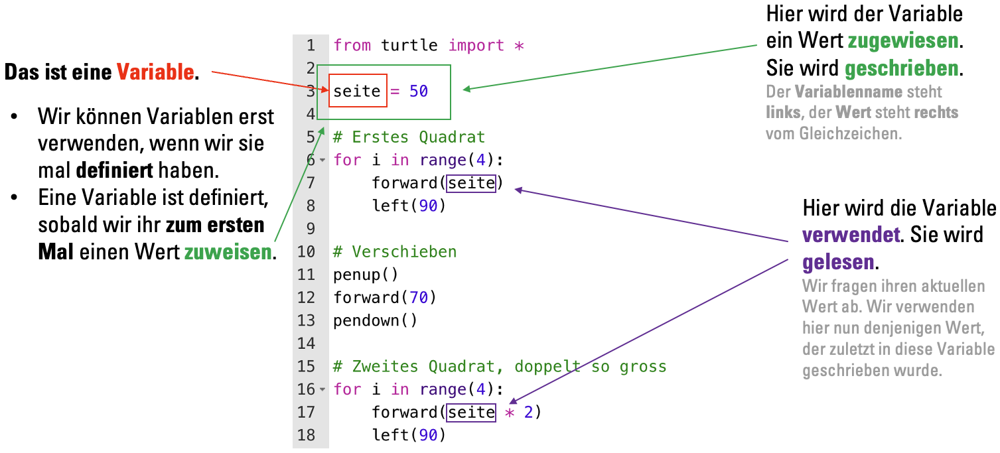
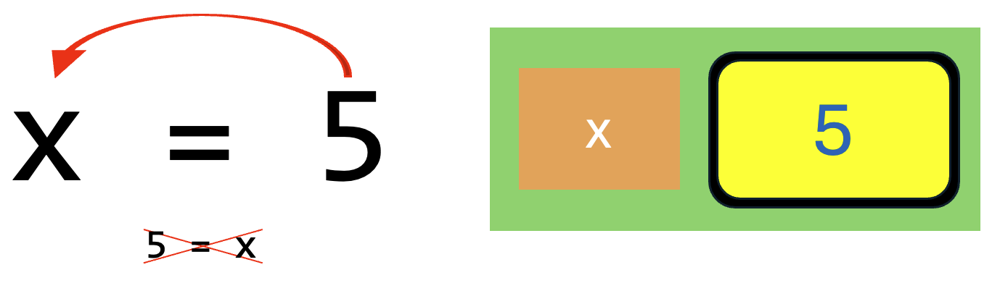
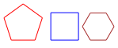

import { points, multipleChoicePoints } from '@tdev-components/documents/Assessable/helpers/scoring';

# Variablen und Datentypen
## Grundlagen


:::key[Keine Behauptung, sondern eine Anweisung…]
In der **Mathematik** kann `x = 5` als Behauptung gelesen werden: „x ist das gleiche wie 5“. Die Behauptung `x = 5` ist demnach gleichbedeutend mit `5 = x`. In der Mathematik ist es also egal, auf welcher Seite des Gleichheitszeichens die Variable steht.

Beim **Programmieren** ist das anders: Hier ist `x = 5` **keine Behauptung, sondern eine Anweisung**. Wir weisen den Computer an, den Wert der Variable `x` auf `5` zu setzen. Eine solche Anweisung hat eine **Richtung:** `x` wird auf `5` gesetzt, nicht umgekehrt. Die Reihenfolge ist deshalb entscheidend! Der _Datenfluss_ geht **von rechts nach links**: **Rechts** von Gleichzeichen steht der Wert, den wir in die Variable schreiben wollen. Links davon steht der **Name der Variable**.


:::

Variablen können ihren Wert im Laufe des Programms ändern (d.h. **überschrieben** werden):

::video[./img/Variablen-überschreiben.mp4]{autoplay loop=true}

## Variablennamen in Python
Variablennamen können mehr oder weniger frei gewählt werden. Es gibt aber einige **Regeln**, an die wir uns halten **müssen**. Zudem gibt es **Konventionen**, an die wir uns halten **sollten**.

### Harte Regeln
_Wenn wir diese Regeln nicht befolgen, können wir das Programm nicht ausführen._
:::rule[Nur alphanumerische Zeichen und Underscore]
Erlaubt sind nur **alphanumerische Zeichen** (also Gross- und Kleinbuchstaben, sowie Zahlen), sowie der **Underscore** (`_`). **Umlaute** (ä, ö, ü) und **Leerschläge** sind **nicht erlaubt**.
- ✅ `groesse_person_1`
- ❌ `grösse_person_1`
- ❌ `groesse person 1`

_**Hinweis:** Einige Python-Umgebungen (z.B. Classrooms) können inzwischen mit Umlauten umgehen. Trotzdem gilt es weiterhin als harte Regel, diese nicht zu verwenden, da sie in anderen Python-Umgebungen zu Problemen führen können._
:::

:::rule[Muss mit Buchstabe oder Underscore beginnen]
Ein Variablenname muss mit einem Buchstaben (oder mit einem Underscore (`_`)) beginnen (also nicht mit einer Zahl).
- ✅ `groesse_person_1`
- (✅ `_groesse_person_1` ← nur in ganz spezifischen Fällen[^1])
- ❌ `1_groesse_person`
:::

:::rule[Gross- und Kleinschreibung]
Die Gross- und Kleinschreibung wird berücksichtigt. `hallo` und `HaLLo` sind also zwei **unterschiedliche** Variablennamen.
:::

:::rule[Keine Python-Keywords]
Python-_Keywords_[^2] wie `for` und `import` dürfen **nicht** als Variablennamen verwendet werden.
:::

### Konventionen
_(Un)verbindliche Abmachungen, die uns dabei helfen, möglichst einheitlichen Python-Code schreiben. Es gehört zum guten Stil, dass wir uns daran halten._
:::convention[Keine Grossbuchstaben]
Wir verwenden nur Kleinbuchstaben, Zahlnen und Underscores. Keine Grossbuchstaben.
- ✅ `seite`
- ✅ `quadrat_2`
- ❌ `Quadrat`
:::

:::convention[Wörter trennen]
Wenn Variablen aus mehreren Wörtern bestehen, trennen wir die Wörter mit einem Underscore (`_`), damit sie lesbar bleiben.
- ✅ `anzahl_ecken`
- ❌ `anzahlecken`
:::

:::convention[Sinnvoll benennen]
Wir verwenden **sinnvolle, sprechende Namen** für Variablen. Der Name sollte möglichst genau beschreiben, was die Variable enthält. So können wir den Code später besser verstehen.

Anders als in der Mathematik verwenden wir beim Programmieren eher nicht Variablennamen wie `a` und `x`, da sie wenig über ihre Bedeutung aussagen. Wenn möglich, verwenden wir lieber _sprechende_ Variablennamen wie `seitenlaenge` oder `anzahl_seiten`.
:::

## Quiz
<Quiz randomizeQuestions randomizeOptions scoring={points(1)} keepExpanded={'correct'} resetMode='incorrect' id='55e6bdd1-5c25-4ac5-8937-73f930552b94'>
    <ChoiceAnswer correct={[3]}>
        ```py showLineNumbers
        a = 12
        b = 7
        b = a
        ```

        Welche Werte haben die Variablen `a` und `b` am Ende dieses Programms?

        1. `a` ist 12, `b` ist 7
        1. `a` ist 7, `b` ist 12
        2. beide 12
        3. beide 7
        4. Dieses Programm ist ungültig, es gibt einen Fehler.

        <Hint when={['correct']}>
          Das ist übrigens kein Turtle-Programm (wir brauchen nirgends Turtle-Befehle wie `forward()` oder `left()`), deshalb braucht es hier auch kein `from turtle import *`.
        </Hint>
    </ChoiceAnswer>
    <ChoiceAnswer correct={[1]}>
      Welche der folgenden Code-Zeilen zeigt das **Schreiben** einer Variable (der Variable wird ein Wert **zugewiesen**)?

      1. `x = 20`
      2. `forward(x)`
      3. `20 = x`
      4. `x`
    </ChoiceAnswer>
    <ChoiceAnswer correct={[2]}>
      Welche der folgenden Code-Zeilen zeigt das **Lesen** einer Variable (der in der Variablen gespeicherte Wert wird **verwendet**)?

      1. `x = 20`
      2. `forward(x)`
      3. `20 = x`
      4. `x`
    </ChoiceAnswer>
    <ChoiceAnswer multiple correct={[2, 3]} scoring={multipleChoicePoints(2, 1, false)}>
      Welche der folgenden Variablennamen sind korrekt (entsprechen sowohl den **harten Regeln** als auch den **Konventionen**)?

      1. `seitenlänge`
      2. `farbe`
      3. `groesse_baum`
      4. `x`
      5. `23_schneeflocken`
      6. `farbebaumstamm`
      7. `for`
    </ChoiceAnswer>
    <ChoiceAnswer multiple correct={[4, 6]} scoring={multipleChoicePoints(2, 1, false)}>
      Welche der folgenden Variablennamen halten sich zwar an die **harten Regeln** aber **nicht** an die **Konventionen**?

      1. `seitenlänge`
      2. `farbe`
      3. `groesse_baum`
      4. `x`
      5. `23_schneeflocken`
      6. `farbebaumstamm`
      7. `for`
    </ChoiceAnswer>
    <ChoiceAnswer correct={[3]}>
      ```py
      from turtle import *

      seite = 30
      ecken = 5

      for i in range(seite):
        forward(seite)
        left(360 / ecken)
      ```

      Wie viele Ecken wird diese Figur haben?

      1. 4
      2. 5
      3. 30
      4. 150
      5. Dieses Programm ist ungültig, es gibt einen Fehler.
    </ChoiceAnswer>
    <ChoiceAnswer multiple correct={[1, 5, 6]} scoring={multipleChoicePoints(2, 1, false)}>
      Welche Aussagen sind korrekt?

      1. Eine Variable gilt als **definiert**, sobald wir ihr zum ersten Mal einen Wert zuweisen.
      2. Wir können eine Variable auch schon verwenden, bevor wir sie definiert haben, solange die Definition später noch folgt.
      3. `x = 5` und `5 = x` sind in Python gleichwertig.
      4. Variablen können ihren Wert nicht ändern. Nachdem wir den Wert einer Variable einmal festgelegt haben, bleibt dieser konstant.
      5. Wenn wir eine nicht-definierte Variable verwenden, gibt es einen Fehler.
      6. Wenn wir bei der Benennung von Variablen bestimmte Regeln missachten, ist das Programm nicht ausführbar (es gibt einen Fehler).
    </ChoiceAnswer>
</Quiz>

## Programmieraufgaben
::::aufgabe[n-eck]
<TaskState id='0ee0a0e8-a937-4cfa-b09f-e5d552cd3499' />

Erweitern Sie das unten stehende angefangene (aber nicht fertige) Turtle-Programm so, dass ein **beliebiges** `n`-Eck mit Seitenlänge `seite` gezeichnet wird.

Mit den hier voreingestellten Werten würde also ein **Fünfeck** mit **Seitenlänge 100** gezeichnet. Sie sollen die
Werte aber auch z.B. zu `n = 3` und `seite = 150` ändern können, um in dem Fall ein Dreieck mit Seitenlänge 150 zu erhalten.

:::tip[Drehung]
Schlussendlich muss sich die Turtle bei einem beliebigen `n`-Eck immer einmal um insgesamt 360° drehen.
:::

```py live_py id=23452f22-1fed-4cb6-bbf0-13552234314b
from turtle import *

shape('turtle')

n = 5
seite = 100
```

<Solution id='689073ef-8de9-41ce-aaac-97f1701a4632'>
  ```py live_py readonly slim
  from turtle import *

  shape('turtle')

  n = 5
  seite = 100

  for i in range(5):
      forward(seite)
      left(360 / n)

  done()
  ```
</Solution>
::::

:::aufgabe[Fehler beheben]
<TaskState id="08760f00-93a0-4b07-bdfa-ed8b1e5ebc65" />
Beim unten stehenden Python-Programm gibt es einen Fehler. Das Programm ist momentan nicht ausführbar.

Analysieren Sie den Code und finden Sie das Problem. **Ergänzen** Sie **genau eine Zeile**, um das Problem zu lösen. Bestehende Zeilen (ausser Leerzeilen) dürfen **nicht verändert oder gelöscht werden**.

Am Schluss sollte die Zeichnung so aussehen:



```py live_py id=a5739362-ca69-4ba0-96df-570a9351a536
from turtle import *

penup()
back(100)
pendown()

pencolor('red')
for i in range(5):
    forward(30)
    left(72)

penup()
forward(abstand)
pendown()

pencolor('blue')
for i in range(4):
    forward(35)
    left(90)

penup()
forward(abstand)
pendown()

pencolor('brown')
for i in range(6):
    forward(20)
    left(60)
```

<Solution id="4f606ba7-ad0b-49ec-b363-6fca1af7e392">
```py live_py readonly slim
from turtle import *

penup()
back(100)
pendown()

abstand = 50  # Diese Zeile hat gefehlt, die Variable abstand war nicht definiert.

pencolor('red')
for i in range(5):
    forward(30)
    left(72)

penup()
forward(abstand)
pendown()

pencolor('blue')
for i in range(4):
    forward(35)
    left(90)

penup()
forward(abstand)
pendown()

pencolor('brown')
for i in range(6):
    forward(20)
    left(60)
```
</Solution>
:::


[^1]: Bei der _objektorientierten Programmierung_ (**nicht** Teil dieser Unterrichtseinheit) unterscheiden wir zwischen _privaten_ und _öffentlichen_ Variablen. _Private_ Variablen kennzeichnen wir mit einem `_` am Anfang des Variablennamens.
[^2]: Als _Keywords_ bezeichnen wir in Programmiersprachen «reservierte Wörter» – also Wörter mit einer besonderen Bedeutung. In Python sind das beispielsweise die Wörter `for`, `while`, `import`, `if` und einige mehr. Eine vollständige Liste aller Python-_Keywords_ finden Sie [hier](https://www.w3schools.com/python/python_ref_keywords.asp).