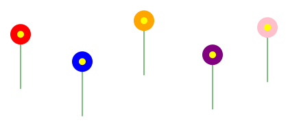
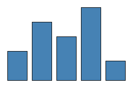
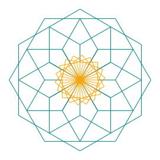

import { points } from '@tdev-components/documents/Assessable/helpers/scoring';

# Funktionen mit Parametern
Eine Funktion `quadrat()`, die immer ein Quadrat mit Seitenlänge 60 zeichnet, hilft uns nicht weiter, wenn wir ein grösseres Quadrat brauchen. Mit einem **Parameter** können wir einer Funktion beim Aufruf einen Wert mitgeben:

```py live_py slim
from turtle import *

def quadrat(seite):
    for i in range(4):
        forward(seite)
        left(90)

quadrat(50)
quadrat(100)
```

- **Parameter:** In der Definition schreiben wir einen Namen in die Klammern, hier `seite`. Innerhalb der Funktion verwenden wir `seite` wie eine Variable.
- **Argument:** Beim Aufruf schreiben wir den Wert in die Klammern, den der Parameter erhalten soll, hier zuerst `50` und dann `100`.

Als Argument können wir auch eine Variable oder eine Berechnung verwenden, z.B. `quadrat(groesse * 2)`. Python berechnet dann **zuerst den Wert** und übergibt erst diesen an den Parameter.

## Funktionen im Arbeitsspeicher
Das folgende Video zeigt, was bei Funktionsaufrufen im Arbeitsspeicher passiert.

::video[./img/Funktionen-und-Parameter.mp4]

Achten Sie besonders auf diese Punkte:
- Beim Aufruf wird für den Parameter `seite` ein **neuer Slot** beschriftet, und der Wert des Arguments wird hineingeschrieben. Übergeben wird nur der **Wert**: `seite_klein` bleibt unverändert.
- Wenn die Funktion fertig ist, werden die Slots von `seite` und `i` **abgeräumt**, denn sie gehören zur Funktion. Danach springt Python zurück zum Aufruf.

## Mehrere Parameter
Eine Funktion kann auch **mehrere Parameter** haben. Wir trennen sie mit Kommas, in der Definition genauso wie beim Aufruf. Das kennen Sie bereits von `goto(x, y)`.

```py live_py slim
from turtle import *

def rechteck(breite, hoehe):
    for i in range(2):
        forward(breite)
        left(90)
        forward(hoehe)
        left(90)

rechteck(120, 40)
```

Beim Aufruf `rechteck(120, 40)` erhält der erste Parameter (`breite`) den ersten Wert (`120`) und der zweite Parameter (`hoehe`) den zweiten Wert (`40`).

:::warning[Die Reihenfolge entscheidet, nicht der Name]
Python ordnet die Argumente den Parametern **nach ihrer Reihenfolge** zu. Wie die Variablen heissen, die wir beim Aufruf verwenden, spielt **keine Rolle**:

```py live_py slim
from turtle import *

def rechteck(breite, hoehe):
    for i in range(2):
        forward(breite)
        left(90)
        forward(hoehe)
        left(90)

breite = 120
hoehe = 40
rechteck(hoehe, breite)
```

Hier wird das Rechteck 40 Pixel breit und 120 Pixel hoch: Das erste Argument ist `hoehe`, also `40`, und dieser Wert landet im ersten Parameter `breite`.
:::

## Quiz
Lösen Sie das Quiz vollständig **von Hand**, ohne die Programme auszuführen.

<Quiz randomizeQuestions randomizeOptions scoring={points(1)} keepExpanded={'correct'} resetMode='incorrect' id='277478da-e873-4359-848e-eee20da9b287'>
    <ChoiceAnswer correct={[2]}>
        ```py
        def rechteck(breite, hoehe):
            for i in range(2):
                forward(breite)
                left(90)
                forward(hoehe)
                left(90)

        a = 30
        b = 80
        rechteck(b, a)
        ```

        Wie **breit** ist das gezeichnete Rechteck?

        1. 30 Pixel
        2. 80 Pixel
        3. 110 Pixel
        4. Es gibt einen Fehler, weil die Variablen nicht `breite` und `hoehe` heissen.
    </ChoiceAnswer>
    <ChoiceAnswer correct={[1]}>
        ```py
        def quadrat(seite):
            for i in range(4):
                forward(seite)
                left(90)

        seite_klein = 50
        quadrat(seite_klein + 10)
        ```

        Welcher Wert steht während des Aufrufs im Speicher-Slot des Parameters `seite`?

        1. `60`
        2. `50`
        3. `seite_klein + 10`
        4. `10`
    </ChoiceAnswer>
    <ChoiceAnswer correct={[3]}>
        ```py
        def punkt(groesse, farbe):
            pencolor(farbe)
            dot(groesse)

        punkt('red', 50)
        ```

        Was passiert, wenn man dieses Programm ausführt?

        1. Es wird ein roter Punkt mit Durchmesser 50 gezeichnet.
        2. Es wird ein schwarzer Punkt mit Durchmesser 50 gezeichnet.
        3. Es gibt einen Fehler.
        4. Es passiert nichts.
    </ChoiceAnswer>
    <ChoiceAnswer correct={[2]}>
        ```py
        def quadrat(seite):
            for i in range(4):
                forward(seite)
                left(90)

        quadrat(30)
        quadrat(60)
        ```

        Wie viele Quadrate werden gezeichnet?

        1. 1
        2. 2
        3. 3
        4. 0
    </ChoiceAnswer>
</Quiz>

## Aufgaben
::::aufgabe[Vielecke]
<TaskState id="9742f2f2-7e31-4359-84f5-4908686f520b" />

Definieren Sie eine Funktion `vieleck(n)`, die ein regelmässiges n-Eck mit Seitenlänge 60 zeichnet. `vieleck(5)` zeichnet also ein Fünfeck.

Zeichnen Sie damit dann alle Vielecke vom Dreieck bis zum Achteck, alle vom gleichen Startpunkt aus:


Verwenden Sie für die sechs Aufrufe eine `for`-Schleife.

:::tip[Tipps]
- Bei einem n-Eck muss sich die Turtle an jeder Ecke um `360 / n` Grad drehen.
- Der Schleifenzähler `i` beginnt bei `0`, das erste Vieleck hat aber `3` Ecken.
:::

```py live_py id=03054936-3be0-4483-93ed-2623d3957c65
from turtle import *
```

<Solution id="c259ba53-4edf-4367-bd5d-c2144f740d8e">
  ```py live_py readonly slim
  from turtle import *

  def vieleck(n):
      for i in range(n):
          forward(60)
          left(360 / n)

  for i in range(6):
      vieleck(i + 3)
  ```
</Solution>
::::

::::aufgabe[Bunte Blumenwiese]
<TaskState id="c1f93a92-3408-4ea6-a455-376d6c9ea005" />

Kopieren Sie Ihre Lösung zur Aufgabe «Blumenwiese» (Seite [Funktionen](../index.mdx)) in den Editor unten. Erweitern Sie die Funktion `blume()` um einen Parameter `farbe`, mit dem man die Farbe der Blüte festlegen kann.

Die fünf Blumen sollen dann von links nach rechts diese Blütenfarben haben: `red`, `blue`, `orange`, `purple`, `pink`.



```py live_py id=2db7d427-0ee7-4635-8d8b-2cfafe026278
```

<Solution id="4ac20c26-571f-4611-bb09-b7104bf98d28">
  ```py live_py readonly slim
  from turtle import *

  def blume(farbe):
      pencolor('green')
      left(90)
      forward(80)
      pencolor(farbe)
      dot(30)
      pencolor('yellow')
      dot(10)
      right(90)

  penup()
  goto(-180, -60)
  pendown()
  blume('red')

  penup()
  goto(-90, -100)
  pendown()
  blume('blue')

  penup()
  goto(0, -40)
  pendown()
  blume('orange')

  penup()
  goto(100, -90)
  pendown()
  blume('purple')

  penup()
  goto(180, -50)
  pendown()
  blume('pink')
  ```
</Solution>
::::

::::aufgabe[Balkendiagramm]
<TaskState id="68bbcb1f-0b12-4370-ad55-8c04126f9707" />

Zeichnen Sie dieses Balkendiagramm:



- Alle Balken sind 40 Pixel breit und mit der Farbe `steelblue` gefüllt.
- Die Balken sind (von links nach rechts) 60, 120, 90, 150 und 40 Pixel hoch.
- Zwischen zwei Balken sind jeweils 10 Pixel Abstand.

Definieren Sie dazu eine Funktion `rechteck(breite, hoehe)`, die ein gefülltes Rechteck zeichnet.

:::tip[Tipp]
Füllen können Sie mit `fillcolor(farbe)`, `begin_fill()` und `end_fill()` (siehe [Cheatsheet](../../05-Cheatsheet-Turtle-Befehle/index.mdx)).
:::

```py live_py id=4fbeb4e3-8476-4d73-adcc-dc3c06f075a2
from turtle import *

penup()
goto(-120, -100)
pendown()
```

<Solution id="56f081fb-2b06-4408-a11d-ebfd97f7df0f">
  ```py live_py readonly slim
  from turtle import *

  def rechteck(breite, hoehe):
      fillcolor('steelblue')
      begin_fill()
      for i in range(2):
          forward(breite)
          left(90)
          forward(hoehe)
          left(90)
      end_fill()

  def verschieben():
      penup()
      forward(50)
      pendown()

  penup()
  goto(-120, -100)
  pendown()

  rechteck(40, 60)
  verschieben()
  rechteck(40, 120)
  verschieben()
  rechteck(40, 90)
  verschieben()
  rechteck(40, 150)
  verschieben()
  rechteck(40, 40)
  ```
</Solution>
::::

::::aufgabe[Dorf mit verschiedenen Häusern]
<TaskState id="73153275-8c0c-4158-8ca1-23bb299a6ffe" />

Definieren Sie eine Funktion `haus(x, y, groesse)`, die ein Haus zeichnet, dessen linke untere Ecke an der Position `(x, y)` liegt. Das Quadrat und das Dach haben beide die Seitenlänge `groesse`.

Zeichnen Sie damit diese vier Häuser:

| Haus | `x` | `y` | `groesse` |
| ---- | --- | --- | --------- |
| 1 | -200 | -100 | 60 |
| 2 | -110 | -100 | 100 |
| 3 | 20 | -100 | 40 |
| 4 | 90 | -100 | 120 |


:::tip[Tipp]
Bewegen Sie die Turtle am Anfang der Funktion mit `goto(x, y)` an die richtige Position. Achten Sie darauf, dass sie dabei keine Linie zeichnet.
:::

```py live_py id=fe2789da-8cce-4ab2-b7db-67a04a4172ad
from turtle import *
```

<Solution id="7869fb25-8ed4-4509-a5d5-ed9747951519">
  ```py live_py readonly slim
  from turtle import *

  def haus(x, y, groesse):
      penup()
      goto(x, y)
      pendown()
      # Quadrat
      for i in range(4):
          forward(groesse)
          left(90)
      # nach oben zum Dach
      left(90)
      forward(groesse)
      right(90)
      # Dach
      for i in range(3):
          forward(groesse)
          left(120)
      # zurück zum Startpunkt
      right(90)
      forward(groesse)
      left(90)

  haus(-200, -100, 60)
  haus(-110, -100, 100)
  haus(20, -100, 40)
  haus(90, -100, 120)
  ```
</Solution>
::::

::::aufgabe[Schneegestöber mit Flocken in allen Grössen]
<TaskState id="e788984a-e321-444e-99f6-4c20f4edc610" />

Kopieren Sie Ihre Lösung zur Aufgabe «Schneegestöber» (Seite [Funktionen](../index.mdx)) in den Editor unten. Passen Sie sie so an, dass die Schneeflocken verschieden gross sind:

- Ändern Sie die Funktion zu `schneeflocke(x, y, groesse)`. Sie soll die Schneeflocke an der Position `(x, y)` zeichnen (die Funktion bewegt die Turtle also selbst dorthin).
- `groesse` ist die Länge eines Arms bis zur Verzweigung (bisher `20`). Die kleinen Zacken und das Stück nach der Verzweigung sind halb so lang.
- Zeichnen Sie 30 Schneeflocken mit zufälliger Position (x und y jeweils zwischen -220 und 220) und zufälliger Grösse (zwischen 5 und 30).

```py live_py id=37c54be4-08dc-44f7-8ef4-8544fa4344d2
```

<Solution id="7ce10c3d-764b-489c-8424-0ea402e53298">
  ```py live_py readonly slim
  from turtle import *
  from random import *

  def schneeflocke(x, y, groesse):
      penup()
      goto(x, y)
      pendown()
      for i in range(6):
          forward(groesse)
          left(45)
          forward(groesse / 2)
          back(groesse / 2)
          right(90)
          forward(groesse / 2)
          back(groesse / 2)
          left(45)
          forward(groesse / 2)
          back(groesse * 1.5)
          right(60)

  speed(0)
  hideturtle()
  bgcolor('midnightblue')
  pencolor('white')

  for i in range(30):
      schneeflocke(randint(-220, 220), randint(-220, 220), randint(5, 30))
  ```
</Solution>
::::

## ⭐️ Zusatzaufgaben
::::aufgabe[⭐️ Mandala]
<TaskState id="e3fb9b24-ca3d-40d6-b29c-86f30638a7c8" />

Definieren Sie eine Funktion `vieleck(n, seite)`, die ein regelmässiges n-Eck zeichnet. Gestalten Sie damit ein eigenes Mandala: Zeichnen Sie Vielecke in einer Schleife und drehen Sie die Turtle nach jedem Vieleck ein Stück weiter. Kombinieren Sie gerne mehrere Schleifen mit verschiedenen Vielecken, Grössen und Farben.

Zum Beispiel so:



```py live_py id=5fbe383c-b617-4eab-9b74-6caaa2b8771a
from turtle import *
```

<Solution id="40cef107-0eb6-42d1-96ff-586fd6660ab4">
  Eine mögliche Lösung (die zum Bild oben passt):

  ```py live_py readonly slim
  from turtle import *

  def vieleck(n, seite):
      for i in range(n):
          forward(seite)
          left(360 / n)

  speed(0)
  hideturtle()

  pencolor('teal')
  for i in range(12):
      vieleck(6, 60)
      left(30)

  pencolor('orange')
  for i in range(18):
      vieleck(4, 30)
      left(20)
  ```
</Solution>
::::
