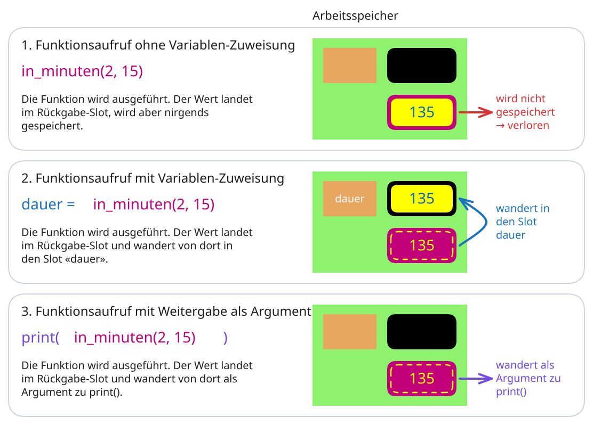
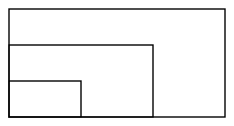

import { points } from '@tdev-components/documents/Assessable/helpers/scoring';

# 🔬 Verschachtelte Funktionsaufrufe
Bisher haben wir den Rückgabewert einer Funktion immer zuerst in einer Variable gespeichert. Wir können ihn aber auch **direkt als Argument** an eine andere Funktion übergeben:

```py live_py slim
def in_minuten(stunden, minuten):
    resultat = stunden * 60 + minuten
    return resultat

# mit Variable
dauer = in_minuten(2, 15)
print(dauer)

# direkt übergeben
print(in_minuten(2, 15))
```

Auf Zeile 10 steht der Aufruf von `in_minuten()` in den Klammern von `print()`. Das nennen wir einen **verschachtelten Funktionsaufruf**. Das kennen Sie eigentlich schon: Bei `dot(randint(5, 15))` wird der Rückgabewert von `randint()` direkt an `dot()` übergeben.

## Verschachtelte Aufrufe im Arbeitsspeicher
Das folgende Video zeigt, was bei einem verschachtelten Funktionsaufruf im Arbeitsspeicher passiert. Der Aufruf von `in_minuten()` steht dort in einem F-String, das Prinzip ist aber dasselbe.

::video[./img/Return-weitergeben.mp4]

Achten Sie besonders auf diese Punkte:
- `print()` muss warten: **Zuerst** wird `in_minuten(2, 15)` ausgeführt.
- Der Wert `135` aus dem Rückgabe-Slot tritt **an die Stelle des Aufrufs**. Erst jetzt wird `print()` ausgeführt.
- Es gibt keinen Slot `dauer`. Der Wert wurde zwar **verwendet**, aber nicht **gespeichert**: Nach dieser Zeile steht er nicht mehr zur Verfügung.

Damit haben wir drei Fälle:



:::key[Von innen nach aussen]
Python führt verschachtelte Aufrufe **von innen nach aussen** aus. Jeder Aufruf wird durch seinen Rückgabewert ersetzt:

```py
print(verdoppeln(plus_eins(4)))   # zuerst: plus_eins(4) → 5
print(verdoppeln(5))              # dann:   verdoppeln(5) → 10
print(10)                         # zuletzt: print(10)
```

`verdoppeln()` erhält als Argument also nicht `plus_eins(4)`, sondern den **Wert** `5`.
:::

<ChoiceAnswer randomizeOptions correct={[2]} title="In welcher Reihenfolge?" id="006965a6-231a-435f-8de4-ac84b03865f9">
    ```py showLineNumbers
    def verdoppeln(zahl):
        print('verdoppeln')
        return zahl * 2

    def plus_eins(zahl):
        print('plus_eins')
        return zahl + 1

    print(verdoppeln(plus_eins(4)))
    ```

    Was gibt dieses Programm aus?

    1. ```
       verdoppeln
       plus_eins
       10
       ```
    2. ```
       plus_eins
       verdoppeln
       10
       ```
    3. ```
       plus_eins
       verdoppeln
       9
       ```
    4. ```
       10
       plus_eins
       verdoppeln
       ```

    <Hint when={['correct']}>
        Genau! `plus_eins(4)` steht ganz innen und wird zuerst ausgeführt. Danach wird `verdoppeln(5)` ausgeführt und ganz am Schluss `print(10)`.
    </Hint>
    <Hint when={['incorrect']}>
        Gehen Sie von innen nach aussen vor: Welchen Wert braucht `print()`? Und welchen Wert braucht `verdoppeln()`, bevor es ausgeführt werden kann?
    </Hint>
</ChoiceAnswer>

## Mehrere Argumente
Auch bei mehreren Argumenten können wir Funktionsaufrufe einsetzen. Sie dürfen von verschiedenen Funktionen stammen:

```py live_py slim
def rechtecksflaeche(laenge, breite):
    return laenge * breite

def quadratsflaeche(seite):
    return seite * seite

def summe(a, b):
    return a + b

print(summe(rechtecksflaeche(4, 3), quadratsflaeche(5)))
```

Python wertet die Argumente der Reihe nach **von links nach rechts** aus. Erst wenn alle Werte bekannt sind, wird die Funktion aufgerufen:

```py
print(summe(rechtecksflaeche(4, 3), quadratsflaeche(5)))
print(summe(12, quadratsflaeche(5)))
print(summe(12, 25))
print(37)
```

:::tip[Klammern zählen]
Das Komma trennt die Argumente derjenigen Funktion, in deren Klammern es direkt steht. Wenn Sie im Editor neben eine Klammer klicken, wird die dazugehörige Klammer hervorgehoben.
:::

## Funktionsaufrufe in F-Strings
In den geschweiften Klammern eines F-Strings kann ebenfalls ein Funktionsaufruf stehen. Hier führt Python **zuerst** beide Aufrufe aus, setzt dann den Text zusammen und übergibt diesen fertigen Text an `print()`:

```py live_py slim
def in_minuten(stunden, minuten):
    return stunden * 60 + minuten

print(f'Hinfahrt: {in_minuten(2, 15)} Minuten, Rückfahrt: {in_minuten(1, 50)} Minuten')
```

## Speichern oder direkt übergeben?
Beide Ansätze sind **gleichwertig**. Keiner ist besser als der andere:

- **Direkt übergeben** ist kürzer.
- **In einer Variable speichern** ist oft klarer, denn die Variable gibt dem Wert einen Namen. Das hilft vor allem dann, wenn der Name der Funktion sehr allgemein ist: `randint(1, 6)` ist einfach eine Zufallszahl, `wurf` sagt uns, was sie bedeutet.

```py live_py slim
from random import *

# mit Variable
wurf = randint(1, 6)
print(wurf)

# direkt übergeben
print(randint(1, 6))
```

:::warning[Brauchen Sie den Wert mehrmals?]
Dann **müssen** Sie ihn in einer Variable speichern. Jeder Aufruf führt die Funktion nämlich neu aus. Hier würfeln wir **zweimal**, es können also zwei verschiedene Zahlen herauskommen:

```py live_py slim
from random import *

print(f'Sie haben eine {randint(1, 6)} gewürfelt.')
print(f'Sie dürfen {randint(1, 6)} Felder vorrücken.')
```
:::

## Quiz
Lösen Sie das Quiz vollständig **von Hand**, ohne die Programme auszuführen. In einigen Fragen werden diese drei Funktionen verwendet:

```py
def verdoppeln(zahl):
    return zahl * 2

def plus_eins(zahl):
    return zahl + 1

def differenz(a, b):
    return a - b
```

<Quiz randomizeQuestions randomizeOptions scoring={points(1)} keepExpanded={'correct'} resetMode='incorrect' id='940b262a-9da2-4f48-8495-b4aa1ffe0a3b'>
    <ChoiceAnswer correct={[1]}>
        ```py
        print(plus_eins(verdoppeln(5)))
        ```

        Was gibt dieses Programm aus?

        1. `11`
        2. `12`
        3. `10`
        4. `verdoppeln(5)`

        <Hint when={['correct']}>
            Genau! Zuerst wird `verdoppeln(5)` ausgeführt, danach `plus_eins(10)`.
        </Hint>
        <Hint when={['incorrect']}>
            Welcher Aufruf steht ganz innen? Ersetzen Sie ihn zuerst durch seinen Rückgabewert.
        </Hint>
    </ChoiceAnswer>
    <ChoiceAnswer correct={[3]}>
        ```py
        print(verdoppeln(plus_eins(3)))
        ```

        Welcher Wert steht im Slot des Parameters `zahl`, während `verdoppeln()` ausgeführt wird?

        1. `plus_eins(3)`
        2. `3`
        3. `4`
        4. `8`

        <Hint when={['correct']}>
            Genau! `plus_eins(3)` wird zuerst ausgeführt. An `verdoppeln()` wird nur noch der Rückgabewert `4` übergeben.
        </Hint>
        <Hint when={['incorrect']}>
            **Achtung:** Es geht nicht um die Ausgabe, sondern um den Wert in einem Variablen-Slot.
            
            In einem Slot steht immer ein **Wert**. Was ist bereits passiert, bevor `verdoppeln()` ausgeführt wird?
        </Hint>
    </ChoiceAnswer>
    <ChoiceAnswer correct={[4]}>
        ```py
        print(differenz(verdoppeln(5), plus_eins(2)))
        ```

        Was gibt dieses Programm aus?

        1. `3`
        2. `-7`
        3. `13`
        4. `7`

        <Hint when={['correct']}>
            Genau! Das erste Argument ist `10`, das zweite `3`. Also wird `differenz(10, 3)` ausgeführt.
        </Hint>
        <Hint when={['incorrect']}>
            Ersetzen Sie zuerst beide Argumente von `differenz()` durch ihren Wert, und behalten Sie dabei die Reihenfolge bei.
        </Hint>
    </ChoiceAnswer>
    <ChoiceAnswer correct={[2]}>
        ```py
        x = plus_eins(6)
        y = verdoppeln(x)
        print(y)
        ```

        Welche Zeile gibt dasselbe aus wie dieses Programm?

        1. `print(plus_eins(verdoppeln(6)))`
        2. `print(verdoppeln(plus_eins(6)))`
        3. `verdoppeln(plus_eins(print(6)))`
        4. `print(verdoppeln(plus_eins))`

        <Hint when={['correct']}>
            Genau! Was im Programm zuerst ausgeführt wird, steht in der verschachtelten Version ganz innen.
        </Hint>
        <Hint when={['incorrect']}>
            Im Programm wird zuerst `plus_eins(6)` ausgeführt und ganz am Schluss `print()`. Wo müssen die beiden stehen, wenn Python von innen nach aussen vorgeht?
        </Hint>
    </ChoiceAnswer>
    <ChoiceAnswer correct={[3]}>
        ```py
        from random import *

        print(verdoppeln(randint(1, 6)))
        ```

        Welche Aussage stimmt?

        1. Das Programm würfelt zweimal.
        2. Das Programm gibt immer eine Zahl zwischen 1 und 6 aus.
        3. Das Programm gibt immer eine gerade Zahl aus.
        4. Es gibt einen Fehler, weil `randint()` nicht in einer Variable gespeichert wird.

        <Hint when={['correct']}>
            Genau! `randint(1, 6)` wird **einmal** ausgeführt. Die gewürfelte Zahl wird verdoppelt und ist damit immer gerade.
        </Hint>
        <Hint when={['incorrect']}>
            Wie oft wird `randint()` hier aufgerufen? Was passiert mit dem Rückgabewert, bevor er ausgegeben wird?
        </Hint>
    </ChoiceAnswer>
    <ChoiceAnswer correct={[1]}>
        ```py
        def verdreifachen(zahl):
            print(zahl * 3)

        print(verdreifachen(2))
        ```

        Was gibt dieses Programm aus?

        1. ```
           6
           None
           ```
        2. ```
           6
           ```
        3. ```
           6
           6
           ```
        4. ```
           None
           ```

        <Hint when={['correct']}>
            Genau! `verdreifachen(2)` gibt `6` aus, hat aber kein `return`. An das äussere `print()` wird deshalb `None` übergeben.
        </Hint>
        <Hint when={['incorrect']}>
            Schauen Sie sich `verdreifachen()` genau an: Wird der Wert zurückgegeben oder nur ausgegeben? Was erhält das äussere `print()` als Argument?
        </Hint>
    </ChoiceAnswer>
    <ChoiceAnswer correct={[4]}>
        Wann **müssen** wir einen Rückgabewert in einer Variable speichern, statt ihn direkt zu übergeben?

        1. immer, denn das ist der bessere Ansatz
        2. wenn die Funktion mehrere Parameter hat
        3. wenn der Wert in einem F-String verwendet wird
        4. wenn wir denselben Wert mehrmals brauchen

        <Hint when={['correct']}>
            Genau! Ein direkt übergebener Wert steht danach nicht mehr zur Verfügung. Sonst sind beide Ansätze gleichwertig.
        </Hint>
        <Hint when={['incorrect']}>
            Was passiert mit einem Rückgabewert, nachdem er direkt übergeben wurde?
        </Hint>
    </ChoiceAnswer>
</Quiz>

## Aufgaben
:::info[Direkt übergeben]
Beide Ansätze sind gleichwertig. In den folgenden Aufgaben geht es aber darum, das **direkte Übergeben** zu üben. Speichern Sie Rückgabewerte also nur dann in einer Variable, wenn es in der Aufgabe ausdrücklich verlangt wird.
:::

::::aufgabe[Variablen einsparen]
<TaskState id="6b6c7f97-151c-4dbc-9f18-946b98e6301a" />

Das Programm im Editor unten speichert jeden Rückgabewert in einer Variable. Schreiben Sie den Teil nach den Funktionsdefinitionen so um, dass er **ohne Variablen** auskommt. Das Programm soll weiterhin dasselbe ausgeben:

```
30
16.0
Dach: 20.0 m2
```

Nach den Funktionsdefinitionen soll Ihr Programm nur noch aus **drei Zeilen** bestehen, und darin darf **kein Gleichzeichen** mehr vorkommen.

:::tip[Tipp]
Gehen Sie bei jedem `print()` vom Variablennamen aus: Welcher Funktionsaufruf liefert diesen Wert? Setzen Sie diesen Aufruf anstelle der Variable ein.
:::

```py live_py id=987b9059-c733-4f59-89dc-eb5fa84a64bb
def rechtecksflaeche(laenge, breite):
    return laenge * breite

def haelfte(zahl):
    return zahl / 2


garten = rechtecksflaeche(6, 5)
print(garten)

balkon = rechtecksflaeche(8, 4)
schatten = haelfte(balkon)
print(schatten)

rechteck = rechtecksflaeche(10, 4)
dach = haelfte(rechteck)
print(f'Dach: {dach} m2')
```

<Solution id="a06fc728-c4a1-4cb0-a34b-51a2f54a1f7b">
  ```py live_py readonly slim
  def rechtecksflaeche(laenge, breite):
      return laenge * breite

  def haelfte(zahl):
      return zahl / 2


  print(rechtecksflaeche(6, 5))
  print(haelfte(rechtecksflaeche(8, 4)))
  print(f'Dach: {haelfte(rechtecksflaeche(10, 4))} m2')
  ```
</Solution>
::::

::::aufgabe[Verschachtelung auflösen]
<TaskState id="80034b54-f5f2-4199-b01c-2f88c0755556" />

Jetzt machen wir es umgekehrt. Das Programm im Editor unten berechnet die Gesamtfläche einer Wohnung mit einem rechteckigen Wohnzimmer (6 m × 4 m) und einem quadratischen Schlafzimmer (3 m × 3 m).

Ersetzen Sie die letzte Zeile durch **vier Zeilen**: Speichern Sie jeden Rückgabewert in einer Variable mit einem **aussagekräftigen Namen**, und geben Sie am Schluss das Ergebnis aus. Es darf kein Funktionsaufruf mehr in einem anderen stehen.

:::tip[Tipp]
Beginnen Sie mit dem Aufruf, den Python zuerst ausführt.
:::

```py live_py id=b63ee890-c1fd-479f-bad1-2fb6b06a3b52
def rechtecksflaeche(laenge, breite):
    return laenge * breite

def quadratsflaeche(seite):
    return seite * seite

def summe(a, b):
    return a + b


print(summe(rechtecksflaeche(6, 4), quadratsflaeche(3)))
```

<Solution id="4a54b6d5-0e4e-4602-b92b-64089521d39d">
  ```py live_py readonly slim
  def rechtecksflaeche(laenge, breite):
      return laenge * breite

  def quadratsflaeche(seite):
      return seite * seite

  def summe(a, b):
      return a + b


  wohnzimmer = rechtecksflaeche(6, 4)
  schlafzimmer = quadratsflaeche(3)
  wohnung = summe(wohnzimmer, schlafzimmer)
  print(wohnung)
  ```
</Solution>
::::

::::aufgabe[Massstab]
<TaskState id="ee2e2e0b-d6cd-424b-aa8b-7713483842ab" />

Ein Zentimeter entspricht in dieser Aufgabe 40 Pixeln. Die Turtle soll drei Rechtecke zeichnen, alle vom gleichen Startpunkt aus: 2 cm × 1 cm, 4 cm × 2 cm und 6 cm × 3 cm (Breite × Höhe).



1. Definieren Sie eine Funktion `in_pixel(zentimeter)`, die eine Länge in Pixel umrechnet und das Ergebnis **zurückgibt**.
2. Rufen Sie `rechteck()` dreimal auf. Verwenden Sie `in_pixel()` für jede Breite und jede Höhe und übergeben Sie die Rückgabewerte **direkt**, also **ohne Variablen**. Die Pixelwerte dürfen Sie nicht selbst ausrechnen.

Die Funktion `rechteck()` dürfen Sie **nicht verändern**.

```py live_py id=70117c42-52fa-4c40-8cda-e20c77281463
from turtle import *

def rechteck(breite, hoehe):
    for i in range(2):
        forward(breite)
        left(90)
        forward(hoehe)
        left(90)

# 1. Definieren Sie hier die Funktion in_pixel(zentimeter)


# 2. Zeichnen Sie hier die drei Rechtecke

```

<Solution id="75885345-ec57-4d25-b6d7-fc6a09e1db8e">
  ```py live_py readonly slim
  from turtle import *

  def rechteck(breite, hoehe):
      for i in range(2):
          forward(breite)
          left(90)
          forward(hoehe)
          left(90)

  def in_pixel(zentimeter):
      return zentimeter * 40

  rechteck(in_pixel(2), in_pixel(1))
  rechteck(in_pixel(4), in_pixel(2))
  rechteck(in_pixel(6), in_pixel(3))
  ```
</Solution>
::::

::::aufgabe[Amerikanisches Wetter]
<TaskState id="7f6b1d1d-f1cb-4943-8f26-92e2e3e9e422" />

In den USA werden Temperaturen in Grad Fahrenheit angegeben. Das Programm soll zwei Temperaturen in Grad Celsius umrechnen, ihren Mittelwert berechnen und Folgendes ausgeben:

```
New York: 10.0 °C
Miami: 20.0 °C
Mittelwert: 15.0 °C
```

Die beiden Variablen im Editor unten sind vorgegeben. Legen Sie **keine weiteren Variablen** an.

1. Definieren Sie die Funktionen `in_celsius(fahrenheit)` und `mittelwert(a, b)`, die ihr Ergebnis jeweils **zurückgeben**.
2. Schreiben Sie für jede Zeile der Ausgabe ein `print()` mit einem F-String. Setzen Sie die Funktionsaufrufe **direkt** in die F-Strings ein. Rechnen dürfen nur die Funktionen.

:::tip[Formeln]
- $\text{Celsius} = (\text{Fahrenheit} - 32) \cdot 5 / 9$
- $\text{Mittelwert} = (a + b) / 2$
:::

:::tip[Tipp zum Mittelwert]
Gesucht ist der Mittelwert der Temperaturen **in Grad Celsius**. Welche zwei Argumente braucht `mittelwert()` also?
:::

```py live_py id=f4243a08-93e7-4bd3-ab0d-a175f0a29c0b
# 1. Definieren Sie hier die beiden Funktionen


new_york_fahrenheit = 50
miami_fahrenheit = 68

# 2. Schreiben Sie hier die drei print()-Zeilen

```

<Solution id="fa7117ee-3c12-43d3-adb0-f72a411fd37c">
  ```py live_py readonly slim
  def in_celsius(fahrenheit):
      return (fahrenheit - 32) * 5 / 9

  def mittelwert(a, b):
      return (a + b) / 2

  new_york_fahrenheit = 50
  miami_fahrenheit = 68

  print(f'New York: {in_celsius(new_york_fahrenheit)} °C')
  print(f'Miami: {in_celsius(miami_fahrenheit)} °C')
  print(f'Mittelwert: {mittelwert(in_celsius(new_york_fahrenheit), in_celsius(miami_fahrenheit))} °C')
  ```
</Solution>
::::

## ⭐️ Zusatzaufgaben
::::aufgabe[⭐️ Zahlentrick]
<TaskState id="3c08bd84-2c97-44e7-bb7d-e820014ce5b8" />

Ein bekannter Zahlentrick geht so: Denken Sie sich eine Zahl aus. Verdoppeln Sie sie, zählen Sie 10 dazu und halbieren Sie das Ergebnis. Ziehen Sie zum Schluss die gedachte Zahl wieder ab. Das Resultat ist immer dasselbe!

Alle nötigen Funktionen sind im Editor unten vorgegeben. Ergänzen Sie das Programm um **eine einzige Zeile**, die den Trick für die Zahl in `gedachte_zahl` durchführt und das Resultat ausgibt.

Warum braucht es hier die Variable `gedachte_zahl`?

:::warning[Zu beachten]
Rechnen dürfen nur die Funktionen. Auf Ihrer `print`-Zeile darf kein `+`, `-`, `*` oder `/` vorkommen.
:::

:::tip[Tipp]
Beginnen Sie ganz innen mit dem ersten Schritt (Verdoppeln) und bauen Sie Schritt für Schritt nach aussen.
:::

```py live_py id=5e8d4c74-f4df-4e78-9a67-5395b8428463
from random import *

def verdoppeln(zahl):
    return zahl * 2

def halbieren(zahl):
    return zahl / 2

def summe(a, b):
    return a + b

def differenz(a, b):
    return a - b

gedachte_zahl = randint(1, 100)

# --- Schreiben Sie hier die passende print(...)-Zeile ---

# --------------------------------------------------------
```

<Solution id="9bd700f9-fbe3-4ab1-89c9-b4b945631d4c">
  ```py live_py readonly slim
  from random import *

  def verdoppeln(zahl):
      return zahl * 2

  def halbieren(zahl):
      return zahl / 2

  def summe(a, b):
      return a + b

  def differenz(a, b):
      return a - b

  gedachte_zahl = randint(1, 100)
  print(differenz(halbieren(summe(verdoppeln(gedachte_zahl), 10)), gedachte_zahl))
  ```

  Das Resultat ist immer `5.0`.

  Die Variable braucht es, weil wir die gedachte Zahl **zweimal** verwenden: beim Verdoppeln und beim Abziehen. Würden wir beide Male `randint(1, 100)` direkt einsetzen, wären das zwei verschiedene Aufrufe, und die Zahlen wären meistens nicht gleich.
</Solution>
::::
