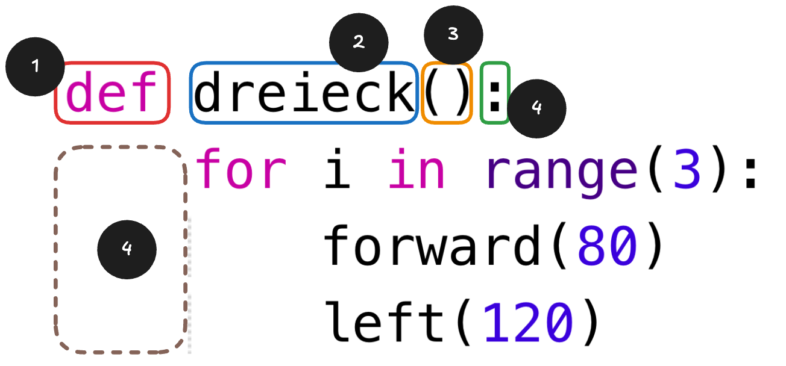
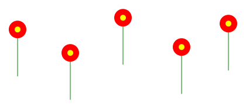
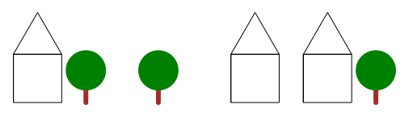
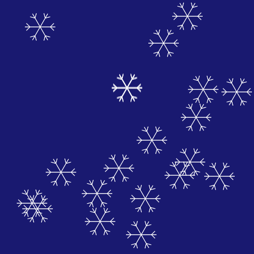
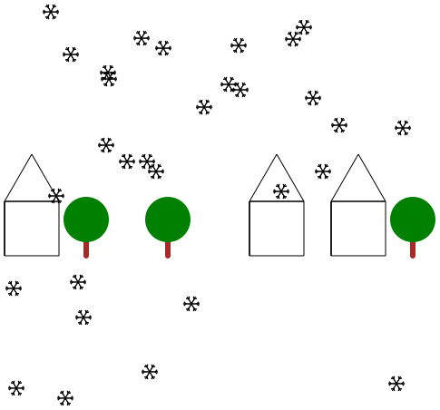

# Funktionen
Mit einer **Funktion** geben wir einem Stück Code einen Namen. Danach können wir den Code über diesen Namen beliebig oft ausführen.

```py live_py slim
from turtle import *

def dreieck():
    for i in range(3):
        forward(80)
        left(120)

dreieck()
right(180)
dreieck()
```

**Definition** (Zeilen 3 bis 6): Hier legen wir fest, _was_ die Funktion `dreieck` tun soll. Achten Sie auf:

:mdi[numeric-1-circle]
: das Schlüsselwort **`def`** (für _define_), gefolgt vom **Namen** der Funktion (es gelten die gleichen Regeln wie für Variablennamen)
:mdi[numeric-2-circle]
: die runden **Klammern** `()` nach dem Namen
:mdi[numeric-3-circle]
: der **Doppelpunkt** `:` am Ende der Zeile
:mdi[numeric-4-circle]
: die **Einrückung**: Alles, was eingerückt unter der `def`-Zeile steht, gehört zur Funktion (genau wie bei einer `for`-Schleife)



:::warning[Aufruf]
Die Definition allein tut noch **nichts**. Erst wenn wir die Funktion mit `dreieck()` (z.B. Zeile 8) **aufrufen**, wird ihr Code ausgeführt, und zwar so oft, wie wir sie aufrufen.
:::

:::insight[Existierende Befehle]
Auf den Zeilen 8 und 10 führen wir mit `dreieck()` die Funktion `dreieck` aus. Genau gleich führen wir auf Zeile 9 mit `right(180)` die Funktion `right` aus. Der einzige Unterschied ist, dass wir `dreieck` selber definiert haben, während `right` aus dem Turtle-Modul stammt und mit `from turtle import *` zur Verfügung gestellt wird.
:::

## Programmablauf mit Funktionen
Das folgende Video zeigt, in welcher Reihenfolge Python ein Programm mit Funktionen ausführt.

::video[./img/Programmablauf-mit-Funktionen.mp4]

Achten Sie besonders auf diese Punkte:
- Bei den `def`-Zeilen merkt sich Python die Funktionen nur (oben rechts: «Verfügbare (neue) Funktionen»). Der eingerückte Code wird dabei **übersprungen**.
- Bei einem Aufruf springt Python zur Definition und führt den Code der Funktion aus. Danach geht es **zurück zum Aufruf** und mit der nächsten Zeile weiter.
- `witz_3` wird **nie aufgerufen** und deshalb auch nie ausgeführt. Die Reihenfolge der Ausgabe bestimmen die Aufrufe, nicht die Definitionen.

<ChoiceAnswer correct={[3]} title="Reihenfolge der Aufrufe" id="9dc060fd-b691-4510-938e-1c5675f71991">
Was würde passieren, wenn wir im Code-Beispiel aus dem Video zuerst `witz_2()` und **danach** `witz_1()` aufrufen würden?

```py showLineNumbers=15 {3,4}
# ...
print('Hallo!')
witz_2()
witz_1()
print('Ich hoffe, die Witze haben dir gefallen.')
verabschieden()
```

1. Das macht keinen Unterschied, die Ausgabe bleibt gleich.
2. Es gibt einen Fehler, weil `witz_1` vor `witz_2` definiert wurde.
3. Es wird zuerst der Witz von `witz_2` ausgegeben, danach der von `witz_1`.
4. Es gibt keine Ausgabe.
</ChoiceAnswer>

:::key[Zuerst definieren, dann aufrufen]
Das kennen Sie bereits von Variablen: Eine Variable können wir erst verwenden, nachdem wir ihr einen Wert zugewiesen haben. Vorher gibt es im Arbeitsspeicher keinen Slot mit ihrem Namen. Bei Funktionen ist es genauso: Erst mit der Definition wird die Funktion bei Python «registriert». Steht der Aufruf vor der Definition, gibt es einen Fehler:

```py live_py slim
gruss()

def gruss():
    print('Hallo!')
```

Funktionsdefinitionen stehen deshalb **zuoberst** im Programm, direkt nach den `import`-Zeilen.
:::

:::key[Klammern auch ohne Parameter]
Beim Aufruf braucht es **immer** die Klammern, auch wenn sie leer sind: `dreieck()`, nicht `dreieck`. Das kennen Sie bereits von Befehlen wie `penup()`.

Der Name `dreieck` allein bezeichnet nur die Funktion selbst. Erst die Klammern sagen Python: «**Führe diese Funktion jetzt aus!**» Steht nur `dreieck` ohne Klammern im Programm, passiert deshalb nichts, und zwar **ohne Fehlermeldung**.
:::

::::aufgabe[Fehlersuche]
<TaskState id="9dd396f9-a709-4c96-a8aa-3a62df8bede0" />

Das Programm im Editor unten soll ein Quadrat, ein Dreieck und ein weiteres Quadrat nebeneinander zeichnen:


Führen Sie das Programm aus. Es gibt keine Fehlermeldung, die Zeichnung stimmt aber trotzdem nicht. Finden und beheben Sie die **zwei Fehler**.

:::tip[Tipp]
Vergleichen Sie, welche Funktionen **definiert** und welche (korrekt) **aufgerufen** werden. Wie viele Quadrate sehen Sie, und wo?
:::

```py live_py id=62f25cba-ea57-4140-a292-3bb9ceeadf7c
from turtle import *

def quadrat():
    for i in range(4):
        forward(60)
        left(90)

def dreieck():
    for i in range(3):
        forward(60)
        left(120)

def verschieben():
    penup()
    forward(80)
    pendown()

quadrat()
verschieben
quadrat()
```

<Solution id="7f8da142-2091-4d14-9bb9-5f5c2cb0e1ac">
  ```py live_py readonly slim
  from turtle import *

  def quadrat():
      for i in range(4):
          forward(60)
          left(90)

  def dreieck():
      for i in range(3):
          forward(60)
          left(120)

  def verschieben():
      penup()
      forward(80)
      pendown()

  quadrat()
  verschieben()
  dreieck()
  verschieben()
  quadrat()
  ```

  Die zwei Fehler:
  1. **`verschieben` ohne Klammern** (Zeile 19): Die Funktion wird nicht ausgeführt. Deshalb wird das zweite Quadrat genau auf das erste gezeichnet.
  2. **`dreieck()` wird nie aufgerufen**: Eine Definition allein zeichnet nichts. Es fehlen die Aufrufe `dreieck()` und ein weiteres `verschieben()`.
</Solution>
::::

## Aufgaben
::::aufgabe[Blumenwiese]
<TaskState id="f286ab90-18e4-480d-891d-c02e35d003f1" />

Zeichnen Sie diese Blumenwiese mit fünf Blumen:



Jede Blume besteht aus:
- einem grünen Stiel, der 80 Pixel nach oben geht,
- einer roten Blüte (`dot(30)`) mit einem gelben Punkt in der Mitte (`dot(10)`).

Im Editor ist bereits Code vorgegeben, der die Turtle an die fünf Positionen bewegt. Definieren Sie eine Funktion `blume()`, die eine Blume zeichnet, und rufen Sie sie an den markierten Stellen auf.

:::tip[Blickrichtung]
Damit alle Blumen nach oben wachsen, sollte die Turtle am Ende der Funktion wieder in die gleiche Richtung schauen wie am Anfang (nach rechts).
:::

```py live_py id=a24d51ca-2e5d-4560-9a7b-4b6ab7a7d107
from turtle import *

# Definieren Sie hier die Funktion blume()...


penup()
goto(-180, -60)
pendown()
# Funktion hier aufrufen

penup()
goto(-90, -100)
pendown()
# Funktion hier aufrufen

penup()
goto(0, -40)
pendown()
# Funktion hier aufrufen

penup()
goto(100, -90)
pendown()
# Funktion hier aufrufen

penup()
goto(180, -50)
pendown()
# Funktion hier aufrufen
```

<Solution id="70204e69-d5e5-49e8-a289-aef6b105ab17">
  ```py live_py readonly slim
  from turtle import *

  def blume():
      pencolor('green')
      left(90)
      forward(80)
      pencolor('red')
      dot(30)
      pencolor('yellow')
      dot(10)
      right(90)

  penup()
  goto(-180, -60)
  pendown()
  blume()

  penup()
  goto(-90, -100)
  pendown()
  blume()

  penup()
  goto(0, -40)
  pendown()
  blume()

  penup()
  goto(100, -90)
  pendown()
  blume()

  penup()
  goto(180, -50)
  pendown()
  blume()
  ```
</Solution>
::::

::::aufgabe[Dorf]
<TaskState id="82533830-601f-4332-9cc7-8c66a55eabd7" />

Zeichnen Sie dieses Dorf:



- Ein **Haus** besteht aus einem Quadrat mit Seitenlänge 60 und einem gleichseitigen Dreieck mit Seitenlänge 60 als Dach.
- Ein **Baum** besteht aus einem braunen Stamm (Länge 40, Stiftbreite 6) und einer grünen Krone (`dot(50)`).
- Von links nach rechts: Haus, Baum, Baum, Haus, Haus, Baum.
- Zwischen zwei Elementen bewegt sich die Turtle jeweils 90 Pixel nach rechts, ohne zu zeichnen.

Definieren Sie die Funktionen `haus()`, `baum()` und `verschieben()` und zeichnen Sie das Dorf damit.

:::tip[Tipps]
- Sorgen Sie dafür, dass die Turtle am Ende von `haus()` und `baum()` wieder **am Startpunkt** steht und **nach rechts** schaut. Dann funktioniert `verschieben()` nach jedem Element gleich.
- Vergessen Sie im Baum nicht, Stiftbreite und Farbe am Schluss wieder zurückzusetzen (`pensize(1)`, `pencolor('black')`).
:::

```py live_py id=8ca1e865-f68b-40f0-9c90-3e2e81341652
from turtle import *

# Hier die Funktionen definieren...


penup()
goto(-230, -50)
pendown()

# Hier die Funktionen aufrufen, um das Dorf zu zeichnen...
```

<Solution id="6874573c-3186-43ef-9191-2cbe934633b9">
  ```py live_py readonly slim
  from turtle import *

  def haus():
      # Quadrat
      for i in range(4):
          forward(60)
          left(90)
      # nach oben zum Dach
      left(90)
      forward(60)
      right(90)
      # Dach
      for i in range(3):
          forward(60)
          left(120)
      # zurück zum Startpunkt
      right(90)
      forward(60)
      left(90)

  def baum():
      pencolor('brown')
      pensize(6)
      left(90)
      forward(40)
      pencolor('green')
      dot(50)
      penup()
      back(40)
      pendown()
      right(90)
      pensize(1)
      pencolor('black')

  def verschieben():
      penup()
      forward(90)
      pendown()

  penup()
  goto(-230, -50)
  pendown()

  haus()
  verschieben()
  baum()
  verschieben()
  baum()
  verschieben()
  haus()
  verschieben()
  haus()
  verschieben()
  baum()
  ```

  Ohne Funktionen bräuchten Sie den Code für ein Haus dreimal, den für einen Baum ebenfalls.
</Solution>
::::

::::aufgabe[Schneegestöber]
<TaskState id="96dbf783-d861-494c-89a9-e641e5ce5e1c" />

Der Code im Editor zeichnet eine Schneeflocke. Machen Sie daraus eine Funktion `schneeflocke()` und zeichnen Sie damit ein Schneegestöber, z.B. so:



- dunkelblauer Hintergrund (`bgcolor('midnightblue')`), weisse Schneeflocken
- 20 Schneeflocken an zufälligen Positionen (x und y jeweils zwischen -220 und 220)

:::tip[Tipps]
- Für die Zufallszahlen brauchen Sie `randint(min, max)` und `from random import *` (siehe [Zufall](../10-Zufall/index.mdx)).
- Mit `speed(0)` und `hideturtle()` geht das Zeichnen schneller.
:::

```py live_py id=9547953e-9528-40d4-814b-f1bde802c2a9
from turtle import *

for i in range(6):
    forward(20)
    left(45)
    forward(10)
    back(10)
    right(90)
    forward(10)
    back(10)
    left(45)
    forward(10)
    back(30)
    right(60)
```

<Solution id="03f3f2f7-9ec6-4dc5-ae5d-c98b961e376a">
  ```py live_py readonly slim
  from turtle import *
  from random import *

  def schneeflocke():
      for i in range(6):
          forward(20)
          left(45)
          forward(10)
          back(10)
          right(90)
          forward(10)
          back(10)
          left(45)
          forward(10)
          back(30)
          right(60)

  speed(0)
  hideturtle()
  bgcolor('midnightblue')
  pencolor('white')

  for i in range(20):
      penup()
      goto(randint(-220, 220), randint(-220, 220))
      pendown()
      schneeflocke()
  ```
</Solution>
::::

::::aufgabe[⭐️ Winterdorf]
<TaskState id="54d57e67-1b45-485b-bb8f-29a266a565b0" />

Kombinieren Sie Ihren Code aus den Aufgaben «Dorf» und «Schneegestöber», um ein Winterdorf zu zeichnen:



:::tip[Tipps]
- Machen Sie die Schneeflocken etwas kleiner, damit sie in das Dorf passen.
- Am besten definieren Sie am Anfang des Programms eine Variable `groesse_schneeflocke` und machen alle `forward()`-Befehle in der Funktion `schneeflocke()` davon abhängig. Dann können Sie die Grösse der Schneeflocken einfach ändern.
- Definieren Sie bei der Variable `groesse_schneeflocke` auch eine Variable `anzahl_schneeflocken` (in der Funktion `schneeflocke()` verwenden), damit Sie die Anzahl der Schneeflocken einfach ändern können.
:::

```py live_py id=a8b931b9-98b4-4c11-ac7a-486adac65155
```

<Solution id="742d6565-9b46-493a-8c3d-cc6beff21712">
```py live_py readonly slim
from turtle import *
from random import randint

groesse_schneeflocke = 6
anzahl_schneeflocken = 30

def haus():
    # Quadrat
    for i in range(4):
        forward(60)
        left(90)
    # nach oben zum Dach
    left(90)
    forward(60)
    right(90)
    # Dach
    for i in range(3):
        forward(60)
        left(120)
    # zurück zum Startpunkt
    right(90)
    forward(60)
    left(90)

def baum():
    pencolor('brown')
    pensize(6)
    left(90)
    forward(40)
    pencolor('green')
    dot(50)
    penup()
    back(40)
    pendown()
    right(90)
    pensize(1)
    pencolor('black')

def verschieben():
    penup()
    forward(90)
    pendown()

def schneeflocke():
    for i in range(6):
        forward(groesse_schneeflocke)
        left(45)
        forward(groesse_schneeflocke / 2)
        back(groesse_schneeflocke / 2)
        right(90)
        forward(groesse_schneeflocke / 2)
        back(groesse_schneeflocke / 2)
        left(45)
        forward(groesse_schneeflocke / 2)
        back(groesse_schneeflocke * 1.5)
        right(60)

# Vorbereitung fürs Zeichnen
hideturtle()
speed(100)
penup()
goto(-230, -50)
pendown()

# Dorf zeichnen
haus()
verschieben()
baum()
verschieben()
baum()
verschieben()
haus()
verschieben()
haus()
verschieben()
baum()

# Schneeflocken zeichnen
for i in range(anzahl_schneeflocken):
    penup()
    goto(randint(-220, 220), randint(-220, 220))
    pendown()
    schneeflocke()
```
</Solution>
::::