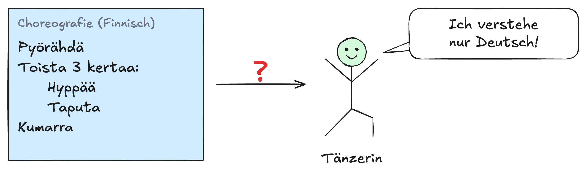
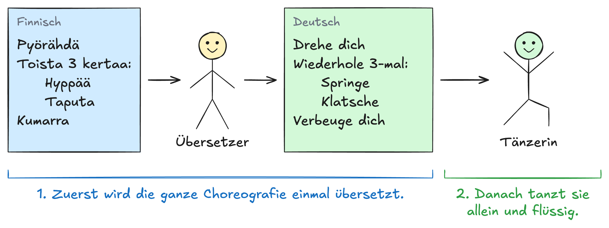
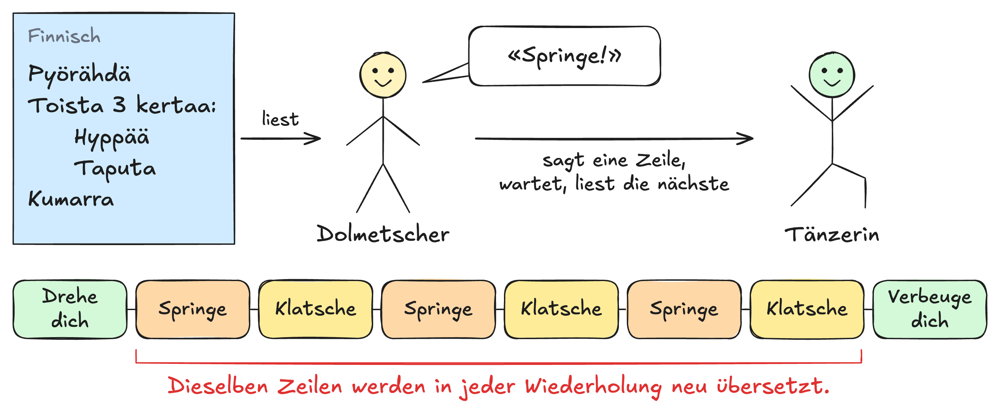
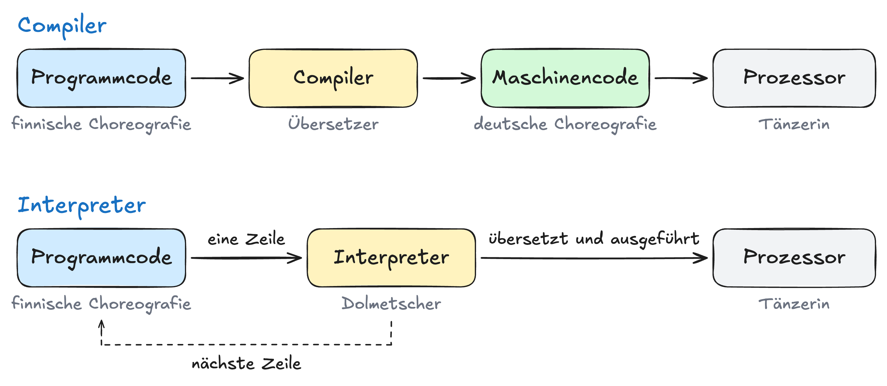
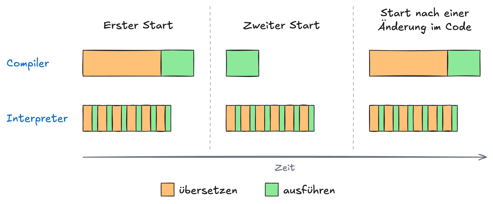
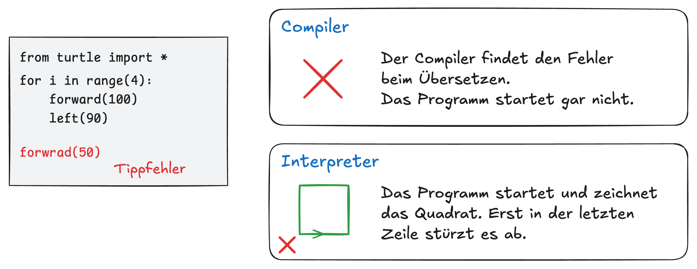
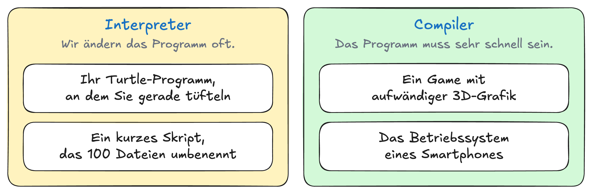

import { points } from '@tdev-components/documents/Assessable/helpers/scoring';

# Programmiersprachen, Compiler und Interpreter

## Natürliche und formale Sprachen
Jede Sprache besteht aus drei Bestandteilen:

Vokabular
: Der Wortschatz: Welche Wörter gibt es?
Syntax
: Die Grammatik: Wie dürfen die Wörter zu Sätzen zusammengesetzt werden?
Semantik
: Die Bedeutung: Was sagt ein Satz aus?

Deutsch oder Finnisch sind **natürliche Sprachen**. Programmiersprachen wie Python sind **formale Sprachen**:

| | Natürliche Sprache | Formale Sprache |
| --- | --- | --- |
| **Regeln** | werden beobachtet und beschrieben (_deskriptiv_) | werden definiert und vorgeschrieben (_präskriptiv_) |
| **Syntax** | flexibel, mit Ausnahmen | streng definiert, keine Ausnahmen |
| **Semantik** | manchmal mehrdeutig | streng definiert, immer eindeutig |
| **Fehler** | «Gehen wir Bahnhof» ist falsch, aber verständlich. | Schon ein kleiner Fehler macht das Programm ungültig. |

:::insight[Wer hat das Fernglas?]
«Die Frau sieht den Mann mit dem Fernglas.» Aus diesem Satz geht nicht hervor, wer das Fernglas hat. Menschen schliessen das meist aus dem Zusammenhang. Ein Computer kann nicht mitdenken: Wir müssen ihm präzise sagen, was wir meinen. Deshalb programmieren wir in einer formalen Sprache.
:::

## Vom Programmcode zur Maschinensprache
Der **Prozessor** ist der Teil des Computers, der Anweisungen ausführt. Er versteht diese Anweisungen aber nur in **Maschinensprache**, also als Nullen und Einsen. Unser **Programmcode** muss deshalb zuerst übersetzt werden. Das Ergebnis dieser Übersetzung heisst **Maschinencode**. Für das Übersetzen gibt es zwei Strategien, die wir uns an einem Beispiel anschauen.

Eine Tänzerin soll eine finnische Choreografie tanzen, versteht aber nur Deutsch. Sie ist in der gleichen Lage wie der **Prozessor**: Sie führt Anweisungen aus, aber nur solche in ihrer eigenen Sprache.



### Strategie 1: Alles im Voraus übersetzen
Ein Übersetzer schreibt die ganze Choreografie auf Deutsch auf. Erst danach beginnt die Tänzerin. Den Übersetzer braucht sie dann nicht mehr.



### Strategie 2: Zeile für Zeile dolmetschen
Ein Dolmetscher liest eine Zeile, übersetzt sie und wartet, bis sie getanzt ist. Dann folgt die nächste Zeile. Er muss bei jeder Aufführung dabei sein.



### Compiler und Interpreter
Übertragen wir das Beispiel auf den Computer:

| Beispiel | Computer |
| --- | --- |
| Die **Tänzerin** führt die Choreografie aus und versteht nur Deutsch. | Der **Prozessor** führt das Programm aus und versteht nur Maschinensprache. |
| Die **finnische Choreografie** | Der **Programmcode**, zum Beispiel in Python |
| Die **deutsche Choreografie** | Der **Maschinencode** |
| Der **Übersetzer** (Strategie 1) | Der **Compiler** |
| Der **Dolmetscher** (Strategie 2) | Der **Interpreter** |

Der Prozessor ist ein Bauteil. Compiler und Interpreter sind dagegen selbst Programme:

:::definition[Compiler und Interpreter]
Ein **Compiler** übersetzt den ganzen Programmcode im Voraus in Maschinencode. Der Maschinencode kann danach beliebig oft ohne den Compiler ausgeführt werden.

Ein **Interpreter** übersetzt den Programmcode während der Ausführung, Zeile für Zeile.
:::



### Maschinencode passt nicht auf jeden Computer
**Die** Maschinensprache gibt es nicht: Verschiedene Arten von Prozessoren haben verschiedene Maschinensprachen. Der Prozessor eines iPhones versteht zum Beispiel eine andere Maschinensprache als der Prozessor der meisten Windows-Laptops. Eine Tänzerin, die nur Spanisch versteht, kann ja auch mit der deutschen Choreografie nichts anfangen.

- **Compiler:** Der Maschinencode läuft nur auf Computern mit einem passenden Prozessor. Auch das Betriebssystem (z.B. Windows oder macOS) muss passen. Für andere Computer muss der Programmcode nochmals übersetzt werden. Deshalb werden viele Programme in mehreren Versionen angeboten, zum Beispiel eine für Windows und eine für macOS.
- **Interpreter:** Wir geben den Programmcode selbst weiter. Dieser kann auf allen Computern gleich bleiben, aber jeder Computer braucht einen passenden Interpreter.

## Die Unterschiede
### Geschwindigkeit


- **Compiler:** Das Übersetzen braucht zuerst Zeit. Danach läuft das Programm schnell, bis wir den Code ändern und neu übersetzen müssen.
- **Interpreter:** Das Programm startet sofort, auch nach einer Änderung. Dafür wird bei jedem Start wieder übersetzt. In einer Schleife werden dieselben Zeilen sogar in jeder Wiederholung neu übersetzt.

### Fehler


Der Compiler liest das ganze Programm, bevor es startet. Der Interpreter bemerkt den Tippfehler erst, wenn die fehlerhafte Zeile an der Reihe ist.

## Python ist interpretiert
Ist das gut oder schlecht? Es kommt auf das Programm an:



Für uns ist der Interpreter ein Vorteil: Wir probieren viel aus, ändern unsere Programme oft und sehen sofort, was passiert. Dass unsere Programme damit etwas langsamer laufen, merken wir meistens nicht.

:::insight[Eine bewusste Vereinfachung]
In Wirklichkeit sind die beiden Strategien nicht so klar getrennt. Auch Python liest den Code zuerst einmal ganz durch und übersetzt ihn in eine einfachere Zwischenform. Ein fehlender Doppelpunkt wird deshalb schon vor dem Start bemerkt, ein falsch geschriebener Name wie `forwrad` hingegen erst beim Ausführen der Zeile.
:::

## Quiz
<Quiz randomizeQuestions randomizeOptions scoring={points(1)} keepExpanded={'correct'} resetMode='incorrect' id='dd877b94-4e2d-4b08-959c-8d27a92588db'>
    <ChoiceAnswer correct={[2]}>
        Weshalb eignet sich Deutsch nicht als Programmiersprache?

        1. Deutsch hat zu wenige Wörter.
        2. Deutsche Sätze können mehrdeutig sein.
        3. Deutsch hat keine Syntax.
        4. Computer verstehen nur Englisch.

        <Hint when={['correct']}>
            Genau! Ein Programm muss eindeutig sein, weil der Computer nicht mitdenken kann.
        </Hint>
        <Hint when={['incorrect']}>
            Denken Sie an den Satz mit dem Fernglas.
        </Hint>
    </ChoiceAnswer>
    <ChoiceAnswer correct={[3]}>
        «Nach `for i in range(4)` muss ein Doppelpunkt stehen.» Zu welchem Bestandteil der Sprache Python gehört diese Regel?

        1. Vokabular
        2. Semantik
        3. Syntax
        4. Maschinensprache

        <Hint when={['correct']}>
            Richtig: Die Syntax legt fest, wie ein Programm aufgebaut sein muss.
        </Hint>
        <Hint when={['incorrect']}>
            Es geht hier weder um ein einzelnes Wort noch um eine Bedeutung.
        </Hint>
    </ChoiceAnswer>
    <ChoiceAnswer correct={[1]}>
        Im Beispiel mit der Choreografie: Welche Rolle hat die Tänzerin?

        1. Sie ist der Prozessor.
        2. Sie ist der Compiler.
        3. Sie ist der Interpreter.
        4. Sie ist der Maschinencode.

        <Hint when={['correct']}>
            Genau: Sie führt die Anweisungen aus, versteht aber nur eine Sprache.
        </Hint>
        <Hint when={['incorrect']}>
            Die Tänzerin führt die Anweisungen aus. Welcher Teil des Computers macht das?
        </Hint>
    </ChoiceAnswer>
    <ChoiceAnswer correct={[4]}>
        Ein Programm wurde mit einem Compiler übersetzt. Es soll nun auf einem zweiten Computer mit der **gleichen Art von Prozessor** und dem **gleichen Betriebssystem** laufen. Was muss auf dem zweiten Computer mindestens vorhanden sein?

        1. Der Programmcode
        2. Der Programmcode und der Compiler
        3. Der Maschinencode und der Compiler
        4. Der Maschinencode

        <Hint when={['correct']}>
            Richtig: Das Programm ist bereits fertig übersetzt, und der zweite Prozessor versteht die gleiche Maschinensprache.
        </Hint>
        <Hint when={['incorrect']}>
            Braucht die Tänzerin den Übersetzer noch, wenn sie die deutsche Choreografie hat?
        </Hint>
    </ChoiceAnswer>
    <ChoiceAnswer correct={[3]}>
        ```py showLineNumbers
        from turtle import *

        for i in range(6):
            forward(80)
            left(60)
        ```

        Wie oft übersetzt ein Interpreter, der sich nichts merkt, die Zeile 4?

        1. 1-mal
        2. 4-mal
        3. 6-mal
        4. 80-mal

        <Hint when={['correct']}>
            Genau: In jeder Wiederholung wird die Zeile neu übersetzt. Ein Compiler würde sie nur einmal übersetzen.
        </Hint>
        <Hint when={['incorrect']}>
            Wie oft wird diese Zeile ausgeführt?
        </Hint>
    </ChoiceAnswer>
    <ChoiceAnswer correct={[2]}>
        ```py showLineNumbers
        from turtle import *

        forward(100)
        left(90)
        forward(100)
        rihgt(90)
        forward(100)
        ```

        Auf Zeile 6 gibt es einen Tippfehler. Was passiert, wenn dieses Programm mit dem Python-Interpreter ausgeführt wird?

        1. Das Programm zeichnet nichts und zeigt eine Fehlermeldung an.
        2. Das Programm zeichnet zwei Linien und stürzt dann ab.
        3. Das Programm zeichnet drei Linien und zeigt am Schluss eine Fehlermeldung an.
        4. Das Programm überspringt Zeile 6 und zeichnet drei Linien.

        <Hint when={['correct']}>
            Richtig: Die Zeilen 3 bis 5 werden noch ausgeführt, danach ist Schluss.
        </Hint>
        <Hint when={['incorrect']}>
            Wann bemerkt ein Interpreter einen Tippfehler? Was macht er danach?
        </Hint>
    </ChoiceAnswer>
    <ChoiceAnswer correct={[1]}>
        Sie ändern in einem grossen Programm eine einzige Zeile und wollen es danach ausführen. Was stimmt?

        1. Mit einem Compiler muss das Programm vor dem Start neu übersetzt werden.
        2. Mit einem Interpreter muss vor dem Start das ganze Programm neu übersetzt werden.
        3. Mit einem Compiler startet das Programm sofort, weil es schon einmal übersetzt wurde.
        4. Sowohl mit Compiler als auch mit Interpreter läuft noch die alte Version.

        <Hint when={['correct']}>
            Genau. Der Interpreter liest beim nächsten Start einfach die neue Version.
        </Hint>
        <Hint when={['incorrect']}>
            Was müssten der Übersetzer und der Dolmetscher tun, wenn jemand die finnische Choreografie ändert?
        </Hint>
    </ChoiceAnswer>
</Quiz>

## Aufgabe
::::aufgabe[Compiler oder Interpreter?]
<TaskState id='ac92d184-297a-4200-90e9-ccb405cc4de7' />

Würden Sie für die folgenden Programme eher eine kompilierte oder eine interpretierte Sprache wählen? **Begründen** Sie Ihre Wahl.

1. Eine Forscherin schreibt ein Programm, das sie nur einmal braucht: Es zählt, wie oft ein bestimmtes Wort in einem Text vorkommt.
2. Eine Firma entwickelt eine App, die ein Video live bearbeitet: 60 Bilder pro Sekunde, ohne spürbare Verzögerung.

<QuillV2 id='58a7aa61-6e85-462c-9326-f2b66c72d403' />

<Solution id='6f7d537f-89a8-4e2e-bc2c-d063005a5462'>
  1. **Interpretiert:** Das Programm wird nur einmal gebraucht. Es lohnt sich nicht, zuerst alles zu übersetzen. Beim Schreiben kann die Forscherin das Programm zudem schnell anpassen und sofort wieder testen.
  2. **Kompiliert:** Die App muss sehr schnell sein und führt dieselben Anweisungen sehr oft aus. Es lohnt sich, den Programmcode einmal im Voraus zu übersetzen.

  Entscheidend ist Ihre Begründung. Mit guten Argumenten kann auch eine andere Wahl sinnvoll sein.
</Solution>
::::
