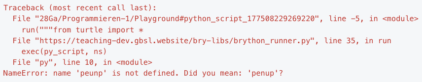
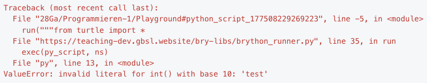
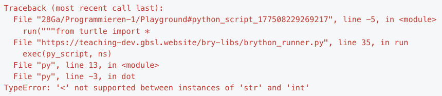
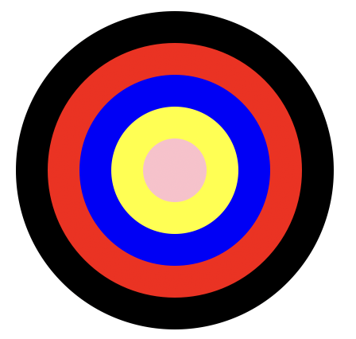

# Bugs 🪲
Beim Programmieren passieren Fehler. Programmfehler nennt man auch **Bugs**.

Es gibt zwei Arten von Programmfehlern:

Regelfehler
: Das Programm verstösst gegen eine Regel von Python und kann deshalb nicht (fertig) ausgeführt werden.
: **Problem:** Python kommt nicht weiter.
: **Lösung:** Fehlermeldung genau analysieren.
Logikfehler (Semantikfehler)
: Das Programm ist für den Computer verständlich und wird ausgeführt, macht aber nicht das, was es soll.
: **Problem:** Python kommt ans falsche Ziel.
: **Lösung:** Code genau analysieren (hier gibt es keine Fehlermeldung).

## Zwei Arten von Regelfehlern
Regelfehler lassen sich weiter unterteilen. Entscheidend ist, **wann** Python den Fehler bemerkt:

Syntaxfehler
: Der Code verstösst gegen die Grammatik von Python. Python bemerkt das schon vor dem Start und führt deshalb **keine einzige Zeile** aus.
: **In der Fehlermeldung:** `SyntaxError` oder `IndentationError`
: **Beispiele:** fehlender Doppelpunkt (`for i in range(4)`), nicht geschlossene Klammer (`forward(100`), fehlende Einrückung in einer Schleife oder Funktion
Laufzeitfehler
: Der Code ist grammatikalisch korrekt, aber eine bestimmte Anweisung lässt sich nicht ausführen. Python **startet** das Programm und **bricht an dieser Stelle ab**. Alles, was vorher kam, wurde bereits ausgeführt.
: **In der Fehlermeldung:** zum Beispiel `NameError` oder `TypeError`
: **Beispiele:** falsch geschriebener Name (`forwrd(100)`), eine Funktion wird vor ihrer Definition aufgerufen, fehlendes Argument (`left()`)

In beiden Fällen hilft Ihnen die Fehlermeldung bei der Fehlersuche.

## Aufgaben
::::aufgabe[Aufgabe 1]
<TaskState id='c77258c2-d876-441d-850f-a4a5693351bd' />

Beim Ausführen eines Programms stossen Sie auf folgende Fehlermeldung:



Was ist hier wohl das Problem? Halten Sie Ihre Vermutung hier fest:

<QuillV2 id='87ef86cf-e5e2-43fe-922b-e0449bbffcdd' />

<Solution id='c86d5bfa-843a-423b-9872-56e0e2a87c38'>
  Es gibt einen Buchstabendreher auf Zeile 10: Statt `penup()` wurde `peunp()` geschrieben.
</Solution>
::::

::::aufgabe[Aufgabe 2]
<TaskState id='10c40ad1-75da-4cb8-8e97-b898f584c4d6' />

Beim Ausführen eines Programms stossen Sie auf folgende Fehlermeldung:



Einige Teile dieser Fehlermeldung kennen Sie noch nicht. Das macht nichts: Um diese Frage zu beantworten, müssen Sie nicht verstehen, was genau schiefgelaufen ist.

Auf welcher Zeile sollten Sie mit der Fehlersuche beginnen?

<String placeholder='Antwort als Zahl' solution="13" id='cc2173bd-716c-4670-8061-7dd0b0bb4f3a' />
::::

::::aufgabe[Aufgabe 3]
<TaskState id='4e5c8f40-29cf-4052-923c-4f21f4b44f2e' />

Beim Ausführen eines Programms stossen Sie auf folgende Fehlermeldung:



Was könnte hier das Problem sein?

:::tip[Tipps]
- Um welchen Turtle-Befehl handelt es sich hier wohl?
- Welche Datentypen haben Sie bereits kennengelernt?
:::

Halten Sie Ihre Vermutung hier fest:

<QuillV2 id='eb11abf1-a093-4ac5-a790-ef2f55886542' />

<Solution id='487d96d5-8ddb-4114-9513-cd9a4c8e175c'>
  Es scheint, als hätte hier jemand den Befehl `dot(d)` mit einem `str` statt mit einem `int` aufgerufen. Vielleicht wurde also so etwas geschrieben wie `dot('40')` statt `dot(40)`.

  Die entsprechenden Hinweise finden Sie auf den letzten beiden Zeilen der Fehlermeldung.
</Solution>
::::

::::aufgabe[Aufgabe 4]
<TaskState id='266ce685-9695-428b-a487-90a22487be0d' />

Beim untenstehenden Programm gibt es einen Fehler. Führen Sie das Programm aus, analysieren Sie die Fehlermeldung und korrigieren Sie den Code.

Am Schluss sollte das Programm fehlerfrei ausgeführt werden können.

```py live_py id=bb98befc-b2db-4258-83f0-e1d977ae9c9a
from turtle import *

shape('turtle')

pencolor('red')

fillcolor('green')
begin_fill()

left(90)
forward(50)
right(90)
forward(50)

left(90)
forward(50)
right(90)
forward(50)

left(90)
forward(50)
right(90)
forward(50)

endfill()

done()
```

<Solution id='72d94602-9f1f-4102-ab83-22ff27bf83f7'>
  Auf Zeile 25 muss das `endfill()` zu `end_fill()` korrigiert werden.
</Solution>
::::

::::aufgabe[Aufgabe 5]
<TaskState id='e1130fbe-4f41-4530-80b3-dc5f9fbf9f32' />

Auch in diesem Programm hat sich wieder ein Bug eingeschlichen. Eigentlich sollte hier die UK-Flagge gezeichnet werden, aber das Programm lässt sich momentan nicht ausführen.

Starten Sie das Programm, analysieren Sie die Fehlermeldung und beheben Sie den Fehler. Das Programm sollte danach mindestens ausführbar sein.

:::tip[Dokumentation]
Die korrekte Verwendung aller Turtle-Befehle ist im [Cheatsheet](../../05-Cheatsheet-Turtle-Befehle/index.mdx) dokumentiert.
:::

```py live_py id=61e46a19-4542-4465-8a70-67462020abbe
from turtle import *

speed(0)
bgcolor('#012169')

penup()
goto(-300, 150)
pendown()
color('white')
pensize(30)
goto(300, -150)

penup()
goto(-300, -150)
pendown()
goto(300, 150)

penup()
goto(-300, 150)
pendown()
color('#C8102E')
pensize(10)
goto(300, -150)

penup()
goto(-300, -150)
pendown()
goto(300, 150)

penup()
goto(0, 150, 0)
pendown()
color('white')
pensize(50)
right(90)
forward(300)

penup()
goto(-300, 0)
pendown()
left(90)
forward(600)

penup()
goto(0, 150)
pendown()
color('#C8102E')
pensize(30)
right(90)
forward(300)

penup()
goto(-300, 0)
pendown()
left(90)
forward(600)

hideturtle()
done()
```

<Solution id='a100e1f4-d9a7-4363-befb-8feed406921a'>
  Der `goto(x, y)`-Befehl auf Zeile 31 hat ein Argument zu viel. Wenn das dritte Argument (also das zusätzliche `, 0`) entfernt wird, dann läuft das Programm fehlerfrei.

  Lassen Sie sich von der Zahl in der Fehlermeldung nicht verwirren: Python zählt hier intern ein zusätzliches Argument mit. Wichtig ist: Es sind zu viele Argumente.
</Solution>
::::

::::aufgabe[Aufgabe 6]
<TaskState id='2ce415d0-ea7b-44e5-8f32-2a66eea910f1' />

Im untenstehenden Programm hat sich ein **Logik**fehler eingeschlichen. Eigentlich sollte hier die folgende «Zielscheibe» gezeichnet werden (die Sie aus dem Kapitel [Farben verwenden](../../07-Farben-Verwenden/index.mdx) kennen):



Korrigieren Sie den Logikfehler.

```py live_py id=b5f48fb8-1b00-4265-98e4-5762f80e36b2
from turtle import *

hideturtle()

pencolor('red')
dot(160)

pencolor('blue')
dot(120)

pencolor('yellow')
dot(80)

pencolor('pink')
dot(40)

pencolor('black')
dot(200)

done()
```

<Solution id='bb82c7a7-21d9-4dc9-947b-62d221e72089'>
  Der schwarze Punkt mit Durchmesser 200 wird hier ganz am Schluss gezeichnet und überdeckt damit alle anderen (kleineren) Punkte. Wenn wir diesen Punkt zuerst zeichnen (also die Zeilen 17 und 18 nach oben verschieben), dann funktioniert das Programm wieder.
</Solution>
::::

::::aufgabe[Aufgabe 7]
<TaskState id='41ba0849-5c37-4840-8bbf-b84a4927ef14' />

Auch in diesem Programm steckt ein **Logik**fehler. Eigentlich sollte es ein regelmässiges Sechseck mit Seitenlänge 80 zeichnen:


Korrigieren Sie den Logikfehler.

```py live_py id=98fedb41-4929-4ceb-b8df-5d476ad47076
from turtle import *

pensize(3)
pencolor('purple')

for i in range(6):
    forward(80)
left(60)

hideturtle()
```

<Solution id='e4ff52c8-70d8-4f3b-b894-479b3eafba6d'>
  Das `left(60)` auf Zeile 8 ist nicht eingerückt und gehört deshalb nicht zur Schleife. Die Turtle geht also sechsmal hintereinander 80 Pixel geradeaus (eine lange gerade Linie) und dreht sich erst nach der Schleife ein einziges Mal. Wenn wir `left(60)` einrücken, wird es in jedem Durchlauf ausgeführt:

  ```py live_py readonly slim
  from turtle import *

  pensize(3)
  pencolor('purple')

  for i in range(6):
      forward(80)
      left(60)

  hideturtle()
  ```
</Solution>
::::
