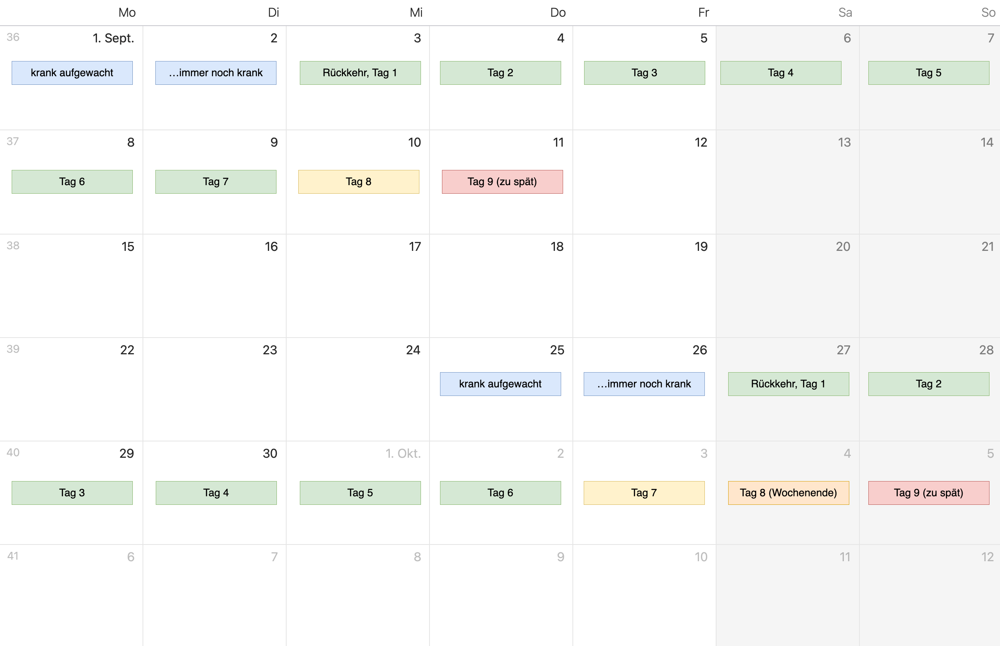

import Steps from "@tdev-components/Steps";

# Absenzen

## Das Absenzenwesen in Kürze
:::info[Verantwortung der SuS]
Die Schüler:innen sind bei jeder Abwesenheit (Krankheit, Arztbesuch, Dispensationen, Halbtage, etc.) selbst dafür verantwortlich, sich über den verpassten Stoff und verpasste Informationen zu informieren und alles fristgerecht nachzuholen.
:::

### Sich abmelden
:::details[Korrekte Abmeldung bei geplanter oder ungeplanter Abwesenheit]
- Mail an alle betroffenen Lehrpersonen + Klassenlehrperson (eine Mail an alle)
- Bei mehrtägiger Abwesenheit: an den Folgetagen erneut abmelden (oder ggf. Dauer der Abwesenheit angeben)
:::

:::details[Geplante Abwesenheit (Dispensationen, Arztbesuche, freie Halbtage, etc.)]
- Geplante Abwesenheiten (Dispensationen, Arztbesuche, etc.) sind zu melden, sobald sie bekannt sind
- Korrekte Abmeldung
- **Selbstständig in Evento eintragen** (vgl. [Anleitung](#geplante-absenz-eintragen))
:::
  
:::details[Abwesenheit im Verlauf des Schultags (zweite oder spätere Lektion)]
- **Persönliche** Abmeldung bei der Lehrperson, mit der man zuletzt Unterricht hatte oder als nächstes Unterricht hätte
- Mail an: 
  - Lehrperson, bei der man sich persönlich abgemeldet hat
  - alle betroffenen Lehrpersonen für den Rest des Tages
  - Klassenlehrperson
:::

### Absenzen entschuldigen
Alle Absenzen müssen durch die Schüler:in innert 8 Kalendertagen nach Rückkehr im Absenzenheft entschuldigt werden.

Der Prozess zum Entschuldigen einer Absenz folgt diesem Ablauf:
<Steps>
1. Absenz ins Absenzenheft eintragen (inkl. **Anzahl Lektionen**)
2. Von den Eltern unterschreiben lassen
3. Zum Schluss von der Klassenlehrperson unterschreiben lassen
</Steps>

Wir dieser Prozess fristgerecht durchgeführt, wird die Absenz in Evento als _entschuldigt_ markiert, ansonsten als _unentschuldigt_.

:::details[Beispiele für die Frist zur Entschuldigung von Absenzen]

:::

### Freie Halbtage
Kontingent
: 5 freie Halbtage pro Schuljahr
: nicht übertragbar auf das nächste Schuljahr
Genehmigung
: mindestens zwei Schultage im Voraus von der Klassenlehrperson genehmigen lassen
: Genehmigung durch Klassenlehrperson erst **nach** Genehmigung durch alle betroffenen Fachlehrpersonen (Fachlehrpersonen haben ein Vetorecht)
Verbot
: keine Halbtage bei angekündigten Proben, Sonderanlässen und besonderen Terminen (inkl. erster und letzter Schultag des Schuljahres)
Evento
: freie Halbtage sind sofort nach der Genehmigung in Evento als geplante Abwesenheit einzutragen
: Absenzgrund: «Freier Halbtag»
Buchhaltung
: gelten als entschuldigte Absenzen, wenn sie korrekt beantragt und genehmigt wurden

### Dispensationen
Bei besonderen Anlässen, wie z.B. Aufgeboten von Amts- und Dienststellen oder bei Umzug, können Sie bei der Schulleitung ein [Dispensationsgesuch](https://erzbe.sharepoint.com/sites/GYMB/gbs/gym/dok/SiteAssets/Forms/AllItems.aspx?id=%2Fsites%2FGYMB%2Fgbs%2Fgym%2Fdok%2FSiteAssets%2FFO%5FGesuch%5FDispensation%5FX0111%2Epdf&parent=%2Fsites%2FGYMB%2Fgbs%2Fgym%2Fdok%2FSiteAssets) einreichen. Abwesenheiten bei Dispensationen werden **nicht** als Absenzen gezählt.

### Verspätungen
Als Verspätung gilt das Betreten des Klassenzimmers nach Lektionsbeginn laut Stundenplan.

Damit unverschuldete Verspätungen (z.B. Busverspätung, Zugausfall, etc.) entschuldigt werden können, müssen die Schüler:innen der betroffenen Fachlehrperson bei Bedarf eine **Bestätigung** (z.B. Screenshot, Foto, etc.) vorlegen. Die Fachlehrperson entscheidet, ob die Verspätung entschuldigt wird oder nicht. Im Zweifelsfall kann die Klassenlehrperson hinzugezogen werden.

Unentschuldigte Verspätungen werden in die Absenzenkontrolle eingetragen.

### Konsequenzen
:::details[Entschuldigte Abwesenheiten]
Bei **entschuldigten** Abwesenheiten (eine _Abwesenheit_ kann aus mehreren zusammenhängenden _Absenzen_ bestehen, z.B. 2 Tage durchgehend krank = 11 _Absenzen_ aber 1 _Abwesenheit_) gilt:
- ab 5 Abwesenheiten ➔ Gespräch mit der Klassenlehrperson
- ab 7 Abwesenheiten ➔ für alle zukünftigen Absenzen wird ein Arztzeugnis verlangt
- ab 10 Abwesenheiten ➔ Gespräch mit der Schulleitung
:::

:::details[Unentschuldigte Absenzen]
Ab 7 unentschuldigten Abwesenheiten ➔ pädagogische oder disziplinarische Massnahme von der Schulleitung
:::

:::details[Unentschuldigte Verspätungen]
- Nach drei unentschuldigten Verspätungen führt die Klassenlehrperson ein Gespräch mit den Schüler:innen.
- Nach sieben unentschuldigten Verspätungen informiert die Klassenlehrperson die Schulleitung. Diese ergreift entsprechende disziplinarische und/oder pädagogische Massnahmen.
:::

:::details[Verlorenes Absenzenheft]
Verlorene Absenzenhefte müssen im Sekretariat ersetzt werden (Kosten: CHF 15.-). Der Schüler / die Schülerin ist dafür verantwortlich, dass alle bisherigen Absenzen korrekt in das neue Absenzenheft eingetragen werden.
:::

### Vollständiges Absenzenreglement
Das vollständige Absenzenreglement finden Sie in Ihrem Absenzenheft, sowie hier:
:::details[Absenzenreglement anzeigen]
::pdf[./pdf/RL_Absenzenreglement_260706.pdf]
:::

## Evento Klassenbuch
### Login
Link
: [evt.apps.be.ch](https://evt.apps.be.ch/?locale=de-CH)
: ➔ Tipp: Bookmark erstellen
Schule
: Gymnasien Biel-Bienne
Anmelde-Methode
: Microsoft Business 365 (Schul-Account)

### Geplante Absenz eintragen
::youtube[https://www.youtube.com/embed/4iDt4mGkSXQ?si=FY7tRNPDAPJV_MFw]

### Was wird in Evento erfasst?
Lehrpersonen tragen in Evento ein, wenn ein:e Schüler:in abwesend ist (analog zum Klassenbuch). Die Klassenlehrperson entschuldigt die Absenz in Evento (falls anwendbar) und gibt dort den Grund der Abwesenheit an. Auch Dispensationen werden in Evento erfasst, wobei diese im Zeugnis nicht als Absenz gezählt werden.

Nebst Absenzen und Dispensationen können in Evento auch _Vorfälle_ eingetragen werden. Dazu zählen z.B.:
- Unentschuldigte Verspätungen (z.B. verschlafen)
- Unerlaubte Handynutzung
- Unterrichtsstörung
- Schulmaterial vergessen

Die Klassenlehrperson erhält in Evento eine Übersicht über alle Absenzen, Dispensationen und Vorfälle der Schüler:innen ihrer Klasse.